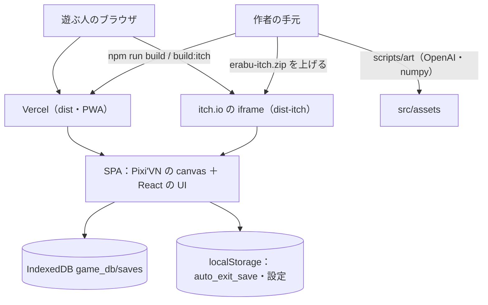

> [erabu-vn『二枚の紙』Repository Intelligence](README.md) の一部。基準は 2026-11-09 の zip（README の source）で、`path:line` はその時点の行。

# 00 Overview

## 全体の要約（Executive Summary）

### Executive Summary

**何か**：『二枚の紙』は、放課後の掲示板に貼られた 2 枚の紙のどちらかに名前を書く、という短編ノベルゲームです。分岐は 1 つ、エンドは 2 つあります（`ink/start.ink:240-243`）。Pixi'VN（`@drincs/pixi-vn` 1.9.6）と ink と React 19 で作られ、ブラウザだけで動きます。

**どう動くか**：`index.html` の `src/main.tsx` が 1920x1080 の canvas を作ります（`src/main.tsx:21-27`）。その上の HTML レイヤーに React を描きます（`src/main.tsx:44-49`）。経路は `/`（タイトル）・`/game`・`/game/narration` の 3 つです（`src/routeTree.gen.ts:50`）。脚本は `ink/start.ink` の 1 本で、build のときに JSON になり、bundle に埋め込まれます（X-001）。

**データ**：すべて遊ぶ人のブラウザに置きます。セーブは IndexedDB の `game_db/saves` に置きます（`src/lib/utils/db-utility.ts:4-22`）。ページを閉じたときの自動セーブは localStorage の `auto_exit_save`、設定も localStorage です。サーバーに送るデータはありません。

**配る経路**：Vercel（`dist`・PWA あり）と itch.io（`dist-itch`・相対パス・経路はメモリ・PWA なし）の 2 つです（`vite.config.ts:27`、`vite.config.ts:59-60`、`src/App.tsx:9-12`）。README によると、まだ出していません（`README.md:26`）。CI はありません。

**主な指摘（重い順）**

関係するリスク（中身・根拠・手当ては [リスクの台帳](70-reliability.md#リスクの台帳全部)）：

- **R-01**（Medium）通信が切れると、全画面のオフライン表示でゲームを止める
- **R-02**（Medium）オート送りを設定画面で切っても、読み直すとオンに戻る
- **R-03**（Medium）auto_exit_save が壊れていると、/ 以外の URL から開いたときにエラー画面になる
- **R-04**（Medium）IndexedDB の失敗の経路で Promise が終わらない／例外が漏れる
- **R-05**（Medium）セーブに版の確かめが無く、更新のあとに古いセーブを戻すと壊れうる
- **R-10**（Medium）依存の "latest" 指定と、Vercel の入れ方が決まっていない
- **R-11**（Medium）CI が無く、test・lint・型の検査は手で走らせるだけ
- **R-12**（Medium）出したあと、遊ぶ人の環境で起きたエラーが作者に届かない
- **R-27**（Medium）知らない URL の query（utm_source など）が付くと、ゲームが進まなくなる

全部で 28 件あります。一覧は [リスクの台帳（全部）](70-reliability.md#リスクの台帳全部) にあります。

**すぐ直すと効くもの**：R-02（オート送りが勝手にオンになる。1 行で直る）、R-27（告知の link の utm_source などでゲームが進まなくなる恐れ。出す前に Q-16 で確かめる）、R-01（オフライン表示で止まる）、R-03（壊れた自動セーブでエラー画面になる）。**出す前に決めること**：Q-01（Vercel の設定）、Q-03（更新のあとに古いセーブを戻すとどうなるか）、Q-11（不具合の報告を誰が受けるか）。

### Scope

- 対象：zip の全体。基準は zip の sha256 です（[調査計画（Discovery Plan）](#調査計画discovery-plan)）。
- 実行はしていません。静的に読んだだけです。

### Findings

| 観点 | 一言で | 詳しく |
|---|---|---|
| 構成 | 1 ページの SPA。canvas（Pixi）と HTML（React）を重ねる | [システムの全体像](10-architecture.md#システムの全体像) |
| 契約 | HTTP の API は無い。経路・ink のタグ・セーブの JSON・ホットキー | [契約の一覧（API Catalog の置き換え）](20-api-and-auth.md#契約の一覧api-catalog-の置き換え) |
| 認証 | 無い。信頼の境界はセーブのファイルの読み込みと翻訳 | [認証と認可（無いことの確認と、信頼の境界）](20-api-and-auth.md#認証と認可無いことの確認と信頼の境界) |
| データ | IndexedDB と localStorage。版の互換の仕組みは無い | [データのモデル](30-data.md#データのモデル) |
| 実行時 | クリック・キー・オート・スキップ・ホイールが goNext に集まる | [実行時の流れ](40-runtime.md#実行時の流れ) |
| 基盤 | Vercel と itch。IaC も CI も無い | [基盤の全体像](50-infrastructure.md#基盤の全体像) |
| 観測 | console と toast。F8 の診断画面だけ | [観測できる所の地図](60-operations.md#観測できる所の地図) |
| 障害 | 遊ぶ人の端末の中で起き、作者には見えない | [障害モードの分析（FMEA）](70-reliability.md#障害モードの分析fmea) |
| 変更 | ink を直すとセーブの互換に響く | [変更の影響（代表の 8 つ）](80-change-impact.md#変更の影響代表の-8-つ) |
| 手順 | 遊ぶ人の問い合わせ 4 本、作者の作業 3 本（itch・リリース・素材） | [runbook の一覧](90-runbooks.md#runbook-の一覧) |

### Diagrams

### Risks and Gaps

上の表と [リスクの台帳（全部）](70-reliability.md#リスクの台帳全部) を見てください。

### Open Questions

関係する未確認の事項（確かめ方は [未確認の事項](99-evidence-and-questions.md#未確認の事項全部)）：

- **Q-01**（High）Vercel の本番のプロジェクト（URL・独自ドメイン・Build/Install Command・Node の版）はもうあるか
- **Q-03**（High）ink を直したあとに古いセーブを restoreGameState するとどうなるか
- **Q-11**（Medium）出したあと、遊ぶ人からの不具合の報告を誰がどこで受けるか
- **Q-16**（High）/?utm_source=x のように知らない query を付けて開き、「はじめから」を押したあとに、クリックで進めるか

### Evidence Index

<!-- BEGIN:stats -->
| 数えたもの | 数 |
|---|---|
| 根拠（Evidence） | 129（Confirmed 128・Corroborated 1・Inferred 0・Unknown 0） |
| リスク | 28（High 0・Medium 9・Low 19） |
| リスクの確度 | Confirmed 15・Inferred 12・Unknown 1 |
| 未確認事項 | 16（High 3・Medium 4・Low 9） |
<!-- END:stats -->

一覧は [根拠の索引（全部）](99-evidence-and-questions.md#根拠の索引全部) にあります。

## 調査計画（Discovery Plan）

### Executive Summary

対象は短編ノベルゲーム『二枚の紙』（erabu-vn）のソースです。サーバー・DB・IaC は持たず、ブラウザだけで動く静的な Web アプリです。そのため Skill Suite の 11 の Skill は、全部は同じ重さで当てはまりません。下の表のとおり、当てはまらない所は短く「無い」と書き、代わりに当てはまるもの（経路・ink のタグ命令・ブラウザの保存先・配る経路）を深く調べました。

### Scope

- 対象：`erabu-vn-main.zip` の全体（171 ファイル）
- 基準：`.git` が無い zip なので、コミット SHA は分かりません。zip の sha256 を基準にします（`43852b88d2d3d72291469920f2c2697c31870ab13f7d8cfbe1af4c6e8ac58fe4`）。zip の中のファイルの更新時刻は 2026-11-05 12:14（タイムゾーンは不明）です。
- 除外：`node_modules/`・`dist/`（どちらも zip に無い）、`src/components/ui/`（shadcn が作った基本の UI。根拠に要る所だけ読む）、画像と音の中身、`package-lock.json`（版を見るときだけ使う）。
- `*.gen.*` は手で直さない生成物です。「生成器が何を理解したか」の根拠としてだけ読みました。
- 実行していないこと：`npm ci`・build・test。外から来た zip なので、読むだけで調べました。どの文書でも、走らせて確かめた事実は書いていません。
- 外部の読み物：`@drincs/pixi-vn-ink@1.3.0` の npm の tarball（読んだだけで、実行はしていない）。ink の JSON の読み込み方を確かめるために使いました（X-001）。

### 分岐（Orchestrator の判断）

| Skill | このリポジトリで | 理由と根拠 |
|---|---|---|
| architecture | 全部 | 実行の単位は「ブラウザの 1 ページ」と「手で走らせる Python のスクリプト」の 2 つ |
| api | 置き換えて調べた | HTTP の API は無い。代わりに経路 3 つ・URL の search param・ink のタグ命令・セーブのファイルの形・ホットキー・build の mode を「内部の契約」として整理（`src/routeTree.gen.ts:50`） |
| auth | 「無い」と書いた | ログイン・トークン・権限は無い。信頼の境界（セーブのファイル・翻訳・Roves の API）だけを書く |
| data | 全部 | IndexedDB・localStorage・Roves のセーブ（`src/lib/utils/db-utility.ts:4-22`） |
| runtime | 同期の処理を中心に | queue も worker も無い（Pixi'VN の worker のファイルはある）。タイマー（スキップ・オート）とブラウザのイベントを追う |
| infrastructure | 設定ファイルを中心に | Terraform・k8s・CI は無い。`vercel.json`・`vite.config.ts`・`.assetpack.ts`・`package.json` の scripts |
| observability | 全部（「無い」ことも含めて） | console と toast と診断の画面だけ |
| failure | 全部 | 遊ぶ人の端末で起きる障害が中心 |
| change-impact | 代表の変更 8 つ | ink・素材・セーブの形・依存・配る経路 |
| runbook | 遊ぶ人の問い合わせと、作者のリリース作業 | 存在するコマンド（npm scripts）とブラウザの標準の機能だけを書く |
| publisher | 全部 | Obsidian に移しやすい構成（MOC・frontmatter・wiki リンク） |

### 進め方

1. ファイルの一覧と行数 → 入口（`index.html` → `src/main.tsx`）
2. 起動の順番（`Game.init` → React → root の loader）を追う
3. 経路・語りの hooks・セーブ・stores を全部読む
4. ink の構造（knot・選択肢・タグ）と test の歩き方を読み、突き合わせる
5. build と配る経路（Vite の mode・AssetPack・PWA・Vercel）
6. ink の JSON の読み込み方を、ライブラリの配布物で確かめる（X-001）
7. リスク・未確認事項・根拠を `tools/data.py` にまとめ、`tools/check.py` で全部の `path:line` と、範囲の中の文字列を確かめる

### 成果物の地図

[目次](README.md#目次) を見てください。中間成果物は `.system-intelligence/` にあります。

### Risks and Gaps

- 動かして確かめていません。画面の振る舞い（キーの割り当て・オフライン表示・PWA の precache）は、コードからの推定を含みます。推定のものには「Inferred」と書き、確かめ方を [未確認の事項（全部）](99-evidence-and-questions.md#未確認の事項全部) に書きました。
- Vercel と itch.io の本番の設定はリポジトリの外にあり、まだ作られていない可能性があります（`README.md:26`）。

### Open Questions

[未確認の事項（全部）](99-evidence-and-questions.md#未確認の事項全部) にまとめました（Q-01〜Q-15）。

### Evidence Index

| Claim | Evidence | Confidence |
|---|---|---|
| 経路は 3 つ | `src/routeTree.gen.ts:50` | Confirmed |
| P4（出す）はまだ | `README.md:26` | Confirmed |
| ink の JSON は bundle に埋め込まれる | X-001 | Corroborated |

## 根拠の索引（要約）

### Executive Summary

すべての根拠は `tools/data.py` の 1 か所にまとめました。この文書は数を数えたものです。一覧は [根拠の索引（全部）](99-evidence-and-questions.md#根拠の索引全部) にあります。

### Scope

- 根拠の形：`path:start-end`（zip を展開した所からの相対パス）
- 確かめ方：`tools/check.py` が、根拠ごとに次の 3 つを機械で確かめます。
  1. ファイルがある。
  2. 行の範囲がファイルの中にある。
  3. その範囲に決めた文字列（needle）がある。
- 加えて、全部の文書の本文に出てくる `path:line` の範囲が正しいかも確かめます。

### Findings

（数は [根拠の索引（要約）](#根拠の索引要約) を見てください）

確度の決め方：

| レベル | ここでの使い方 |
|---|---|
| Confirmed | コードか設定で直接見た |
| Corroborated | 2 か所以上で合っている（例：ink の JSON を埋め込むことを、ライブラリの 2 か所で確かめた。virtual module を作る `vite.mjs` の load と、それを読む `vite-listener.mjs`） |
| Inferred | 間接の証拠からの推定（例：ブラウザやライブラリの既定の振る舞い） |
| Unknown | 証拠が足りない。[未確認の事項（全部）](99-evidence-and-questions.md#未確認の事項全部) に確かめ方を書いた |

### Diagrams

（なし）

### Risks and Gaps

- 行番号は、この zip（sha256 43852b88…）の中身に対してだけ正しいです。コードが変わったら `tools/check.py` を走らせ直してください。
- 外部のライブラリの根拠（X-001）は、npm の版 1.3.0 に対してだけ正しいです。

### Open Questions

（なし）

### Evidence Index

[根拠の索引（全部）](99-evidence-and-questions.md#根拠の索引全部)
