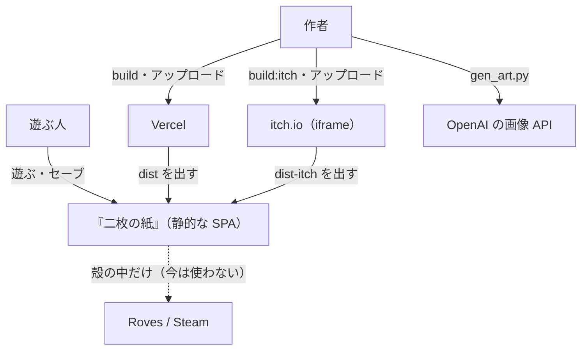
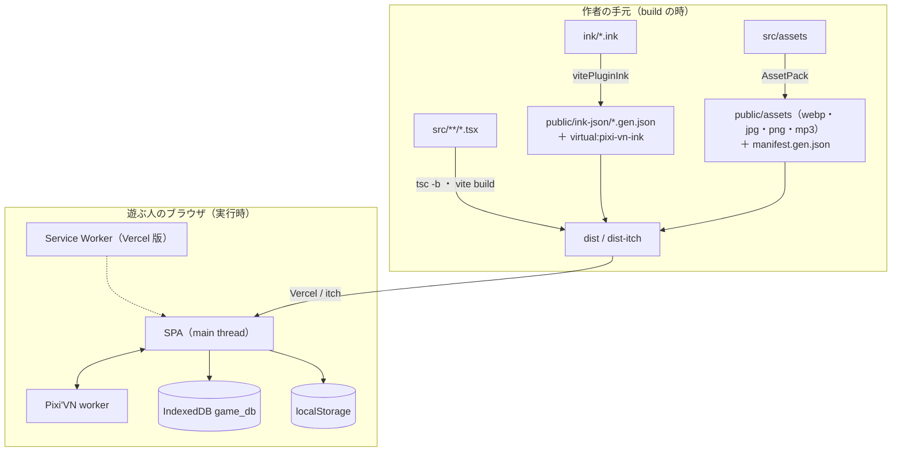
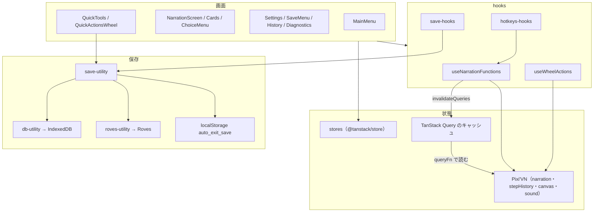

```mermaid
flowchart TB
    subgraph Browser["ブラウザの 1 ページ"]
        direction TB
        HTML["index.html"] --> MAIN["src/main.tsx<br/>Game.init・音・エラー"]
        MAIN --> CANVAS["Pixi'VN canvas 1920x1080<br/>背景・立ち絵・タイトルの絵"]
        MAIN --> REACT["React（#root を HTML レイヤーに）"]
        REACT --> ROUTER["TanStack Router<br/>/ ・ /game ・ /game/narration"]
        ROUTER --> UI["台詞・選択肢・メニュー"]
        UI -->|"goNext・selectChoice"| NARR["Pixi'VN narration"]
        NARR -->|"show image・play sound"| CANVAS
        NARR -.->|"invalidateQueries"| UI
        INK["ink JSON（bundle に埋め込み）"] --> NARR
        UI --> SAVE["save-utility"]
        SAVE --> IDB[("IndexedDB")]
        SAVE --> LS[("localStorage")]
    end
```

> [erabu-vn『二枚の紙』Repository Intelligence](README.md) の一部。基準は 2026-11-09 の zip（README の source）で、`path:line` はその時点の行。

# 10 Architecture

## システムの全体像

### Executive Summary

erabu-vn は create-pixi-vn 2.2.0 のテンプレ（`visual-novel-ink`・Web 版）から作った 1 ページの SPA です（`README.md:5`）。画面は 2 枚の層を重ねています。下は Pixi'VN が描く canvas（背景・立ち絵・タイトルの絵）、上は React が描く HTML（台詞の枠・選択肢・メニュー）です。物語の進行は Pixi'VN の `narration` が持ち、React は TanStack Query で、その状態を読んで描き直します。

### Scope

- 対象：`src/`・`ink/`・`index.html`・`vite.config.ts`
- 除外：`src/components/ui/`（shadcn の基本の UI）

### Findings

#### 実行の単位

| 単位 | 入口 | 動く所 |
|---|---|---|
| ゲーム本体（SPA） | `index.html` → `src/main.tsx` | 遊ぶ人のブラウザ（Vercel・itch の iframe）。Roves のネイティブの殻でも動くように書かれている |
| Pixi'VN の worker | `src/pixi-vn.worker.gen.ts`（生成物） | ブラウザの Web Worker（推定。Pixi'VN の中の使い方は見ていない） |
| 脚本の test | `tests/story.test.ts` | 作者の手元の node（vitest） |
| 素材のスクリプト | `scripts/art/*.py` | 作者の手元の Python（OpenAI の API を呼ぶものもある） |

#### 起動の順番（Confirmed）

1. `Game.init(body, {...})`：canvas を作ります（`src/main.tsx:21-27`）。
2. canvas の `ui` レイヤーと、音の `bgm`・`sfx` チャンネルを作り、保存してある音量を戻します（`src/main.tsx:29-36`）。
3. `#root` を Pixi'VN の HTML レイヤーにして、React の `<App />` を描きます（`src/main.tsx:44-49`）。
4. `App` が TanStack Router を作ります。itch の mode では、経路をメモリに持ちます（`src/App.tsx:9-12`）。
5. root の loader が、次の 4 つを並べて待ちます（`src/routes/__root.tsx:28`）。
   - `content` を読み込む（登場人物とタグ命令の登録）
   - IndexedDB を開く
   - 素材の manifest を読み、`images` の bundle を読み込む
   - i18n を初期化する
6. `/` 以外の URL で開いて、まだ 1 step も進んでいなければ、`auto_exit_save` から状態を戻します（`src/routes/__root.tsx:31-36`）。

#### 層の分け方

| 層 | 置き場 | 決まり（AGENTS.md） |
|---|---|---|
| 物語 | `ink/` | 語りは ink で書く。TS の label は使っていない（`src/content/labels/` は無い） |
| ゲームの中身の登録 | `src/content/` | 登場人物・タグ命令・文の置き換え |
| 画面 | `src/routes/`・`src/components/` | UI は React、絵は Pixi |
| 共通の処理 | `src/lib/`（hooks・query・stores・utils） | 画面に縛られない処理 |
| 型 | `src/models/` | `Character`・`GameSaveData` |
| 生成物 | `*.gen.*` | 手で直さない |

### Diagrams

### Risks and Gaps

関係するリスク（中身・根拠・手当ては [リスクの台帳](70-reliability.md#リスクの台帳全部)）：

- **R-13**（Low）AGENTS.md が今の構成と合わない（release.yml・.vscode・Roves で配る）
- **R-26**（Low）RootProvider が描画のたびに Game.onNavigate を登録する

- `src/router.tsx` の `getRouter` は使われていません。`App.tsx` が自前で router を作っています（`src/router.tsx:10-21`）。テンプレの名残と推定しています。消しても動きは変わりません（Inferred）。

### Open Questions

関係する未確認の事項（確かめ方は [未確認の事項](99-evidence-and-questions.md#未確認の事項全部)）：

- **Q-13**（Low）Roves・Steam の機能（achievement・roves のセーブ・終了ボタン）を残すか

### Evidence Index

| Claim | Evidence | Confidence |
|---|---|---|
| canvas は 1920x1080・contain | `src/main.tsx:21-27` | Confirmed |
| React は HTML レイヤーに描く | `src/main.tsx:44-49` | Confirmed |
| root の loader で 4 つを並べて初期化する | `src/routes/__root.tsx:26-30` | Confirmed |
| itch では経路をメモリに持つ | `src/App.tsx:9-12` | Confirmed |
| getRouter は使っていない | `src/router.tsx:10-21` | Confirmed |

## C4 Context（システムの境界）

### Executive Summary

境界の内側にあるのは、ゲームの静的なファイル一式だけです。実行時に話す外部のシステムはありません。外部とのつながりは次の 3 つです。

- 配る所（Vercel・itch.io）
- 作る時の外部 API（OpenAI の画像の生成。作者の手元だけ）
- 未来の配る先（Roves・Steam。コードはあるが、今は使っていない）

### Scope

実行時と作る時を分けて書きます。

### Findings

| 相手 | 向き | いつ | 何を | 根拠 | 確度 |
|---|---|---|---|---|---|
| 遊ぶ人 | 人 → システム | 実行時 | クリック・キー・ホイール・セーブのファイルの読み込み | `src/lib/hooks/hotkeys-hooks.ts:112-392` | Confirmed |
| Vercel | システム ← 配る所 | 配るとき | `dist` を静的に出す。全部の経路を `/index.html` に書き換える | `vercel.json:1-3` | Confirmed |
| itch.io | システム ← 配る所 | 配るとき | `erabu-itch.zip` を iframe のサブパスで出す | `package.json:13`、`README.md:30` | Confirmed |
| OpenAI の画像 API | 作者の手元 → API | 作る時だけ | 絵の生成と表情の差し替え | `scripts/art/gen_art.py:62-66` | Confirmed |
| raw.githubusercontent.com | ブラウザ → 外部 | 実行時（使っていない） | SW の runtimeCaching の対象として名前だけある。コードから取りに行っている所は無い | `vite.config.ts:22` | Confirmed |
| Roves（ネイティブの殻）・Steam | システム → 殻 | 殻の中で動くときだけ | セーブ・実績・終了・OS の情報 | `src/lib/utils/roves-utility.ts:22-52`、`src/content/ink/hashtag-commands.ts:44-58` | Confirmed（コードはある）／今は使わない（`README.md:35`） |
| pixi-vn.com | 遊ぶ人 → 外部 | 遊ぶ人がリンクを押したとき | 「について」の画面のリンク | `src/components/menus/settings/about.tsx:22` | Confirmed |

実行時の外向きの fetch は `src/lib/i18n.ts:62` だけです。これは本番では出ないボタン（`src/components/menus/settings/system-controls.tsx:187-205`）から呼ばれ、同じオリジンの ink の JSON を読みます。

### Diagrams

### Risks and Gaps

- 実行時の外部のオリジンへの依存はほとんど無いのに、「オフライン表示」で止めてしまいます（R-01）。同じオリジンからは、遊んでいる間も素材を読み込みます。
- 配る所の設定がリポジトリの外にあり、まだ確かめられていません（Q-01、Q-02）。

### Open Questions

関係する未確認の事項（確かめ方は [未確認の事項](99-evidence-and-questions.md#未確認の事項全部)）：

- **Q-01**（High）Vercel の本番のプロジェクト（URL・独自ドメイン・Build/Install Command・Node の版）はもうあるか
- **Q-02**（Medium）itch.io のページの設定（Embed のサイズ・全画面ボタン・itch のアプリで遊べるか）
- **Q-13**（Low）Roves・Steam の機能（achievement・roves のセーブ・終了ボタン）を残すか

### Evidence Index

| Claim | Evidence | Confidence |
|---|---|---|
| Vercel は SPA の rewrite だけ | `vercel.json:1-3` | Confirmed |
| 実行時の fetch は翻訳のダウンロードだけで、本番では出ない | `src/lib/i18n.ts:60-64`、`src/components/menus/settings/system-controls.tsx:187-205` | Confirmed |
| OpenAI は作る時だけ | `scripts/art/gen_art.py:62-66` | Confirmed |

## C4 Container（実行の単位と置き場）

### Executive Summary

container に当たるものは 5 つです。

- ブラウザで動く SPA
- その中の Pixi'VN の worker
- ブラウザの 2 つの保存先（IndexedDB・localStorage）
- 静的なファイル（Vercel か itch）
- 作者の手元の道具（Vite・vitest・Python）

### Scope

実行時の container と、build の時の container を分けます。

### Findings

| Container | 技術 | 責務 | 根拠 | 確度 |
|---|---|---|---|---|
| SPA（main thread） | React 19・TanStack Router/Query・Pixi'VN 1.9.6・pixi.js 8 | 画面・語り・セーブ | `src/main.tsx:21-63` | Confirmed |
| Pixi'VN の worker | Web Worker（生成物） | `handleGameWorkerMessage` で、エンジンの仕事を main thread の外でする | `src/pixi-vn.worker.gen.ts:4-9` | Confirmed（ファイル）／Inferred（何をするか） |
| IndexedDB `game_db` | ブラウザ | 手動セーブとクイックセーブ | `src/lib/utils/db-utility.ts:4-22` | Confirmed |
| localStorage | ブラウザ | 自動セーブ（`auto_exit_save`）と設定 | `src/lib/utils/save-utility.ts:199-209` | Confirmed |
| Service Worker（Vercel 版だけ） | vite-plugin-pwa（workbox） | precache と外部の素材の CacheFirst | `vite.config.ts:59-107` | Confirmed（設定）／Inferred（precache の中身。Q-09） |
| 静的なファイル | Vercel（`dist`）／itch（`dist-itch`） | 配る | `vite.config.ts:126` | Confirmed |
| build の道具 | Vite 8・AssetPack・pixi-vn と ink の vite プラグイン | 型の検査・ink の変換・素材の変換・PWA | `vite.config.ts:26-145` | Confirmed |
| 脚本の test | vitest 5（node） | 経路・素材・鍵の検査 | `vitest.config.ts:3-8` | Confirmed |
| 素材のスクリプト | Python・Pillow・numpy・OpenAI | 絵と BGM を作る | `scripts/art/gen_art.py:62-66` | Confirmed |

### Diagrams

### Risks and Gaps

関係するリスク（中身・根拠・手当ては [リスクの台帳](70-reliability.md#リスクの台帳全部)）：

- **R-10**（Medium）依存の "latest" 指定と、Vercel の入れ方が決まっていない
- **R-08**（Low）isNativeBuild の向きが逆で、Web 版にネイティブ向けの素材の設定が付く
- **R-09**（Low）PWA の precache に絵と音が入っていない可能性がある

### Open Questions

関係する未確認の事項（確かめ方は [未確認の事項](99-evidence-and-questions.md#未確認の事項全部)）：

- **Q-09**（Medium）build した dist/sw.js の precache に、public/assets の webp・jpg・mp3 が入っているか
- **Q-12**（Medium）Vercel の build で prebuild（pwa-assets-generator の sharp）と optional の依存が入るか

### Evidence Index

| Claim | Evidence | Confidence |
|---|---|---|
| worker は生成物で、handleGameWorkerMessage を呼ぶ | `src/pixi-vn.worker.gen.ts:4-9` | Confirmed |
| ink は public/ink-json に変換される | `vite.config.ts:54-58` | Confirmed |
| 素材は public/assets に出る | `.assetpack.ts:84-103` | Confirmed |
| ink の JSON は bundle に埋め込まれる | X-001 | Corroborated |

## C4 Component（SPA の中の部品）

### Executive Summary

SPA の中は、次の 4 つの塊に分かれます。

- 画面（routes・components）
- 画面の操作の入口（hooks）
- 状態（Pixi'VN と stores と Query のキャッシュ）
- 保存（save-utility → db-utility・roves-utility・localStorage）

依存は画面 → hooks → Pixi'VN／保存 の一方向です。逆向きの依存は、Pixi'VN の `StepLabelProps` に、React の `navigate`・`t`・`toast` を渡す所だけです（`src/pixi-vn.d.ts:9-39`、`src/lib/hooks/props-hooks.ts:7-22`）。

### Scope

`src/` の全部（`src/components/ui/` を除く）。

### Findings

#### 語り（narration）の部品

| 部品 | 役目 | 根拠 |
|---|---|---|
| `useNarrationFunctions` | goNext・goBack・selectChoice・startNewGame・jump・call。メニューが開いていると止める | `src/lib/hooks/narration-hooks.ts:31-164` |
| `useNarrationPointerHandlers` | クリック・長押し（700ms でスキップ）・ドラッグの見分け | `src/lib/hooks/narration-hooks.ts:166-284` |
| `useSkipAutoDetector` | スキップ（100ms ごと）とオート（N 秒の debounce） | `src/lib/hooks/narration-hooks.ts:286-335` |
| `narration-query` | 台詞・選択肢・入力・戻れるか・進めるか・履歴を Pixi'VN から読む | `src/lib/query/narration-query.ts:10-182` |
| `NarrationScreen`・`NarrationCards`・`ChoiceMenu`・`InputRequestDialog` | 描画 | `src/components/screens/narration/index.tsx:7-33` |

#### 保存の部品

| 部品 | 役目 | 根拠 |
|---|---|---|
| `save()`・`save.*` | 作る・書く・読む・最新・消す・ファイルへ・ファイルから | `src/lib/utils/save-utility.ts:22-139` |
| `quickSave` | -2〜-7 の 6 枠を順に使う | `src/lib/utils/save-utility.ts:150-192` |
| `autoExit` | localStorage の自動セーブ | `src/lib/utils/save-utility.ts:199-240` |
| `gameDB` | IndexedDB を包む | `src/lib/utils/db-utility.ts:3-173` |
| `roves` | Roves の殻のセーブ | `src/lib/utils/roves-utility.ts:22-52` |
| `useSaveActions`・`useAutoSaveOnPageClose` | 確認のダイアログ・toast・自動セーブのイベント | `src/lib/hooks/save-hooks.tsx:15-200` |

#### 状態（stores）

| store | 中身 | 保存 | 根拠 |
|---|---|---|---|
| `SearchParams` | メニューの開閉（URL と同じ） | URL | `src/lib/stores/search-param-store.ts:3-20` |
| `GameStatus` | step を読み込み中か | しない | `src/lib/stores/game-status-store.ts:10-19` |
| `SkipSettings` | スキップ中か | しない | `src/lib/stores/skip-settings-store.ts:10-26` |
| `AutoSettings` | オート送り・秒数 | localStorage（R-02） | `src/lib/stores/auto-settings-store.ts:14-44` |
| `TextDisplaySettings` | 文字の速さ・大きさ・タイプライターの状態 | localStorage | `src/lib/stores/text-display-settings-store.ts:22-81` |
| `MasterSound`・`ChannelSound` | 音量・ミュート | localStorage | `src/lib/stores/master-sound-storage.ts:15-68` |
| `AlertDialogState` | 開いている確認ダイアログの数 | しない | `src/lib/stores/alert-dialog-store.ts:3-13` |
| `QuickActionsWheelState`・`SaveMenuPagination` | 輪の開閉・セーブの画面のページ | ページだけ localStorage | `src/lib/stores/save-menu-pagination-store.ts:10-24` |

### Diagrams

### Risks and Gaps

- ホイールだけが `useNarrationFunctions` を通らずに Pixi'VN を直に呼びます（R-15）。
- `invalidateInterfaceData` は全部の query を invalidate します（`src/lib/hooks/props-hooks.ts:18-21`）。セーブの一覧の query も、1 step ごとに読み直されます（Inferred。セーブの画面は普段閉じているので、影響は小さい）。

関係するリスク（中身・根拠・手当ては [リスクの台帳](70-reliability.md#リスクの台帳全部)）：

- **R-02**（Medium）オート送りを設定画面で切っても、読み直すとオンに戻る
- **R-15**（Low）ホイールでの送りと戻しは、メニューを開いているかを見ない

### Open Questions

関係する未確認の事項（確かめ方は [未確認の事項](99-evidence-and-questions.md#未確認の事項全部)）：

- **Q-07**（Low）ホイールの向き（上で進む・下で戻る）は意図どおりか

### Evidence Index

| Claim | Evidence | Confidence |
|---|---|---|
| goNext はメニューが開いていると止まる | `src/lib/hooks/narration-hooks.ts:39-63` | Confirmed |
| invalidate は全部の query に効く | `src/lib/hooks/props-hooks.ts:18-21` | Confirmed |
| ホイールは Pixi'VN を直に呼ぶ | `src/lib/hooks/quick-tools-hooks.ts:58-66` | Confirmed |

## 部品の一覧（Component Catalog）

### Executive Summary

変更の影響を調べるときに引く表です。`.system-intelligence/components.yaml` と同じ中身です。

### Scope

実行時の部品と、build の時の部品の両方を載せます。

### Findings

<!-- BEGIN:components -->
| ID | Component | Responsibility | Entrypoint | Depends on |
|---|---|---|---|---|
| C-01 | Bootstrap | Pixi'VN の canvas・音のチャンネル・React の HTML レイヤーを作り、エラーと END の処理を登録する | `src/main.tsx:21-63` | Pixi'VN, App, stores(sound) |
| C-02 | Router / Screens | TanStack Router の 3 つの経路。root の loader で初期化と auto-exit の復元をする | `src/routes/__root.tsx:22-43` | content, gameDB, assets, i18n, save-utility |
| C-03 | Story (ink) | 脚本。場面・台詞・選択肢・絵と音のタグ命令 | `ink/start.ink:6-877` | vitePluginInk（build 時）、Pixi'VN ink の実行時 |
| C-04 | Content registry | 登場人物、ink のタグ命令、文の置き換えを登録する | `src/content/index.ts:2-4` | Pixi'VN, pixi-vn-ink, roves-api, zod |
| C-05 | Narration UI | 台詞の表示（タイプライター）、選択肢、入力、クリック・長押し・スキップ・オート | `src/routes/game/narration.tsx:10-30` | narration-query, narration-hooks, stores |
| C-06 | Menus / Settings | タイトル、設定、セーブとロード、履歴、操作一覧、診断 | `src/components/menus/settings/index.tsx` | save-utility, stores, hotkeys |
| C-07 | Save subsystem | セーブの作成・保存・ロード・削除・ファイルの書き出しと読み込み・クイックセーブ・auto-exit | `src/lib/utils/save-utility.ts:22-240` | db-utility(IndexedDB), roves-utility, localStorage, Pixi'VN |
| C-08 | Settings stores | 音量・文字・オート・スキップ・テーマ・ページの状態（多くは localStorage に保存） | `src/lib/stores/` | @tanstack/store, localStorage |
| C-09 | Assets pipeline | AssetPack で src/assets を public/assets（webp と元の形式）と manifest に変える | `.assetpack.ts:84-103` | @assetpack/core（build 時） |
| C-10 | Build / Distribution | Vite の build。Vercel 版（dist・PWA）と itch 版（dist-itch・相対パス・メモリの経路） | `vite.config.ts:26-145` | Vite, plugins, Vercel, itch.io |
| C-11 | Diagnostics | 端末と描画の診断。テキスト・JSON・クリップボードに書き出す | `src/lib/utils/device-diagnostics-utility.ts:155-534` | WebGL, navigator, roves-api |
| C-12 | Story test | ink を label の図にして全経路・素材・鍵を確かめる | `tests/story.test.ts:124-197` | pixi-vn-ink/converter, vitest |
| C-13 | Art/BGM scripts | 絵の生成（OpenAI）、組み立て（Pillow）、BGM の合成（numpy）。手で走らせる | `scripts/art/` | Python, OpenAI API, Pillow, numpy |
<!-- END:components -->

#### 主な依存（版は package-lock.json の値）

<!-- BEGIN:deps -->
| パッケージ | 版（lock） | 役目 | ライセンス（lock の license 欄） |
|---|---|---|---|
| `@drincs/pixi-vn` | 1.9.6 | VN エンジン（canvas・語り・音・セーブの状態） | LGPL-2.1 |
| `@drincs/pixi-vn-ink` | 1.3.0 | ink の変換・実行・vite プラグイン | LGPL-2.1 |
| `@drincs/roves-api` | 0.9.1 | ネイティブの殻（Roves）の API。Web では isAvailable() が false | MPL-2.0 |
| `pixi.js` | 8.19.0 | 描画（pixi-vn から） | MIT |
| `react / react-dom` | 19.3.0 | UI | MIT |
| `@tanstack/react-router` | 1.170.45（package.json は latest） | 経路 | MIT |
| `@tanstack/react-query` | 5.104.4（package.json は latest） | 画面のデータのキャッシュ | MIT |
| `i18next ほか` | 26.5.2 | UI の文言（ja/en） | MIT |
| `markdown-typewriter` | 2.2.0 | 台詞のタイプライター表示 | lockfile に記載なし（未確認） |
| `vite` | 8.3.4 | build・開発サーバー | MIT |
| `vite-plugin-pwa` | 2.0.0 | Service Worker と manifest | MIT |
| `@assetpack/core` | 1.7.0 | 素材の変換と manifest | MIT |
| `vitest` | 5.1.0 | 脚本の test | MIT |
| `typescript` | 7.0.2 | 型の検査（tsc -b） | Apache-2.0 |
<!-- END:deps -->

### Diagrams

依存の向きの図は [C4 Component（SPA の中の部品）](#c4-componentspa-の中の部品) と [依存の図](80-change-impact.md#依存の図) にあります。

### Risks and Gaps

- 使っていない部品があります。
  - `useMinigame`（`src/lib/hooks/minigame-hooks.ts:6-55`）：どこからも呼ばれていない
  - `src/lib/steam.ts`：どこからも import されていない
  - `getRouter`（`src/router.tsx:10-21`）
  - タグ命令のうち navigate・rename・unlock achievement：ink から呼んでいない
- いずれもテンプレの名残と推定しています。

関係するリスク（中身・根拠・手当ては [リスクの台帳](70-reliability.md#リスクの台帳全部)）：

- **R-10**（Medium）依存の "latest" 指定と、Vercel の入れ方が決まっていない

### Open Questions

関係する未確認の事項（確かめ方は [未確認の事項](99-evidence-and-questions.md#未確認の事項全部)）：

- **Q-13**（Low）Roves・Steam の機能（achievement・roves のセーブ・終了ボタン）を残すか

### Evidence Index

| Claim | Evidence | Confidence |
|---|---|---|
| 登場人物は 5 人 | `src/content/characters.ts:26` | Confirmed |
| content は glob で全部読み込む | `src/content/index.ts:2-4` | Confirmed |
| 版は lockfile の値 | `package-lock.json`（node_modules/@drincs/pixi-vn など） | Confirmed |
