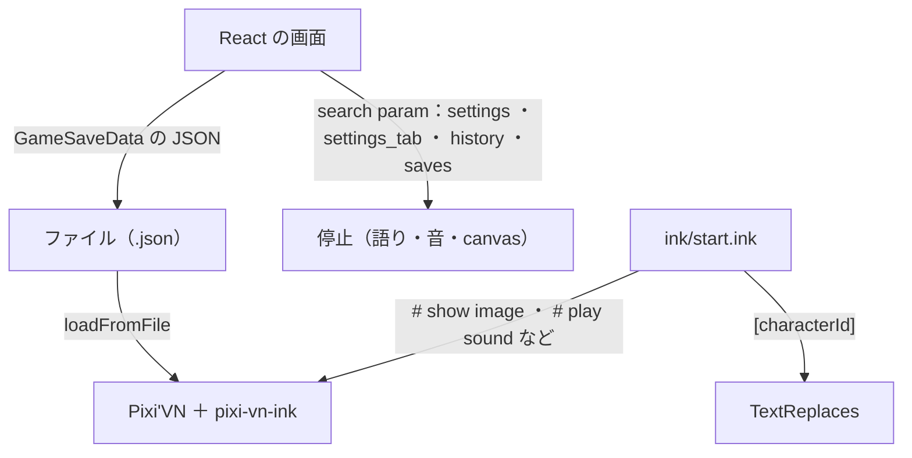
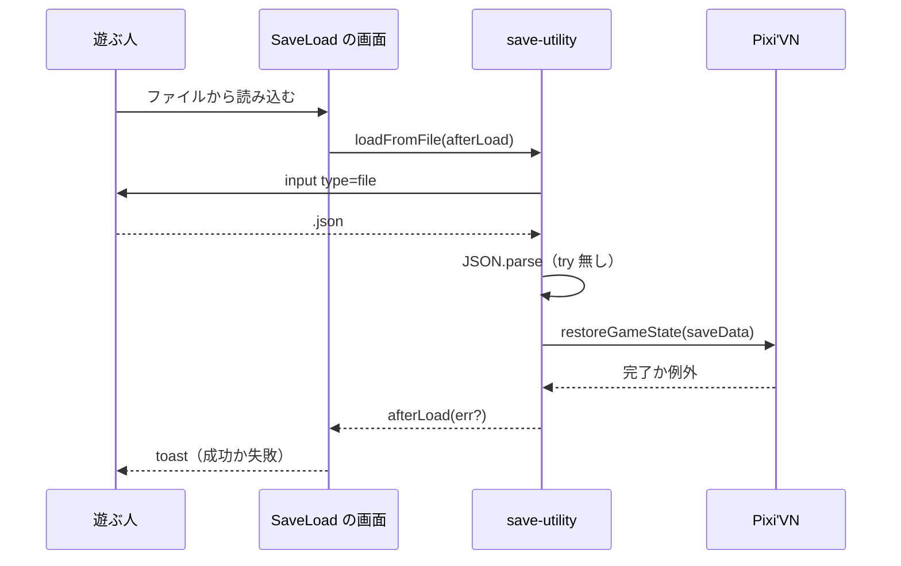
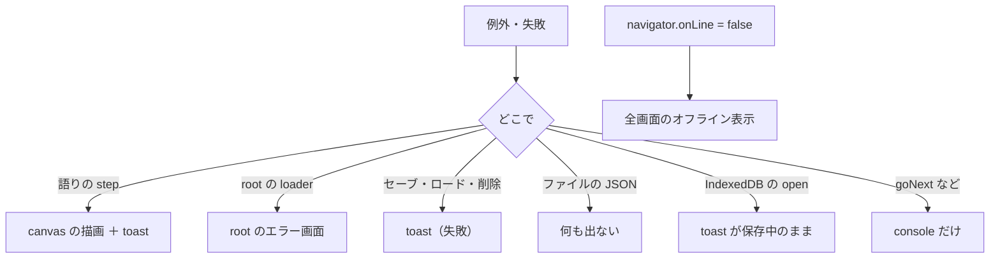
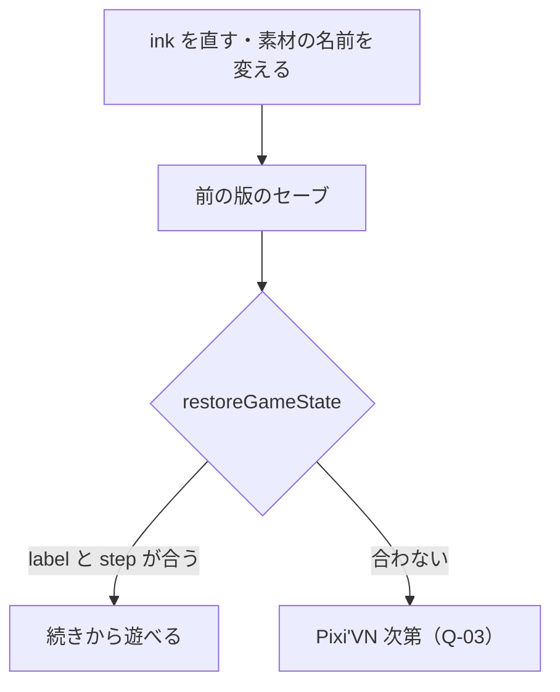
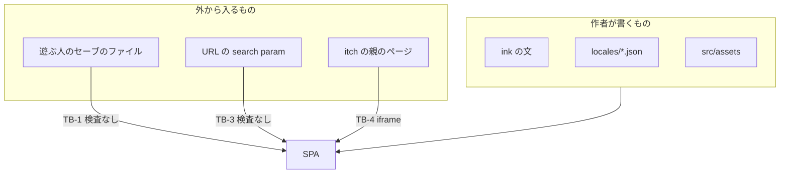

> [erabu-vn『二枚の紙』Repository Intelligence](README.md) の一部。基準は 2026-11-09 の zip（README の source）で、`path:line` はその時点の行。

# 20 API and Auth

## 契約の一覧（API Catalog の置き換え）

### Executive Summary

HTTP の API（Router・Controller・OpenAPI・GraphQL・gRPC）はありません。Orchestrator の分岐の決まりに従い、API の調査は省きます。その代わりに、部品と部品、脚本とエンジン、遊ぶ人とゲームのあいだの「契約」を一覧にしました。変更でいちばん壊れやすいのは、次の 3 つです。

- **ink のタグ命令**：脚本とエンジンの契約
- **セーブの JSON**：版をまたぐ契約
- **経路と search param**：メニューの開閉と停止の契約

### Scope

- 対象：`src/routes/`・`src/routeTree.gen.ts`・`src/content/ink/`・`src/models/`・`src/lib/hooks/hotkeys-hooks.ts`・`vite.config.ts`
- HTTP の API が無いこと：`fetch` は `src/lib/i18n.ts:62` だけで、同じオリジンの静的な JSON を読みます。サーバーの側のコードは無く、`vercel.json:1-3` は rewrite だけです。

### Findings

#### 経路（TanStack Router）

<!-- BEGIN:interfaces kind=route,search-param -->
| ID | 種類 | 名前 | 中身 | 根拠 |
|---|---|---|---|---|
| I-01 | route | `/` | タイトル（MainMenu） | `src/routes/index.tsx:4-6` |
| I-02 | route | `/game` | ゲームの枠。入力ダイアログ・クイックアクション・ホットキー・メニューのあいだの停止 | `src/routes/game.tsx:7-21` |
| I-03 | route | `/game/narration` | 語りの画面。離れるときに語りの query を消す | `src/routes/game/narration.tsx:10-30` |
| I-04 | search-param | `settings / settings_tab / history / saves` | メニューの開閉。値があるとメニューが開いていると見なす（/game では停止） | `src/lib/hooks/pause-game-hooks.ts:23-43` |
<!-- END:interfaces -->

- search param は、何でも `SearchParams` の store に入ります。型や値の検査はしません（`src/routes/__root.tsx:23`）。
- `false` を入れると `undefined` に直して URL から消します（`src/lib/hooks/navigation-hooks.ts:107`）。
- search param のどれかに値があれば「メニューが開いている」と見なします。すると次のことが起きます。
  - 語りが止まる（`src/lib/hooks/narration-hooks.ts:34-37`）
  - 音と canvas も止まる（`src/lib/hooks/pause-game-hooks.ts:27-43`）
  - 知らない search param を付けた URL（告知の link の utm_source など）で開くと、ゲームが止まったまま進まない恐れがある（R-27・Q-16。Inferred）

#### ink のタグ命令（脚本 → エンジン）

<!-- BEGIN:interfaces kind=ink-tag,text-replace -->
| ID | 種類 | 名前 | 中身 | 根拠 |
|---|---|---|---|---|
| I-05 | ink-tag | `# navigate <route>` | 経路を移る（今の脚本では使っていない） | `src/content/ink/hashtag-commands.ts:9-23` |
| I-06 | ink-tag | `# rename <characterId> <name>` | 人物の名前を変える（使っていない） | `src/content/ink/hashtag-commands.ts:25-42` |
| I-07 | ink-tag | `# unlock achievement <id>` | Roves の実績を解く（使っていない） | `src/content/ink/hashtag-commands.ts:44-58` |
| I-08 | ink-tag | `# show image / show imagecontainer / remove / play sound / stop sound / lazyload bundle` | Pixi'VN の基本命令。脚本で使っている | `src/content/ink/hashtag-commands.ts:7` |
| I-09 | text-replace | `[characterId]` | 翻訳のあとで人物名に置き換える | `src/content/ink/text-replaces.ts:4-10` |
<!-- END:interfaces -->

脚本が実際に使っている命令の数は次のとおりです（`ink/start.ink` を数えたもの）。

| 命令 | 回数 |
|---|---|
| `# show imagecontainer` | 57 |
| `# show image` | 33 |
| `# remove imagecontainer` | 10 |
| `# play sound` | 8 |
| `# stop sound` | 7 |
| `# lazyload bundle` | 1 |

自前で足した 3 つの命令（navigate・rename・unlock achievement）は、使っていません。

#### ファイルの形・ホットキー・build の mode・環境変数

<!-- BEGIN:interfaces kind=file-format,hotkey,build-mode,env,testing-bridge -->
| ID | 種類 | 名前 | 中身 | 根拠 |
|---|---|---|---|---|
| I-10 | file-format | `セーブの JSON（.json）` | GameSaveData（saveData・gameVersion・date・name・image）。書き出しと読み込み | `src/models/GameSaveData.ts:3-9` |
| I-11 | hotkey | `F5/Ctrl+S・F9/Ctrl+L・Esc・K・F8・H・Tab・Enter/Space・↑↓` | セーブ・ロード・設定・操作一覧・診断・履歴・輪・スキップと送り・選択肢の移動 | `src/lib/hooks/hotkeys-hooks.ts:112-392` |
| I-12 | build-mode | `--mode itch` | base ./・メモリの経路・PWA なし・dist-itch | `vite.config.ts:27` |
| I-13 | env | `ROVES_BUILD` | build 時の定数。AssetPack の設定も変える | `vite.config.ts:123` |
| I-14 | env | `OPENAI_API_KEY / ERABU_ART_MODEL` | 絵の生成スクリプトだけで使う。アプリは使わない | `scripts/art/gen_art.py:62-66` |
| I-15 | testing-bridge | `Game.testing` | 開発の build でだけ、操作を外から呼べる口を出す | `src/components/providers/root-provider.tsx:25` |
<!-- END:interfaces -->

### Diagrams

### Risks and Gaps

関係するリスク（中身・根拠・手当ては [リスクの台帳](70-reliability.md#リスクの台帳全部)）：

- **R-27**（Medium）知らない URL の query（utm_source など）が付くと、ゲームが進まなくなる
- **R-14**（Low）設定画面のキーの表示（Ctrl+K・Ctrl+H）と、登録しているキー（K・H）が違う

### Open Questions

関係する未確認の事項（確かめ方は [未確認の事項](99-evidence-and-questions.md#未確認の事項全部)）：

- **Q-06**（Low）@tanstack/hotkeys の "K" は Ctrl+K でも発火するか
- **Q-13**（Low）Roves・Steam の機能（achievement・roves のセーブ・終了ボタン）を残すか

### Evidence Index

| Claim | Evidence | Confidence |
|---|---|---|
| 経路は 3 つ | `src/routeTree.gen.ts:50` | Confirmed |
| search param を検査せずに store に入れる | `src/routes/__root.tsx:23` | Confirmed |
| 基本のタグ命令を bundle と alias の一覧付きで登録する | `src/content/ink/hashtag-commands.ts:7` | Confirmed |
| 自前のタグ命令は 3 つ | `src/content/ink/hashtag-commands.ts:9-58` | Confirmed |

## 契約の中身（API Contracts の置き換え）

### Executive Summary

壊れたときの影響が大きい契約を 4 つ取り上げ、中身を書きました。

- セーブの JSON
- ink のタグ命令の文法
- エンドの knot の名前の決まり
- 素材の alias

### Scope

[契約の一覧（API Catalog の置き換え）](#契約の一覧api-catalog-の置き換え) の中から選びました。

### Findings

#### 1. セーブの JSON（GameSaveData）

| 項目 | 型 | 中身 | 根拠 |
|---|---|---|---|
| `saveData` | `GameState`（Pixi'VN） | `Game.exportGameState()` の結果。step の位置・履歴・ストレージ・canvas・音 | `src/lib/utils/save-utility.ts:13` |
| `gameVersion` | string | build の時の `npm_package_version`（今は 0.1.0） | `src/lib/utils/save-utility.ts:14`、`vite.config.ts:115` |
| `date` | Date | 作った時刻。IndexedDB には Date のまま、ファイルと localStorage には文字列で入る | `src/lib/utils/save-utility.ts:15` |
| `name` | string | 遊ぶ人が付けた名前（空でもよい） | `src/lib/utils/save-utility.ts:16` |
| `image` | string（任意） | スクショ。`canvas.extractImage()` の戻り値（データ URL と推定） | `src/lib/utils/save-utility.ts:27` |
| `id` | number | 枠の番号。手動 0〜59、クイック -2〜-7、auto-exit は -1 | `src/lib/utils/save-utility.ts:150-192`、`src/lib/utils/save-utility.ts:233-239` |

- **互換**：`gameVersion` は記録するだけで、読み込むときに比べません（`src/lib/utils/save-utility.ts:128-130`）。後方の互換が保たれるかは Pixi'VN 任せで、確かめていません（Q-03）。
- **ファイル名**：`<アプリ名>-<版>-<名前> <ISO 時刻>.json` です（`src/lib/utils/save-utility.ts:95`）。
- **読み込み**：`accept="application/json"`、`JSON.parse` → `restoreGameState` の順で、形の検査はしません（`src/lib/utils/save-utility.ts:100-125`）。

#### 2. ink のタグ命令の文法（自前の 3 つ）

| 命令 | zod の検証 | 失敗したとき | 根拠 |
|---|---|---|---|
| `# navigate <route>` | `tuple([literal("navigate"), string()])` | 検証に通らなければ、この命令としては扱われない（Pixi'VN の仕組み。Inferred） | `src/content/ink/hashtag-commands.ts:21` |
| `# rename <characterId> <newName>` | `tuple([literal("rename"), enum(characterIdsEnum), string()])` | 知らない人物の id は通らない | `src/content/ink/hashtag-commands.ts:40` |
| `# unlock achievement <id>` | `tuple([literal("unlock"), literal("achievement"), string()])` | Roves の外では `achievements.unlock` が何をするかは未確認 | `src/content/ink/hashtag-commands.ts:56` |

#### 3. 脚本の決まり（test が守らせているもの）

| 決まり | 守らせ方 | 根拠 |
|---|---|---|
| エンドの knot は `ending_` で始める | 全部の `ending_` に届く経路がある・エンドは 2 つ以上 | `tests/story.test.ts:142-155` |
| 全部の経路が明示の END で終わる | 尻切れの経路があれば落ちる | `tests/story.test.ts:137-140` |
| 参照先の label が全部ある | 無い label があれば落ちる | `tests/story.test.ts:129-135` |
| 歩き方を知らない step を使わない | `KNOWN_STEP_KEYS` の外の鍵があれば落ちる（`VAR` や条件分岐を足すときは test も広げる） | `tests/story.test.ts:24-32`、`tests/story.test.ts:84-88` |
| 最初の背景に `with fade` を付けない | test は無い（README の罠） | `README.md:33`、`ink/start.ink:10` |

#### 4. 素材の alias（脚本 → manifest）

- AssetPack が、`<フォルダ>/<ファイル>` から `<フォルダ>_<名前>` と `<名前>` の 2 つの alias を作ります。同じ名前がぶつかったら、bundle の名前を前に付けます（`.assetpack.ts:58-82`）。
- bundle は、`src/assets` の直下のフォルダごとに 1 つです（`.assetpack.ts:20-46`）。今は audio・bg・images・senpai の 4 つです（`src/pixi-vn.keys.gen.ts:72`）。
- 脚本は `bg_hallway`、`senpai_neutral`、`bgm_day` のように、フォルダ付きの形でも、フォルダ無しの形でも書けます。test は両方の形を受け付けます（`tests/story.test.ts:157-187`）。

### Diagrams

### Risks and Gaps

関係するリスク（中身・根拠・手当ては [リスクの台帳](70-reliability.md#リスクの台帳全部)）：

- **R-05**（Medium）セーブに版の確かめが無く、更新のあとに古いセーブを戻すと壊れうる
- **R-06**（Low）セーブファイルの読み込みで JSON を確かめない

### Open Questions

関係する未確認の事項（確かめ方は [未確認の事項](99-evidence-and-questions.md#未確認の事項全部)）：

- **Q-03**（High）ink を直したあとに古いセーブを restoreGameState するとどうなるか

### Evidence Index

| Claim | Evidence | Confidence |
|---|---|---|
| セーブの型 | `src/models/GameSaveData.ts:3-9` | Confirmed |
| gameVersion は build の時の package の版 | `vite.config.ts:115` | Confirmed |
| alias の作り方 | `.assetpack.ts:58-82` | Confirmed |

## エラーの一覧

### Executive Summary

エラーの形は、HTTP の status code ではありません。「遊ぶ人に何が見えるか」で次の 5 つに分かれます。

- canvas への描画
- toast
- 全画面の表示
- root のエラー画面
- 何も出ない

「何も出ない」ものもあり、遊ぶ人からは原因が分かりません。

### Scope

`src/main.tsx` のエラーの処理と、`toast.error`・`console.error`・`throw` を全部たどりました。

### Findings

| # | 起きる所 | 遊ぶ人に見えるもの | 文言の鍵 | 根拠 | 確度 |
|---|---|---|---|---|---|
| ERR-01 | 語りの step の中の例外（Pixi'VN の `addOnError`） | canvas へのエラーの描画と、toast | `allert_error_occurred` | `src/main.tsx:57-61` | Confirmed |
| ERR-02 | root の loader の例外（IndexedDB の open の失敗・素材の images の読み込みの失敗・auto-exit の復元の失敗）。IndexedDB が開けない環境では / でも出る | TanStack Router の `ErrorComponent`（root のエラー画面） | なし（英語の既定の文） | `src/routes/__root.tsx:38-42` | Confirmed |
| ERR-03 | オフライン（`navigator.onLine === false`） | 全画面の「オフライン」と「再試行」のボタン | `offline_title` ほか | `src/components/modals/error-allerts.tsx:14-41` | Confirmed |
| ERR-04 | セーブの失敗 | toast の「保存に失敗」 | `fail_save` | `src/lib/hooks/save-hooks.tsx:98-102` | Confirmed |
| ERR-05 | ロードの失敗 | toast の「ロードに失敗」 | `fail_load` | `src/lib/hooks/save-hooks.tsx:41-45` | Confirmed |
| ERR-06 | 削除の失敗 | toast の「削除に失敗」 | `fail_delete` | `src/lib/hooks/save-hooks.tsx:67-71` | Confirmed |
| ERR-07 | ファイルからの読み込みの失敗（restore の例外） | toast の一般のエラー | `allert_error_occurred` | `src/components/menus/settings/menus/save-load.tsx:42-46` | Confirmed |
| ERR-08 | ファイルの JSON が壊れている | **何も出ない**（FileReader の onload の中で例外が漏れる） | なし | `src/lib/utils/save-utility.ts:109-118` | Confirmed |
| ERR-09 | 起動のあとでの IndexedDB の open の失敗（put・delete） | **toast が「保存中」のまま**（Promise が終わらない）。確認ダイアログの OK も押せないまま（キャンセルはできる） | `saving` | `src/lib/utils/db-utility.ts:57-59` | Confirmed（コード）／Inferred（画面） |
| ERR-10 | goNext・goBack・選択の例外 | **何も出ない**（console.error だけ。ローディングは消える） | なし | `src/lib/hooks/narration-hooks.ts:54-61` | Confirmed |
| ERR-11 | 起動の失敗（body・#root・HTML レイヤーが無い） | 何も出ない（例外を投げて止まる） | なし | `src/main.tsx:16-19`、`src/main.tsx:39-47` | Confirmed |
| ERR-12 | 素材の manifest が無い（build の時） | build が失敗する | なし | `vite.config.ts:49-50` | Confirmed |
| ERR-13 | auto-exit の restore の失敗 | **何も出ない**（catch が握りつぶして Game.clear()。鍵は残る） | なし | `src/lib/utils/save-utility.ts:223-226` | Confirmed |

### Diagrams

### Risks and Gaps

関係するリスク（中身・根拠・手当ては [リスクの台帳](70-reliability.md#リスクの台帳全部)）：

- **R-01**（Medium）通信が切れると、全画面のオフライン表示でゲームを止める
- **R-03**（Medium）auto_exit_save が壊れていると、/ 以外の URL から開いたときにエラー画面になる
- **R-04**（Medium）IndexedDB の失敗の経路で Promise が終わらない／例外が漏れる
- **R-12**（Medium）出したあと、遊ぶ人の環境で起きたエラーが作者に届かない
- **R-06**（Low）セーブファイルの読み込みで JSON を確かめない

### Open Questions

関係する未確認の事項（確かめ方は [未確認の事項](99-evidence-and-questions.md#未確認の事項全部)）：

- **Q-11**（Medium）出したあと、遊ぶ人からの不具合の報告を誰がどこで受けるか

### Evidence Index

| Claim | Evidence | Confidence |
|---|---|---|
| step の例外は canvas と toast に出る | `src/main.tsx:57-61` | Confirmed |
| root の loader の例外は ErrorComponent に出る | `src/routes/__root.tsx:38-42` | Confirmed |
| goNext の例外は console だけ | `src/lib/hooks/narration-hooks.ts:54-61` | Confirmed |

## 契約の互換のリスク

### Executive Summary

版の番号（versioning）や「古い契約をまだ受け付ける」仕組み（deprecated）はありません。互換が問題になるのは、出したあと（P4 のあと）に次のものを変えたときです。

- 脚本
- 素材の名前
- 経路
- localStorage の鍵

いちばん重いのはセーブの互換（R-05）です。

### Scope

[契約の中身（API Contracts の置き換え）](#契約の中身api-contracts-の置き換え) の 4 つの契約。

### Findings

| 契約 | 変えると壊れるもの | 互換の仕組み | 根拠 | 確度 |
|---|---|---|---|---|
| セーブの JSON | 前の版で作ったセーブ（IndexedDB・ファイル・auto_exit_save） | 無い（gameVersion を見ない） | `src/lib/utils/save-utility.ts:128-130` | Confirmed |
| knot と label の名前 | セーブの中の「今いる label」。test の `ending_` の決まり | 無い | `src/pixi-vn.keys.gen.ts:13-25` | Confirmed（名前が型になる）／Inferred（セーブへの影響） |
| 素材の alias | 脚本（show image）と、セーブの中の canvas の状態 | test が、脚本から見える alias だけは確かめる | `tests/story.test.ts:157-187` | Confirmed |
| 経路 | Vercel で、ブックマークした `/game/narration`。auto-exit を戻す条件 | rewrite で全部 index.html に行く | `vercel.json:1-3`、`src/routes/__root.tsx:31` | Confirmed |
| localStorage の鍵 | 前の版で保存した設定（R-02 の直し方によっては、前の値の読み方が変わる） | 無い | `src/lib/stores/auto-settings-store.ts:15-18` | Confirmed |
| IndexedDB の schema | `INDEXED_DB_VERSION` を上げずに store を変えると、onupgradeneeded が走らない | 版の番号（今は 2） | `src/lib/utils/db-utility.ts:4` | Confirmed |
| 人物の id | `# rename` の検証と `[characterId]` の置き換え。セーブの中の人物のストレージ | 無い | `src/content/characters.ts:5-26` | Confirmed |

### Diagrams

### Risks and Gaps

関係するリスク（中身・根拠・手当ては [リスクの台帳](70-reliability.md#リスクの台帳全部)）：

- **R-02**（Medium）オート送りを設定画面で切っても、読み直すとオンに戻る
- **R-05**（Medium）セーブに版の確かめが無く、更新のあとに古いセーブを戻すと壊れうる
- **R-14**（Low）設定画面のキーの表示（Ctrl+K・Ctrl+H）と、登録しているキー（K・H）が違う

### Open Questions

関係する未確認の事項（確かめ方は [未確認の事項](99-evidence-and-questions.md#未確認の事項全部)）：

- **Q-03**（High）ink を直したあとに古いセーブを restoreGameState するとどうなるか

### Evidence Index

| Claim | Evidence | Confidence |
|---|---|---|
| restore は版を見ない | `src/lib/utils/save-utility.ts:128-130` | Confirmed |
| IndexedDB の版は 2 | `src/lib/utils/db-utility.ts:4` | Confirmed |

## 認証と認可（無いことの確認と、信頼の境界）

### Executive Summary

認証・認可・ID の連携・トークン・サービス間の認証は、どれもありません。Skill の仕様の 21〜23（Token Lifecycle・Authorization Model・Identity Integration）は書くことが無いので作りませんでした。代わりに、この文書で「無い」ことの根拠を示し、信頼の境界を 5 つ挙げます。

### Scope

`src/` 全体と設定ファイル。調べた言葉は次のとおりです。

- JWT・token・session・cookie・OAuth・OIDC・SAML・SCIM
- RBAC・role・IAM・CORS・CSRF・API key

### Findings

#### 無いことの根拠

| 調べたこと | 結果 | 根拠 |
|---|---|---|
| ログインの画面・経路 | 無い。経路は 3 つで、ガード（beforeLoad など）も無い | `src/routeTree.gen.ts:50`、`src/routes/__root.tsx:22-43` |
| トークン・cookie・session | 無い。保存先は IndexedDB と localStorage だけで、中身はセーブと設定 | `src/lib/utils/db-utility.ts:4-22`、[データの持ち主（誰が読み、誰が書くか）](30-data.md#データの持ち主誰が読み誰が書くか) |
| サーバーへの要求 | 無い。fetch は同じオリジンの静的な JSON（開発だけ） | `src/lib/i18n.ts:60-64` |
| 秘密の値 | アプリには無い。`OPENAI_API_KEY` は手元のスクリプトが環境変数から読むだけで、repo にも bundle にも入らない | `scripts/art/gen_art.py:62-66`、`.gitignore:6` |
| サービス間の認証 | 無い。Roves の API は、殻の中でだけ動く同じプロセスの橋（Inferred） | `src/lib/system-info.ts:19-32` |

#### 信頼の境界（認証の代わりに見るべき所）

| # | 境界 | 入ってくるもの | 今の扱い | 根拠 | 関連 |
|---|---|---|---|---|---|
| TB-1 | セーブのファイルの読み込み | 遊ぶ人が選んだ任意の JSON | 検査なしで restore する | `src/lib/utils/save-utility.ts:100-125` | R-06 |
| TB-2 | 台詞の HTML | ink の文と翻訳の文 | allowHtml で描く | `src/components/screens/narration/narration-cards.tsx:123-136` | R-18 |
| TB-3 | URL の search param | 任意のキーと値 | 検査なしで store に入る。値があるとゲームが止まる | `src/routes/__root.tsx:23` | R-27・[契約の一覧（API Catalog の置き換え）](#契約の一覧api-catalog-の置き換え) |
| TB-4 | itch の iframe | 親のページ | 経路はメモリに持ち、history には触らない | `src/lib/hooks/navigation-hooks.ts:47-70` | R-19 |
| TB-5 | 素材の生成の API | OpenAI の応答（b64 の画像） | 手元で PNG に書く。人が見てから repo に入れる（Inferred） | `scripts/art/gen_art.py:51-59` | R-25 |

### Diagrams

### Risks and Gaps

- 認証が無いのは仕様です（遊ぶ人ごとのデータは、その人のブラウザにしか無い）。
- 遊ぶ人の端末の中の値は、遊ぶ人が自由に書き換えられます。今はランキングも実績も使っていないので、問題になりません。Steam の実績を使うようになったら、考え直します（Q-13）。

### Open Questions

関係する未確認の事項（確かめ方は [未確認の事項](99-evidence-and-questions.md#未確認の事項全部)）：

- **Q-13**（Low）Roves・Steam の機能（achievement・roves のセーブ・終了ボタン）を残すか

### Evidence Index

| Claim | Evidence | Confidence |
|---|---|---|
| 経路にガードが無い | `src/routes/__root.tsx:22-43` | Confirmed |
| 秘密はスクリプトの環境変数だけ | `scripts/art/gen_art.py:62-66` | Confirmed |
| .env は ignore している | `.gitignore:6` | Confirmed |

## セキュリティのリスクの一覧（Auth Risk Register の置き換え）

### Executive Summary

認証が無いので、認証のリスクもありません。ここには、信頼の境界（[認証と認可（無いことの確認と、信頼の境界）](#認証と認可無いことの確認と信頼の境界)）にまつわるセキュリティのリスクを載せます。どれも Low です。サーバーも秘密も持たないので、影響は遊ぶ人自身のブラウザの中に限られます。

### Scope

区分が security のリスク。

### Findings

関係するリスク（中身・根拠・手当ては [リスクの台帳](70-reliability.md#リスクの台帳全部)）：

- **R-06**（Low）セーブファイルの読み込みで JSON を確かめない
- **R-18**（Low）台詞を allowHtml で描いている
- **R-19**（Low）Vercel の応答にセキュリティのヘッダーが無い

### Diagrams

（[認証と認可（無いことの確認と、信頼の境界）](#認証と認可無いことの確認と信頼の境界) の図を見てください）

### Risks and Gaps

- 秘密の扱い：`OPENAI_API_KEY` は環境変数から読みます（`scripts/art/gen_art.py:62-66`）。`.env*` は ignore しています（`.gitignore:6`）。zip の中を、秘密らしい文字列（`sk-…`・`AKIA…`・秘密鍵の BEGIN 行・`ghp_…`・`xox[bp]-`・api_key や password の代入）で grep しました（package-lock.json は除く）。1 件も当たりませんでした。出力の文書の側は、`tools/check.py` が同じ形で毎回確かめます。

### Open Questions

（なし）

### Evidence Index

| Claim | Evidence | Confidence |
|---|---|---|
| .env を ignore している | `.gitignore:6-7` | Confirmed |
