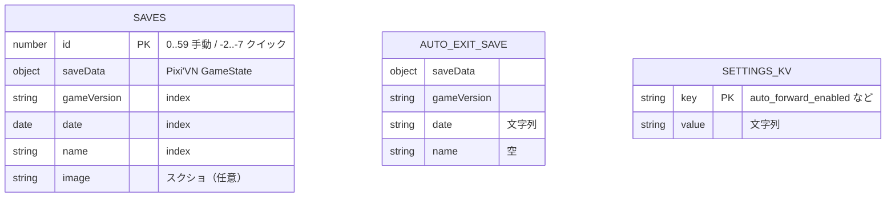
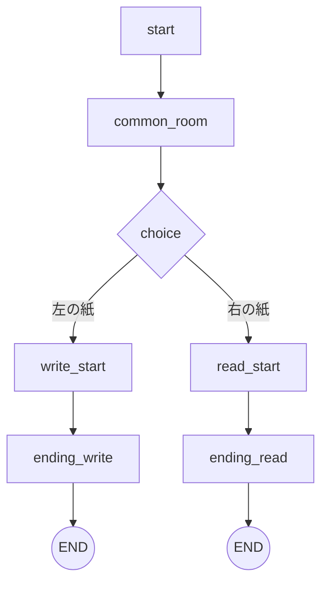
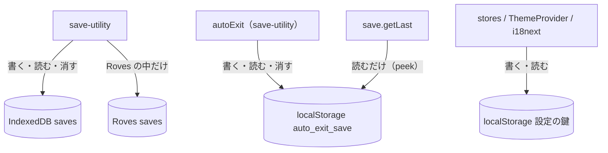
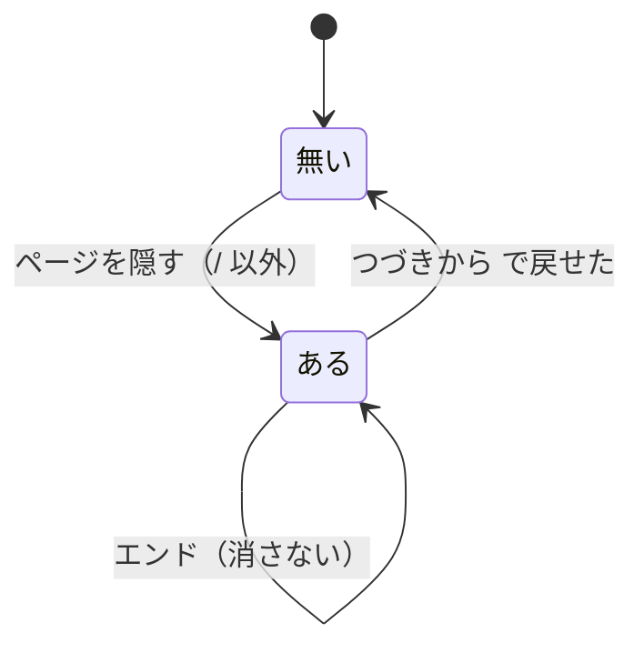
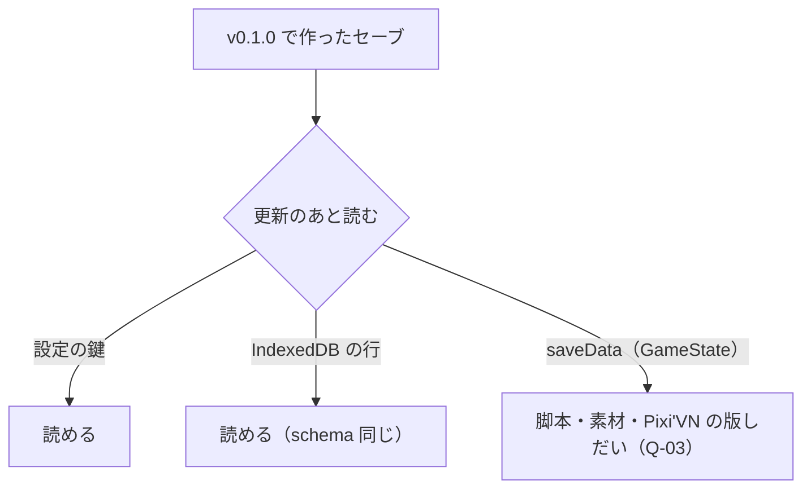

> [erabu-vn『二枚の紙』Repository Intelligence](README.md) の一部。基準は 2026-11-09 の zip（README の source）で、`path:line` はその時点の行。

# 30 Data

## データのモデル

### Executive Summary

永続するデータは、遊ぶ人のブラウザの中だけにあります。中身は 3 種類です。

- **セーブ**：IndexedDB と、auto-exit の localStorage
- **設定**：localStorage
- **ネイティブの殻のセーブ**：Roves。今は使っていない

ORM・migration・SQL はありません。schema は IndexedDB の object store が 1 つ（`saves`）で、版は 2 です。ゲームの状態の中身（`GameState`）は Pixi'VN が決め、このリポジトリは丸ごと出し入れするだけです。

### Scope

`src/lib/utils/db-utility.ts`・`save-utility.ts`・`roves-utility.ts`・`src/lib/stores/*`・`src/models/*`

### Findings

#### 置き場

<!-- BEGIN:datastores -->
| ID | 置き場 | 持ち主 | 中身 | 残る期間 | 根拠 |
|---|---|---|---|---|---|
| D-01 | IndexedDB game_db / saves (v2) | save-utility | 手動セーブ（id 0〜59）とクイックセーブ（id -2〜-7）。スクショ入り | プレイヤーが消すまで。ブラウザのデータ削除で消える | `src/lib/utils/db-utility.ts:4-22` |
| D-02 | localStorage auto_exit_save | save-utility.autoExit | ページを隠したときの GameSaveData（画像なし、id -1 扱い） | 次に戻せたら消す。エンドでは消さない | `src/lib/utils/save-utility.ts:199-240` |
| D-03 | localStorage 設定の鍵 | stores/* | auto_forward_enabled・auto_forward_second・<alias>_volume・<alias>_muted・master_volume・master_muted・typewriter_delay_millisecond・text_display_font_size・save_screen_page・vite-ui-theme・i18nextLng | ずっと | `src/lib/stores/auto-settings-store.ts:15-18` |
| D-04 | Roves のセーブ（ネイティブの殻の中だけ） | roves-utility | IndexedDB と同じ中身。鍵は数値か quicksave-N。Steam Cloud と同期しうる | 殻しだい | `src/lib/utils/roves-utility.ts:14-52` |
| D-05 | メモリ（Pixi'VN の状態・TanStack Query のキャッシュ・stores） | Pixi'VN / React | 今の step・履歴・画面のデータ | タブを閉じるまで | `src/lib/hooks/props-hooks.ts:18-21` |
| D-06 | build の成果物（静的なファイル） | Vite / AssetPack | dist（または dist-itch）の js・css・html・public/assets・ink の JSON | 配る所（Vercel・itch）しだい | `.assetpack.ts:84-103` |
<!-- END:datastores -->

#### IndexedDB の schema（`game_db` v2）

| object store | keyPath | autoIncrement | index | 根拠 |
|---|---|---|---|---|
| `saves` | `id` | true（実際は id を必ず渡す） | `id`（unique）・`date`・`name`・`gameVersion` | `src/lib/utils/db-utility.ts:12-22` |

- `onupgradeneeded` は「store が無ければ作る」だけです。v1 から v2 で何が変わったかは、コードからは分かりません（Unknown）。
- `getList` は index `date` を `prev` の向きで歩き、最新の 1 件を取ります（`src/lib/utils/save-utility.ts:60-63`）。

#### 枠の番号（id）の決まり

| 範囲 | 使い道 | 置き場 | 根拠 |
|---|---|---|---|
| 0〜59 | 手動セーブ（10 ページ × 6） | IndexedDB／Roves | `src/components/menus/save-menu/index.tsx:16-18`、`src/components/menus/save-menu/index.tsx:70-72` |
| -1 | auto-exit（読み出すときだけ id を付ける） | localStorage | `src/lib/utils/save-utility.ts:233-239` |
| -2〜-7 | クイックセーブ 6 枠 | IndexedDB／Roves（鍵は quicksave-0〜5） | `src/lib/utils/save-utility.ts:169-192`、`src/lib/utils/roves-utility.ts:14-20` |

### Diagrams

ER の線は引いていません。3 つのあいだに外部キーはなく、それぞれ独立しています。

### Risks and Gaps

関係するリスク（中身・根拠・手当ては [リスクの台帳](70-reliability.md#リスクの台帳全部)）：

- **R-02**（Medium）オート送りを設定画面で切っても、読み直すとオンに戻る
- **R-03**（Medium）auto_exit_save が壊れていると、/ 以外の URL から開いたときにエラー画面になる
- **R-04**（Medium）IndexedDB の失敗の経路で Promise が終わらない／例外が漏れる
- **R-05**（Medium）セーブに版の確かめが無く、更新のあとに古いセーブを戻すと壊れうる
- **R-07**（Low）ページを閉じるときの自動セーブは、書き終わる保証が無い
- **R-16**（Low）IndexedDB の getList が limit のあとも最後まで歩く
- **R-17**（Low）セーブ 1 件ごとに、全画面のスクショをそのまま入れる

### Open Questions

関係する未確認の事項（確かめ方は [未確認の事項](99-evidence-and-questions.md#未確認の事項全部)）：

- **Q-03**（High）ink を直したあとに古いセーブを restoreGameState するとどうなるか
- **Q-15**（Low）1 周したときの auto_exit_save は何 KB になるか

### Evidence Index

| Claim | Evidence | Confidence |
|---|---|---|
| DB の名前と版 | `src/lib/utils/db-utility.ts:4-5` | Confirmed |
| store と index | `src/lib/utils/db-utility.ts:12-22` | Confirmed |
| セーブの型 | `src/models/GameSaveData.ts:3-9` | Confirmed |

## エンティティの一覧（ゲームの中身を含む）

### Executive Summary

ここでは「永続するデータ」に加えて、「build の時に決まる、ゲームの中身のデータ」を一覧にします。中身は登場人物・label・素材の bundle と alias・文言の鍵です。変更の影響を見るときに使います。

### Scope

`src/content/`・`src/pixi-vn.keys.gen.ts`・`src/assets/manifest.gen.json`・`src/locales/`

### Findings

#### 永続するエンティティ

| エンティティ | 主キー | 中身 | 根拠 |
|---|---|---|---|
| GameSaveData | `id`（枠） | saveData・gameVersion・date・name・image | `src/models/GameSaveData.ts:3-9` |
| Character のストレージ | 人物の id | name・surname・age を書き換えたもの（GameState の中に入る） | `src/models/Character.ts:17-36` |
| 設定 | localStorage の鍵 | [データの持ち主（誰が読み、誰が書くか）](#データの持ち主誰が読み誰が書くか) を見てください | — |

#### 登場人物（`src/content/characters.ts:5-26`）

| id | 名前 | 色 | 立ち絵 | ink の台詞の行数 |
|---|---|---|---|---|
| `mc` | わたし | — | 無い | 129 |
| `senpai` | 先輩 | #0084ac | 有る（4 枚） | 168 |
| `kaikei` | 会計の子 | — | 無い | 11 |
| `mio` | みお | — | 無い | 15 |
| `shisho` | 司書さん | — | 無い | 7 |

行数は、`ink/start.ink` で `<id>:` で始まる行を数えたものです。

#### label（`src/pixi-vn.keys.gen.ts:13-25`）

| label | 役目 | 次へ | 根拠 |
|---|---|---|---|
| `start` | 共通 1（廊下・掲示板・先輩と会う） | `common_room` | `ink/start.ink:8-104` |
| `common_room` | 共通 2（部室・夕方。BGM が夜に変わる） | `choice` | `ink/start.ink:106-219` |
| `choice` | 選ぶ（掲示板・日没） | `choice_|_c-0` → `write_start`／`choice_|_c-1` → `read_start` | `ink/start.ink:221-243` |
| `write_start` | 書く人の枝 | `ending_write` | `ink/start.ink:247-538` |
| `ending_write` | エンド（書く） | END | `ink/start.ink:540-561` |
| `read_start` | 読む人の枝 | `ending_read` | `ink/start.ink:565-849` |
| `ending_read` | エンド（読む） | END | `ink/start.ink:851-877` |

#### 素材（bundle と alias）

| bundle | 中身 | いつ読み込むか | 根拠 |
|---|---|---|---|
| `images` | main-menu | 起動の前に待つ | `src/lib/utils/assets-utility.ts:21-22` |
| `audio` | bgm_day・bgm_night | 起動のとき裏で | `src/lib/utils/assets-utility.ts:24-25` |
| `senpai` | neutral・smile・grin・concern | start の最初に lazyload | `ink/start.ink:9` |
| `bg` | bedroom・board_read_end・board_two(_dusk)・board_write_end・clubroom(_dusk)・hallway(_dusk) の 9 枚 | show image のとき（Inferred） | `src/pixi-vn.keys.gen.ts:72` |

src の素材は、全部で約 10MB です（jpg・png が 14 枚、mp3 が 2 本）。AssetPack が、それぞれ webp と元の形式の 2 通りを出します（`src/assets/manifest.gen.json` の `src`）。

#### 文言

| namespace | ja | en | 根拠 |
|---|---|---|---|
| `ui` | 186 の鍵 | 186 の鍵（test が揃っているかを確かめる） | `tests/story.test.ts:189-196` |
| `narration` | 空 | 空 | `src/locales/en.json:1-2` |

ink の文は、原文（日本語）をそのまま鍵にして `t()` に通します（`src/lib/query/narration-query.ts:78-82`）。`narration` が空なので、言語を en にしても物語は日本語のままです。

### Diagrams

### Risks and Gaps

関係するリスク（中身・根拠・手当ては [リスクの台帳](70-reliability.md#リスクの台帳全部)）：

- **R-21**（Low）label id の名前で bundle を裏で読み込もうとしている
- **R-22**（Low）ドキュメントの物差しと、実際の素材の数が合わない

### Open Questions

関係する未確認の事項（確かめ方は [未確認の事項](99-evidence-and-questions.md#未確認の事項全部)）：

- **Q-10**（Low）物語の英語版を出す予定はあるか（en を選べるのに narration が空）
- **Q-04**（Low）Assets.backgroundLoadBundle("start") など、無い bundle の名前を渡すと警告や例外が出るか

### Evidence Index

| Claim | Evidence | Confidence |
|---|---|---|
| 登場人物は 5 人 | `src/content/characters.ts:26` | Confirmed |
| 分岐は choice の 2 択 | `ink/start.ink:240-243` | Confirmed |
| bundle は 4 つ | `src/pixi-vn.keys.gen.ts:72` | Confirmed |
| narration の翻訳は空 | `src/locales/en.json:1-2` | Confirmed |

## データの持ち主（誰が読み、誰が書くか）

### Executive Summary

各データには、書く部品が 1 つずつあります。例外が 1 つあり、auto-exit のセーブだけは `save.getLast`（読む）と `autoExit.load`（読んで消す）の 2 か所が触ります。遊ぶ人ごと（tenant ごと）の分け方は、ブラウザのオリジンが受け持ちます。Vercel と itch はオリジンが違うので、セーブも設定も別々になります（Inferred：ブラウザの同一オリジンの決まり）。

### Scope

localStorage の鍵を全部（`localStorage.` で grep）と、IndexedDB・Roves。

### Findings

#### localStorage の鍵（全部）

| 鍵 | 書く所 | 読む所 | 値 | 根拠 |
|---|---|---|---|---|
| `auto_exit_save` | `autoExit.add` | `autoExit.load`・`autoExit.peek` | GameSaveData の JSON | `src/lib/utils/save-utility.ts:200-238` |
| `auto_forward_enabled` | `AutoSettings.toggleEnabled` | 起動のとき | "true"/"false"（R-02） | `src/lib/stores/auto-settings-store.ts:15-28` |
| `auto_forward_second` | `AutoSettings.setTime` | 起動のとき | 秒 | `src/lib/stores/auto-settings-store.ts:17`、`src/lib/stores/auto-settings-store.ts:40-43` |
| `bgm_volume`・`sfx_volume` | `ChannelSound.setVolume` | `ChannelSound.getStore` | 0〜100 | `src/lib/stores/channel-sound-stores.ts:29-47` |
| `bgm_muted`・`sfx_muted` | `ChannelSound.setMuted` | 同上 | "true"/"false" | `src/lib/stores/channel-sound-stores.ts:54-58` |
| `master_volume`・`master_muted` | `MasterSound` | 起動のとき | 0〜100・"true"/"false" | `src/lib/stores/master-sound-storage.ts:16-58` |
| `typewriter_delay_millisecond` | `TextDisplaySettings.setDelay` | 起動のとき | ミリ秒（既定 10） | `src/lib/stores/text-display-settings-store.ts:27`、`src/lib/stores/text-display-settings-store.ts:36-41` |
| `text_display_font_size` | `TextDisplaySettings.setFontSize` | 起動のとき（html の font-size に入れる） | %（既定 100） | `src/lib/stores/text-display-settings-store.ts:23-24` |
| `save_screen_page` | `SaveMenuPagination.setPage` | 起動のとき | 0〜9 | `src/lib/stores/save-menu-pagination-store.ts:11-23` |
| `vite-ui-theme` | ThemeProvider | 同上 | light/dark/system | `src/components/providers/theme-provider.tsx:26-53` |
| `i18nextLng`（推定。i18next の既定の鍵） | i18next の LanguageDetector | 同上 | ja/en | `src/lib/i18n.ts:33-36` |
| `__diagnostics_test__` | 診断（書いてすぐ消す） | — | "1" | `src/lib/utils/device-diagnostics-utility.ts:308-310` |

チャンネルの alias は `bgm` と `sfx` です（`src/constants.ts:7-8`）。そこから鍵の名前が決まります。

#### IndexedDB と Roves

| データ | 書く | 読む | 消す | 根拠 |
|---|---|---|---|---|
| `saves` | `save()`（手動・クイック・上書き） | `save.get`・`save.getLast` | `save.remove`（確認のあと） | `src/lib/utils/save-utility.ts:22-83` |
| Roves のセーブ | `roves.writeSave` | `roves.getSave`・`getMostRecentSave` | `roves.deleteSave` | `src/lib/utils/roves-utility.ts:22-52` |

#### 機微な情報

- 個人情報は持ちません。セーブの名前は遊ぶ人が自由に入れる文字列です（`src/lib/hooks/save-hooks.tsx:83-89`）。
- 診断のレポートには、User Agent・GPU の名前・画面の大きさが入ります。遊ぶ人が自分でコピーするか書き出すかしたときだけ、外に出ます（`src/lib/utils/device-diagnostics-utility.ts:439-534`）。
- 暗号化はしません（端末の中の、遊ぶ人自身のデータなので要らない）。

### Diagrams

### Risks and Gaps

関係するリスク（中身・根拠・手当ては [リスクの台帳](70-reliability.md#リスクの台帳全部)）：

- **R-02**（Medium）オート送りを設定画面で切っても、読み直すとオンに戻る
- **R-03**（Medium）auto_exit_save が壊れていると、/ 以外の URL から開いたときにエラー画面になる
- **R-07**（Low）ページを閉じるときの自動セーブは、書き終わる保証が無い

### Open Questions

関係する未確認の事項（確かめ方は [未確認の事項](99-evidence-and-questions.md#未確認の事項全部)）：

- **Q-15**（Low）1 周したときの auto_exit_save は何 KB になるか

### Evidence Index

| Claim | Evidence | Confidence |
|---|---|---|
| チャンネルの alias は bgm と sfx | `src/constants.ts:7-8` | Confirmed |
| auto-exit の鍵 | `src/lib/utils/save-utility.ts:200` | Confirmed |
| テーマの鍵 | `src/components/providers/theme-provider.tsx:26` | Confirmed |

## データの一生（作る・残す・消す）

### Executive Summary

- 消すのは 2 か所だけです。遊ぶ人がセーブを消すとき（確認のあとに消える。論理削除は無い）と、auto-exit のセーブを戻せたとき。
- クイックセーブは、枠が埋まると確認なしで一番古い枠を上書きします。
- エンドまで読んでも、auto-exit のセーブは残ります（R-24）。
- 保存期間の決まりも、archive もありません。ブラウザのデータを消すと全部なくなります。

### Scope

セーブ（3 種類）と設定。

### Findings

| データ | 作られる | 書き換わる | 消える | 根拠 |
|---|---|---|---|---|
| 手動セーブ | 空の枠を押して名前を入れる | 上書きの確認（名前を変えられる） | 削除の確認 | `src/lib/hooks/save-hooks.tsx:51-156` |
| クイックセーブ | F5・Ctrl+S・クイックツールのボタン | 空きが無ければ一番古い枠を、確認なしで | 削除の確認（クイックの画面で） | `src/lib/utils/save-utility.ts:150-167`、`src/lib/hooks/hotkeys-hooks.ts:70-84` |
| auto-exit | / 以外で、ページを隠すか閉じたとき | 隠すたびに上書き | 戻せたとき（つづきから・/ 以外の URL で開いたとき）。戻せなかったときは消さずに Game.clear() | `src/lib/hooks/save-hooks.tsx:174-200`、`src/lib/utils/save-utility.ts:212-230` |
| 設定 | 変えたとき | 変えたとき | 消す所は無い | [データの持ち主（誰が読み、誰が書くか）](#データの持ち主誰が読み誰が書くか) |
| ファイルのセーブ | 書き出し（枠のボタン・今の状態） | — | 遊ぶ人の手元 | `src/lib/utils/save-utility.ts:86-97` |

- **`/` のとき**：auto-exit を書きません（`src/lib/hooks/save-hooks.tsx:177-182`）。タイトルに戻ったあとにタブを閉じても、前の auto-exit が残ります。
- **auto-exit が無い／戻せなかったとき**：`load()` は false を返します（`src/lib/utils/save-utility.ts:212-230`）。このとき、つづきからの画面は「何も起きない」に見えます（Inferred：`ContinueMenuButton` は戻り値を見ずに invalidate するだけ。`src/components/menus/main-menu.tsx:242-244`）。

### Diagrams

### Risks and Gaps

関係するリスク（中身・根拠・手当ては [リスクの台帳](70-reliability.md#リスクの台帳全部)）：

- **R-07**（Low）ページを閉じるときの自動セーブは、書き終わる保証が無い
- **R-17**（Low）セーブ 1 件ごとに、全画面のスクショをそのまま入れる
- **R-23**（Low）タイトルへ戻るとセーブせずに状態を消す
- **R-24**（Low）エンドのあとも、前の auto_exit_save が「つづきから」に残る

### Open Questions

関係する未確認の事項（確かめ方は [未確認の事項](99-evidence-and-questions.md#未確認の事項全部)）：

- **Q-08**（Low）エンドまで読んだあと、auto_exit_save を消すべきか
- **Q-15**（Low）1 周したときの auto_exit_save は何 KB になるか

### Evidence Index

| Claim | Evidence | Confidence |
|---|---|---|
| クイックセーブは一番古い枠を上書きする | `src/lib/utils/save-utility.ts:150-167` | Confirmed |
| / では auto-exit を書かない | `src/lib/hooks/save-hooks.tsx:177-182` | Confirmed |
| 戻せたら消す | `src/lib/utils/save-utility.ts:217-222` | Confirmed |

## データの移行と互換のリスク

### Executive Summary

migration の仕組みは、IndexedDB の `onupgradeneeded`（store が無ければ作る）だけです。出したあとに心配な変更は、次の 4 つです。

1. 脚本の変更（セーブの step の位置がずれる）
2. 設定の値の読み方の変更（R-02 を直すとき）
3. IndexedDB の schema の変更
4. Pixi'VN の版の更新（GameState の形）

### Scope

前の版で作ったデータを、次の版で読むときのこと。

### Findings

| 変更 | 前のデータへの影響 | 前に進む互換 | 後ろに戻る互換 | 根拠 | 確度 |
|---|---|---|---|---|---|
| ink の行を足す・消す | セーブの step の位置がずれる。違う所から始まるか、例外になる | 無い | 無い | `src/lib/utils/save-utility.ts:128-130` | Inferred（Q-03） |
| knot の名前を変える | その knot の中で作ったセーブは、無い label を指す | 無い | 無い | `src/pixi-vn.keys.gen.ts:13-25` | Inferred |
| 素材の alias を変える | セーブの中の canvas の状態が、無い alias を指す | 無い | 無い | `.assetpack.ts:58-82` | Inferred |
| R-02 を直す（=== "true" で読む） | 今 "false" を持つ人は、直したあと正しく off になる。悪い向きの影響は無い | 有る | 有る | `src/lib/stores/auto-settings-store.ts:15-18` | Confirmed |
| IndexedDB に store や index を足す | `INDEXED_DB_VERSION` を 3 に上げないと、`onupgradeneeded` が走らない。今の実装は「store が無ければ作る」だけなので、index を足すには `oldVersion` で分ける upgrade のコードが要る。戻すと、新しい版で遊んだ人は VersionError で起動できない（RB-05） | 条件付き | 戻すと VersionError（ブラウザの決まり。Inferred） | `src/lib/utils/db-utility.ts:4`、`src/lib/utils/db-utility.ts:10-23` | Confirmed／Inferred |
| Pixi'VN の版を上げる | GameState の形が変わると、全部のセーブが読めなくなりうる | Pixi'VN 次第 | — | `package.json`（`@drincs/pixi-vn ^1.9.6`） | Unknown |
| itch と Vercel を行き来する | オリジンが違うので、セーブは引き継げない（ファイルの書き出しと読み込みなら移せる） | — | — | `src/lib/utils/save-utility.ts:86-125` | Inferred |

**cascade delete**：外部キーが無いので起きません。データが消えるのは、遊ぶ人の操作か、ブラウザの掃除だけです。

### Diagrams

### Risks and Gaps

関係するリスク（中身・根拠・手当ては [リスクの台帳](70-reliability.md#リスクの台帳全部)）：

- **R-02**（Medium）オート送りを設定画面で切っても、読み直すとオンに戻る
- **R-05**（Medium）セーブに版の確かめが無く、更新のあとに古いセーブを戻すと壊れうる

対策の案（作者が決めること）：

- 脚本を直すときは、step を消さずに足すだけにする。
- セーブの互換を壊す変更のときは、package.json の version を上げ、restore の前に比べて警告を出す。

### Open Questions

関係する未確認の事項（確かめ方は [未確認の事項](99-evidence-and-questions.md#未確認の事項全部)）：

- **Q-03**（High）ink を直したあとに古いセーブを restoreGameState するとどうなるか

### Evidence Index

| Claim | Evidence | Confidence |
|---|---|---|
| upgrade は store が無ければ作るだけ | `src/lib/utils/db-utility.ts:10-23` | Confirmed |
| restore は版を見ない | `src/lib/utils/save-utility.ts:128-130` | Confirmed |
