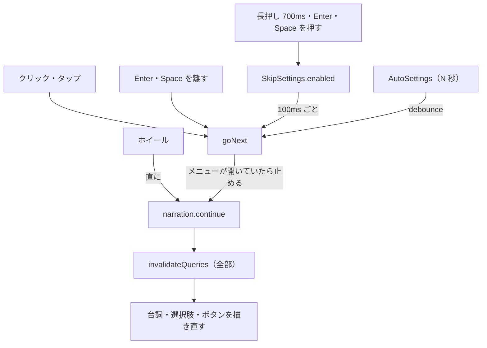
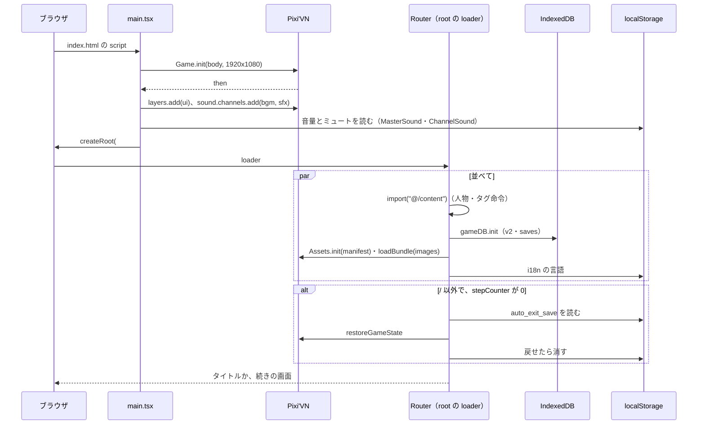
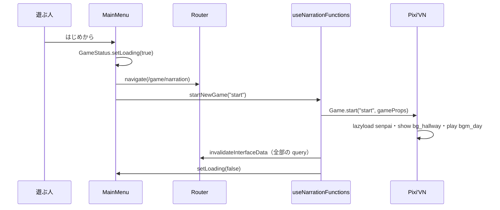
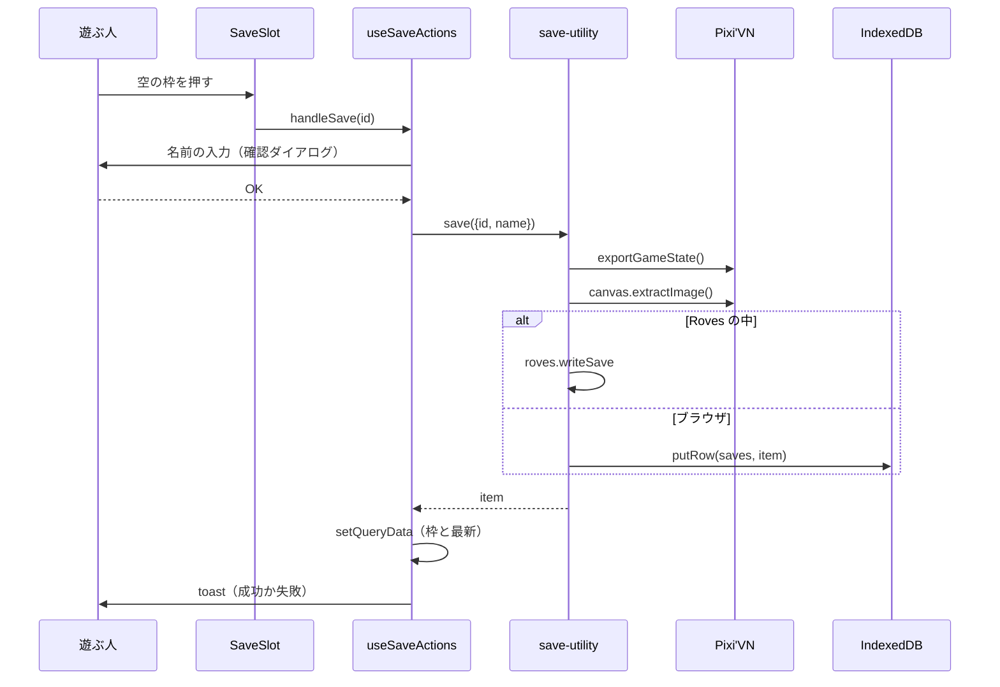
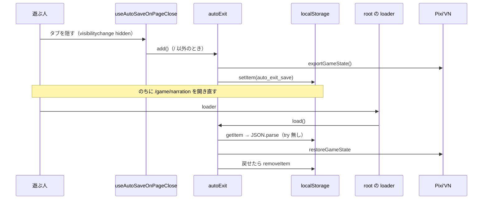
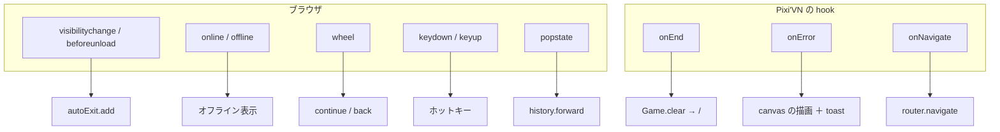
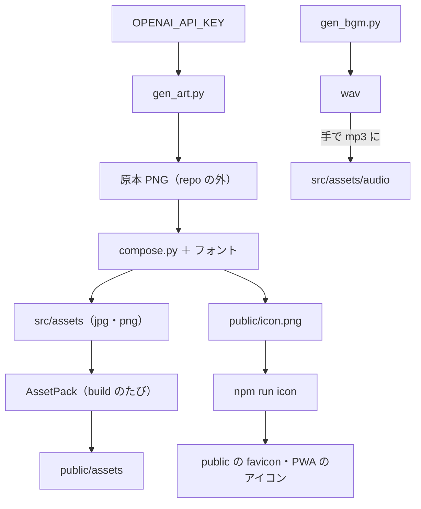

> [erabu-vn『二枚の紙』Repository Intelligence](README.md) の一部。基準は 2026-11-09 の zip（README の source）で、`path:line` はその時点の行。

# 40 Runtime

## 実行時の流れ

### Executive Summary

queue・event bus・consumer・outbox・saga はありません。処理はすべてブラウザの main thread で動き、間に Pixi'VN の worker が入ります。進め方は「入力 → `goNext` などの関数 → Pixi'VN → `invalidateQueries` → 画面を描き直す」の 1 本です。この入口に、次の 6 つが集まります。

- クリック
- キー（Enter・Space）
- 長押し
- スキップ（100ms ごと）
- オート（N 秒）
- ホイール

### Scope

[シーケンス図](#シーケンス図) に図をまとめました。ここでは経路ごとの分岐（happy・失敗・重複・途中の失敗）を書きます。

### Findings

#### 流れの一覧

<!-- BEGIN:flows -->
| ID | 流れ | 手順 | 根拠 |
|---|---|---|---|
| F-01 | 起動 | main.tsx の Game.init → canvas と音の準備 → React の描画 → root の loader（content・gameDB.init・defineAssets・i18n）→ / 以外なら auto-exit を戻す | `src/main.tsx:21-50` `src/routes/__root.tsx:26-37` |
| F-02 | はじめから | /game/narration へ → Game.start("start") → ink の label start → 全 query を invalidate | `src/components/menus/main-menu.tsx:146-158` `src/lib/hooks/narration-hooks.ts:98-106` |
| F-03 | 次へ進む | クリック・Enter/Space を離す・オート・スキップ・ホイール → goNext → narration.continue → invalidate | `src/lib/hooks/narration-hooks.ts:39-63` |
| F-04 | 選ぶ | ChoiceMenu → selectChoice → narration.choices.select → choice_\|_c-0/1 → write_start / read_start | `src/components/menus/choice-menus.tsx:12-21` `ink/start.ink:240-243` |
| F-05 | セーブ | 枠をクリック → 名前の入力 → create（exportGameState）→ スクショ → IndexedDB か Roves → query を更新 | `src/lib/hooks/save-hooks.tsx:77-113` `src/lib/utils/save-utility.ts:22-44` |
| F-06 | ロード | 確認 → restoreGameState → 全 query を invalidate → 設定を閉じる | `src/lib/hooks/save-hooks.tsx:24-49` |
| F-07 | ページを閉じる・隠す | beforeunload / visibilitychange(hidden) → / 以外なら autoExit.add → localStorage | `src/lib/hooks/save-hooks.tsx:174-200` |
| F-08 | エンド | ink の -> END → Game.onEnd → Game.clear → / へ | `ink/start.ink:561` `src/main.tsx:52-55` |
<!-- END:flows -->

#### 経路ごとの分岐（Skill の仕様の必須の分析）

| 観点 | 語り（goNext） | セーブ | ロード | auto-exit |
|---|---|---|---|---|
| happy path | continue → invalidate → 描き直す（`src/lib/hooks/narration-hooks.ts:48-53`） | create → スクショ → 書く → query を直に更新（`src/lib/hooks/save-hooks.tsx:91-97`） | 確認 → restore → invalidate → 設定を閉じる（`src/lib/hooks/save-hooks.tsx:31-40`） | 隠す → localStorage（`src/lib/hooks/save-hooks.tsx:184-191`） |
| 入力の検査の失敗 | 進めない（`canContinue` が false）→ ローディングを消すだけ（`src/lib/hooks/narration-hooks.ts:44-47`）。URL に知らない query があると、メニューが開いていると見なして何もしない（R-27） | 名前は空でもよい（検査なし） | ファイルの JSON が壊れていると何も出ない（R-06） | JSON が壊れていると loader が落ちる（R-03） |
| 依存先の失敗 | console だけ（`src/lib/hooks/narration-hooks.ts:54-61`） | toast の失敗。IndexedDB の open の失敗では終わらない（R-04） | toast の失敗 | QuotaExceeded を扱わない（R-07） |
| 再試行 | 無い（遊ぶ人がもう一度押す） | 無い | 無い | 次に隠すとき |
| 重複して届く | `GameStatus.loading` で選択肢とボタンは止まる。スキップの interval は loading を見ない（Pixi'VN の側で直列にするかは Unknown） | ボタンを連打すると枠が 2 回書かれる（同じ id への put なので結果は同じ。Inferred） | 確認ダイアログが loading の間は押せない（`src/components/providers/alert-dialog-provider.tsx:87`） | 上書きなので何度でもよい |
| 途中の失敗 | — | スクショのあと、書く前に落ちると何も残らない | restore の途中の失敗は Pixi'VN 次第 | 戻せなければ Game.clear()。鍵は残る |
| 埋め合わせ（compensation） | 無い | 無い | 無い | 無い |

#### つづきからの画面の移り方

「つづきから」のボタンは、自分では `/game/narration` に移りません（`src/components/menus/main-menu.tsx:238-252`）。restore したあとに、Pixi'VN が保存されていた経路へ `Game.onNavigate` で移す、と推定しています。onNavigate は RootProvider が登録します（`src/components/providers/root-provider.tsx:13`）。そのため、RootProvider の `onNavigate` を消すと「つづきから」が動かなくなります（Inferred）。

#### 止まる条件

search param のどれかに値があると、語り・音・canvas が止まります（`src/lib/hooks/pause-game-hooks.ts:23-43`、`src/lib/hooks/narration-hooks.ts:34-40`）。確認ダイアログや入力ダイアログが開いている間は、ホットキーだけが止まります（`src/lib/hooks/hotkeys-hooks.ts:37-41`）。

### Diagrams

### Risks and Gaps

関係するリスク（中身・根拠・手当ては [リスクの台帳](70-reliability.md#リスクの台帳全部)）：

- **R-27**（Medium）知らない URL の query（utm_source など）が付くと、ゲームが進まなくなる
- **R-15**（Low）ホイールでの送りと戻しは、メニューを開いているかを見ない
- **R-21**（Low）label id の名前で bundle を裏で読み込もうとしている
- **R-23**（Low）タイトルへ戻るとセーブせずに状態を消す
- **R-24**（Low）エンドのあとも、前の auto_exit_save が「つづきから」に残る
- **R-26**（Low）RootProvider が描画のたびに Game.onNavigate を登録する

### Open Questions

関係する未確認の事項（確かめ方は [未確認の事項](99-evidence-and-questions.md#未確認の事項全部)）：

- **Q-04**（Low）Assets.backgroundLoadBundle("start") など、無い bundle の名前を渡すと警告や例外が出るか
- **Q-07**（Low）ホイールの向き（上で進む・下で戻る）は意図どおりか
- **Q-08**（Low）エンドまで読んだあと、auto_exit_save を消すべきか

### Evidence Index

| Claim | Evidence | Confidence |
|---|---|---|
| goNext の流れ | `src/lib/hooks/narration-hooks.ts:39-63` | Confirmed |
| スキップは 100ms | `src/lib/hooks/narration-hooks.ts:305-310`、`src/constants.ts:10` | Confirmed |
| オートは N 秒の debounce | `src/lib/hooks/narration-hooks.ts:312-333` | Confirmed |
| つづきからは自分では移らない | `src/components/menus/main-menu.tsx:238-252` | Confirmed |

## シーケンス図

### Executive Summary

主な流れを 4 つ、図にしました。起動・はじめから・セーブ・ページを閉じて戻る、です。図の矢印は、どれもコードの呼び出しに対応します（根拠は各図の下）。Pixi'VN の中の動き（restore のあとの navigate など）は Inferred です。

### Scope

[実行時の流れ](#実行時の流れ) の F-01・F-02・F-05・F-07。

### Findings

#### F-01 起動

根拠：`src/main.tsx:21-50`、`src/routes/__root.tsx:26-37`、`src/lib/utils/assets-utility.ts:12-29`

#### F-02 はじめから

根拠：`src/components/menus/main-menu.tsx:146-158`、`src/lib/hooks/narration-hooks.ts:98-106`、`ink/start.ink:9-11`

#### F-05 セーブ（手動）

根拠：`src/lib/hooks/save-hooks.tsx:77-113`、`src/lib/utils/save-utility.ts:22-44`

#### F-07 ページを閉じて、また開く

根拠：`src/lib/hooks/save-hooks.tsx:174-200`、`src/lib/utils/save-utility.ts:203-230`、`src/routes/__root.tsx:31-36`

### Diagrams

（上の 4 つ）

### Risks and Gaps

関係するリスク（中身・根拠・手当ては [リスクの台帳](70-reliability.md#リスクの台帳全部)）：

- **R-03**（Medium）auto_exit_save が壊れていると、/ 以外の URL から開いたときにエラー画面になる
- **R-04**（Medium）IndexedDB の失敗の経路で Promise が終わらない／例外が漏れる
- **R-07**（Low）ページを閉じるときの自動セーブは、書き終わる保証が無い

### Open Questions

関係する未確認の事項（確かめ方は [未確認の事項](99-evidence-and-questions.md#未確認の事項全部)）：

- **Q-03**（High）ink を直したあとに古いセーブを restoreGameState するとどうなるか

### Evidence Index

各図の下に書きました。

## イベントの一覧

### Executive Summary

message queue や topic はありません。「イベント」に当たるのは次の 3 つです。

- ブラウザの DOM のイベント
- Pixi'VN の hook（onEnd・onError・onLoadingLabel・onNavigate）
- 開発の時だけの HMR のイベント

この文書では、何を聞いて、何をするかを一覧にします。

### Scope

`addEventListener`・`Game.on*`・`import.meta.hot.on` を全部。

### Findings

| イベント | 出す所 | 受ける所 | すること | 根拠 |
|---|---|---|---|---|
| `Game.onEnd` | Pixi'VN（ink の END） | main.tsx | Game.clear() → / へ | `src/main.tsx:52-55` |
| `Game.addOnError` ×2 | Pixi'VN | main.tsx | canvas に描く／toast と console | `src/main.tsx:57-61` |
| `Game.onLoadingLabel` | Pixi'VN | main.tsx | label id の bundle を裏で読む（R-21） | `src/main.tsx:63` |
| `Game.onNavigate` | Pixi'VN（restore・# navigate） | RootProvider | router の navigate | `src/components/providers/root-provider.tsx:13` |
| `beforeunload` | ブラウザ | useAutoSaveOnPageClose | autoExit.add | `src/lib/hooks/save-hooks.tsx:192` |
| `visibilitychange` | ブラウザ | useAutoSaveOnPageClose／useNetworkDetector | hidden で autoExit.add／見えたら onLine を見直す | `src/lib/hooks/save-hooks.tsx:193`、`src/lib/hooks/network-hooks.ts:15-24` |
| `online`・`offline` | ブラウザ | useNetworkDetector | オフライン表示を出す・消す（R-01） | `src/lib/hooks/network-hooks.ts:22-23` |
| `popstate` | ブラウザ（戻る） | useConfirmBackNavigation | history.forward() で打ち消す（iframe の外だけ） | `src/lib/hooks/navigation-hooks.ts:50-61` |
| `wheel`（passive: false） | ブラウザ | useWheelActions | 上で continue・下で back（300ms の throttle・20 未満は無視） | `src/lib/hooks/quick-tools-hooks.ts:39-77` |
| `resize` | ブラウザ | useDeviceDiagnostics | 解像度と向きを読み直す | `src/lib/hooks/device-diagnostics-hooks.ts:65-73` |
| pointer（down・move・up・cancel） | 語りの画面の overlay と台詞の枠 | useNarrationPointerHandlers | タップで次へ・長押しでスキップ・ドラッグは無視 | `src/components/screens/narration/click-overlay.tsx:3-15` |
| keydown・keyup | ブラウザ | @tanstack/react-hotkeys | [契約の一覧（API Catalog の置き換え）](20-api-and-auth.md#契約の一覧api-catalog-の置き換え) の I-11 | `src/lib/hooks/hotkeys-hooks.ts:112-392` |
| 合成の KeyboardEvent | クイックアクションの輪 | 登録したホットキー | 輪で選んだ操作を、キーを押したことにして呼ぶ | `src/components/modals/quick-actions-wheel.tsx:9-33` |
| `ink-updated`・`ink-error-cleared` | vite の開発サーバー | setupInkHmrListener | ink を直したら読み直す（開発だけ） | `src/routes/__root.tsx:30`（X-001） |

### Diagrams

### Risks and Gaps

関係するリスク（中身・根拠・手当ては [リスクの台帳](70-reliability.md#リスクの台帳全部)）：

- **R-01**（Medium）通信が切れると、全画面のオフライン表示でゲームを止める
- **R-15**（Low）ホイールでの送りと戻しは、メニューを開いているかを見ない
- **R-21**（Low）label id の名前で bundle を裏で読み込もうとしている
- **R-26**（Low）RootProvider が描画のたびに Game.onNavigate を登録する

### Open Questions

関係する未確認の事項（確かめ方は [未確認の事項](99-evidence-and-questions.md#未確認の事項全部)）：

- **Q-04**（Low）Assets.backgroundLoadBundle("start") など、無い bundle の名前を渡すと警告や例外が出るか
- **Q-07**（Low）ホイールの向き（上で進む・下で戻る）は意図どおりか

### Evidence Index

| Claim | Evidence | Confidence |
|---|---|---|
| 戻るを打ち消す | `src/lib/hooks/navigation-hooks.ts:50-61` | Confirmed |
| ホイールは 300ms の throttle | `src/lib/hooks/quick-tools-hooks.ts:15-21` | Confirmed |

## バッチと定期の処理

### Executive Summary

cron・scheduler・サーバーのバッチはありません。代わりに次の 2 つを書きます。

- **ブラウザの中のタイマー**：スキップ・オート・診断・debounce
- **作者が手で走らせる「素材のバッチ」**：絵と BGM の生成と組み立て

### Scope

`setInterval`・`setTimeout`・debounce・throttle を全部。それに `scripts/art/*.py` と npm scripts。

### Findings

#### ブラウザの中のタイマー

| タイマー | 間隔 | 止まる条件 | 根拠 |
|---|---|---|---|
| スキップ | 100ms の setInterval | スキップを切る／メニューが開く | `src/lib/hooks/narration-hooks.ts:305-310` |
| オート送り | autoTime 秒（既定 1）の debounce | オートを切る／スキップ中／タイプライター中／メニュー | `src/lib/hooks/narration-hooks.ts:312-333` |
| 長押しでスキップ | 700ms | 指を動かす・離す | `src/lib/hooks/narration-hooks.ts:196-201` |
| search param の navigate | 10ms の debounce | — | `src/lib/hooks/navigation-hooks.ts:18-30` |
| 選択肢・入力を出すまで | 200ms の debounce | タイピング中・ローディング中 | `src/constants.ts:12`、`src/components/menus/choice-menus.tsx:17-20` |
| 確認ダイアログを消すまで | 100ms | — | `src/components/providers/alert-dialog-provider.tsx:15` |
| 診断の FPS とメモリ | 1000ms の setInterval（診断の画面が開いている間だけ） | 画面を閉じる | `src/lib/hooks/device-diagnostics-hooks.ts:75-81` |
| ホイール | 300ms の throttle | — | `src/lib/hooks/quick-tools-hooks.ts:39-69` |

#### 作者が手で走らせる処理（README の「素材を作り直す」）

| 処理 | コマンド | 外部への依存 | 出力 | 何度走らせても同じか | 根拠 |
|---|---|---|---|---|---|
| 絵の原本を作る | `python3 scripts/art/gen_art.py --out <dir> [key ...]` | OpenAI の API（`OPENAI_API_KEY`）。timeout は 290 秒 | `<dir>/*.png`（repo の外）。原本があれば作らない | 違う（生成するたびに変わる） | `scripts/art/gen_art.py:51-53`、`scripts/art/gen_art.py:94-109` |
| 表情を作る | `gen_art.py --out <dir> --face` | 同上（images/edits） | senpai_smile・concern・grin | 違う | `scripts/art/gen_art.py:69-78` |
| 組み立てる | `python3 scripts/art/compose.py --src <dir> --font <ttf>` | Pillow・numpy・フォント（Zen Kurenaido） | `src/assets/bg`・`senpai`・`images`・`public/icon.png` | 同じ（乱数の seed を座標や画像の大きさから決めている。`scripts/art/compose.py:38`・`scripts/art/compose.py:75`） | `scripts/art/compose.py:257-281` |
| BGM | `python3 scripts/art/gen_bgm.py --out <dir>` | numpy | wav 2 本（mp3 には手で直す） | 同じ（seed を決めている。`scripts/art/gen_bgm.py:26`・`scripts/art/gen_bgm.py:79`） | `scripts/art/gen_bgm.py:134-137` |
| アイコン | `npm run icon`（`npm run build` の prebuild でも走る） | sharp（optional の依存。Inferred） | favicon・PWA のアイコン | 同じ | `package.json:14-15`、`pwa-assets.config.js` |
| 脚本の test | `npm test` | node | 合否 | 同じ | `package.json:20` |

### Diagrams

### Risks and Gaps

関係するリスク（中身・根拠・手当ては [リスクの台帳](70-reliability.md#リスクの台帳全部)）：

- **R-20**（Low）build:itch が POSIX のコマンドに頼っている
- **R-25**（Low）絵の原本が repo に無く、同じ絵を作り直せない

- wav を mp3 に直すコマンドは、リポジトリにありません。どの道具で直したかは分かりません（Unknown）。

### Open Questions

関係する未確認の事項（確かめ方は [未確認の事項](99-evidence-and-questions.md#未確認の事項全部)）：

- **Q-14**（Low）生成した絵であることを、作品ページとエンドのあとでどう開示するか

### Evidence Index

| Claim | Evidence | Confidence |
|---|---|---|
| スキップは 100ms | `src/constants.ts:10` | Confirmed |
| 選択肢を出すまで 200ms | `src/constants.ts:12` | Confirmed |
| 絵の API の timeout は 290 秒 | `scripts/art/gen_art.py:51-53` | Confirmed |
