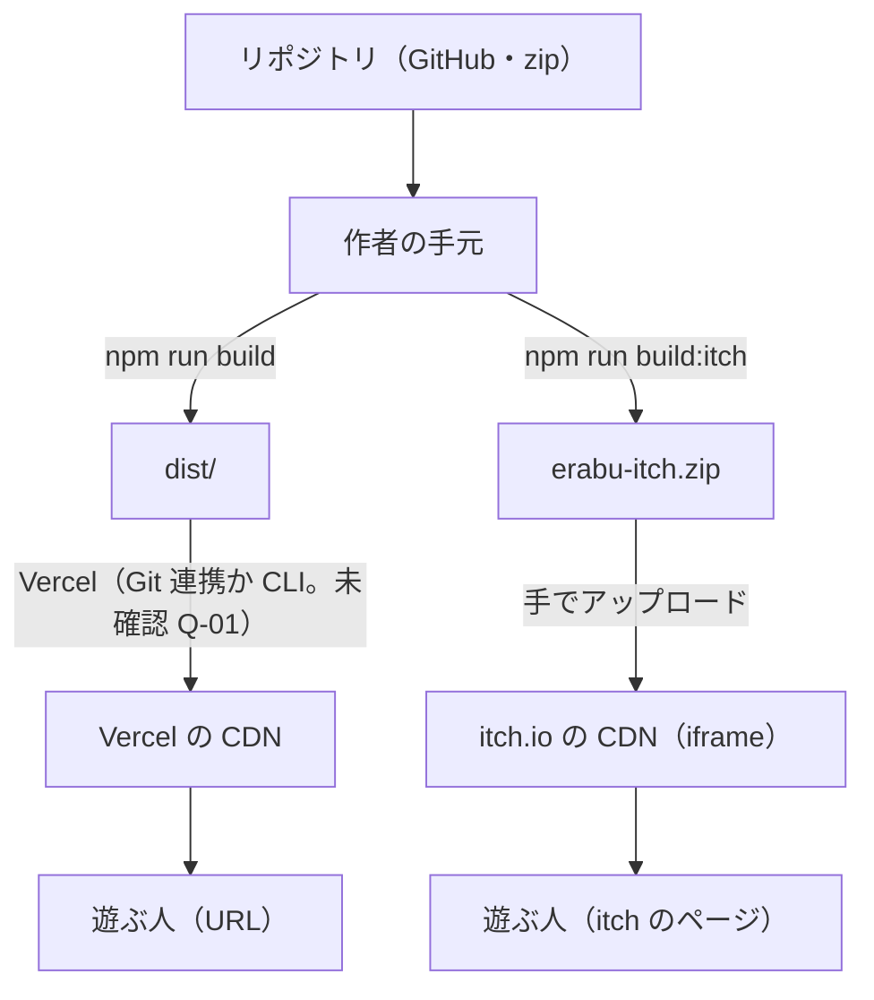
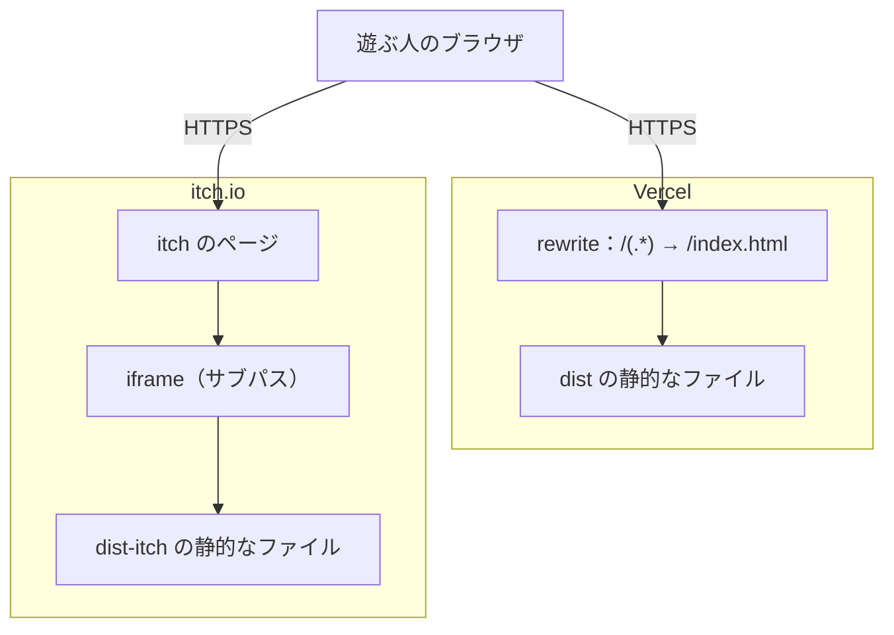
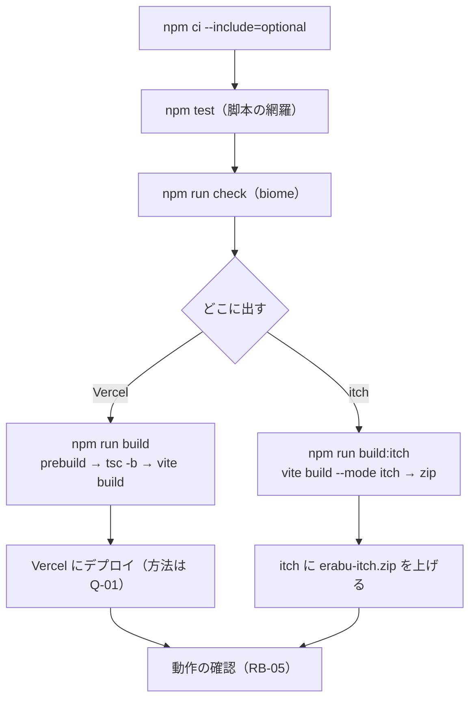
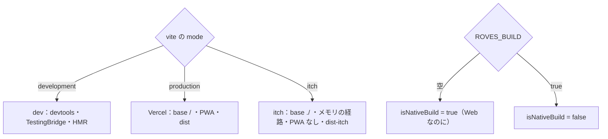
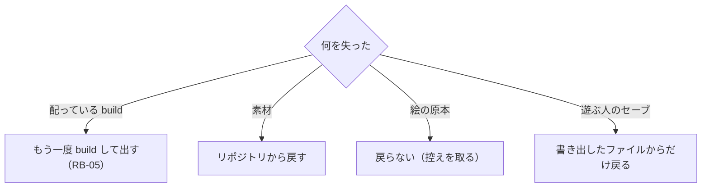

> [erabu-vn『二枚の紙』Repository Intelligence](README.md) の一部。基準は 2026-11-09 の zip（README の source）で、`path:line` はその時点の行。

# 50 Infrastructure

## 基盤の全体像

### Executive Summary

次のものは、どれもありません。

- IaC：Terraform・CloudFormation・CDK
- コンテナ：Kubernetes・Docker
- CI：GitHub Actions など

基盤は Vercel（静的なホスティング）と itch.io（HTML のゲームの CDN）の 2 つで、どちらも外のサービスの設定にあたります。リポジトリにある基盤の設定は、次の 3 つだけです。

- `vercel.json`：SPA の rewrite
- `vite.config.ts`：mode ごとの出力
- `.assetpack.ts`：素材の変換

### Scope

`vercel.json`・`vite.config.ts`・`.assetpack.ts`・`package.json` の scripts・`pwa-assets.config.js`・`.gitignore`

### Findings

| 項目 | Vercel 版 | itch 版 | 根拠 |
|---|---|---|---|
| build | `npm run build`（prebuild でアイコン → `tsc -b` → `vite build`） | `npm run build:itch`（`vite build --mode itch` → zip） | `package.json:11-15` |
| 出力 | `dist/` | `dist-itch/` → `erabu-itch.zip` | `vite.config.ts:126`、`package.json:13` |
| base | `/` | `./`（相対） | `vite.config.ts:27` |
| 経路 | ブラウザの history（URL が変わる） | メモリ（URL は変わらない） | `src/App.tsx:9-12` |
| PWA | 有る（manifest・Service Worker） | 無い | `vite.config.ts:59-60` |
| rewrite | 全部 → `/index.html` | （itch の側。不要） | `vercel.json:1-3` |
| 型の検査 | `tsc -b` と vite-plugin-checker | `tsc -b` は無い。vite-plugin-checker（`tsconfig.app.json`）は build でも走る（plugin の既定。Inferred） | `package.json:11`、`package.json:13`、`vite.config.ts:30-34` |
| 素材 | AssetPack（`src/assets` → `public/assets`） | 同じ | `vite.config.ts:147-176` |
| 出した日 | まだ（P4） | まだ（P4） | `README.md:26` |

- **stateful なもの**：サーバーの側にはありません。遊ぶ人のデータは、遊ぶ人のブラウザにだけあります（[データのモデル](30-data.md#データのモデル)）。サーバーの側でバックアップするものは、build の成果物とリポジトリだけです。
- **秘密の注入**：build にも実行時にも、秘密はありません。`ROVES_BUILD` は秘密ではなく、build の印です（`vite.config.ts:123`）。

### Diagrams

### Risks and Gaps

関係するリスク（中身・根拠・手当ては [リスクの台帳](70-reliability.md#リスクの台帳全部)）：

- **R-10**（Medium）依存の "latest" 指定と、Vercel の入れ方が決まっていない
- **R-11**（Medium）CI が無く、test・lint・型の検査は手で走らせるだけ
- **R-08**（Low）isNativeBuild の向きが逆で、Web 版にネイティブ向けの素材の設定が付く
- **R-09**（Low）PWA の precache に絵と音が入っていない可能性がある
- **R-20**（Low）build:itch が POSIX のコマンドに頼っている
- **R-25**（Low）絵の原本が repo に無く、同じ絵を作り直せない
- **R-28**（Low）更新したあとも、Service Worker が前の版を出し続けうる

### Open Questions

関係する未確認の事項（確かめ方は [未確認の事項](99-evidence-and-questions.md#未確認の事項全部)）：

- **Q-01**（High）Vercel の本番のプロジェクト（URL・独自ドメイン・Build/Install Command・Node の版）はもうあるか
- **Q-02**（Medium）itch.io のページの設定（Embed のサイズ・全画面ボタン・itch のアプリで遊べるか）
- **Q-12**（Medium）Vercel の build で prebuild（pwa-assets-generator の sharp）と optional の依存が入るか

### Evidence Index

| Claim | Evidence | Confidence |
|---|---|---|
| mode ごとに出力と base が違う | `vite.config.ts:27`、`vite.config.ts:126` | Confirmed |
| itch では PWA を切る | `vite.config.ts:60` | Confirmed |
| P4 はまだ | `README.md:26` | Confirmed |

## ネットワークと公開の範囲

### Executive Summary

公開するのは静的なファイルだけです。private な部品・subnet・WAF・load balancer はありません。外に出る通信は、実行時にはほぼありません（[C4 Context（システムの境界）](10-architecture.md#c4-contextシステムの境界)）。気を付けることは 2 つです。

- Vercel の応答にセキュリティのヘッダーが無い（R-19）
- itch の iframe の中での振る舞い（URL・history・オフライン）

### Scope

`vercel.json`・`vite.config.ts`（base・PWA）・`index.html`・`public/robots.txt`・`src/lib/hooks/navigation-hooks.ts`

### Findings

| 項目 | 今の形 | 根拠 | 確度 |
|---|---|---|---|
| 公開の範囲 | `dist` の全部（js・css・html・public/assets・ink-json・アイコン・robots.txt） | `vite.config.ts:126` | Confirmed |
| 検索エンジン | `robots.txt` は全部を許可 | `public/robots.txt`（`Allow: /`） | Confirmed |
| rewrite | 全部の path → `/index.html`（無い素材の path も index.html を返す。素材の 404 が HTML になる。Inferred） | `vercel.json:1-3` | Confirmed／Inferred |
| ヘッダー | 指定なし（Vercel の既定） | `vercel.json:1-3` | Confirmed |
| 外部のオリジン | 実行時：無い（`raw.githubusercontent.com` は SW の設定にあるだけ） | `vite.config.ts:22`、`vite.config.ts:91-107` | Confirmed |
| iframe（itch） | 相対の base。経路はメモリ。`history.pushState` と popstate の打ち消しを iframe の中では止める | `vite.config.ts:27`、`src/App.tsx:9-12`、`src/lib/hooks/navigation-hooks.ts:51-52`、`src/lib/hooks/navigation-hooks.ts:63-66` | Confirmed |
| 素材の根 | `new URL(BASE_URL, document.baseURI)`。iframe のサブパスでも、そこから素材を引く | `src/lib/utils/assets-utility.ts:14-17` | Confirmed |
| ink の JSON | bundle に埋め込む。`/ink-json/` の絶対パスは開発の翻訳ダウンロードだけが使う | X-001、`src/assets/ink-manifest.gen.json:1-3` | Corroborated |
| PWA の start_url | `/`（Vercel の根に置く前提。サブパスに置くと合わない） | `vite.config.ts:69` | Confirmed |

### Diagrams

### Risks and Gaps

関係するリスク（中身・根拠・手当ては [リスクの台帳](70-reliability.md#リスクの台帳全部)）：

- **R-01**（Medium）通信が切れると、全画面のオフライン表示でゲームを止める
- **R-09**（Low）PWA の precache に絵と音が入っていない可能性がある
- **R-19**（Low）Vercel の応答にセキュリティのヘッダーが無い

- Vercel の rewrite が素材の path にまで効くので、無い素材を引くと 404 ではなく index.html（200）が返ります。Pixi の読み込みは、画像として読めずに失敗します。原因が「無い素材」だと気付きにくくなります（Inferred）。素材の漏れは test が見ます（`tests/story.test.ts:157-187`）。

### Open Questions

関係する未確認の事項（確かめ方は [未確認の事項](99-evidence-and-questions.md#未確認の事項全部)）：

- **Q-01**（High）Vercel の本番のプロジェクト（URL・独自ドメイン・Build/Install Command・Node の版）はもうあるか
- **Q-02**（Medium）itch.io のページの設定（Embed のサイズ・全画面ボタン・itch のアプリで遊べるか）

### Evidence Index

| Claim | Evidence | Confidence |
|---|---|---|
| iframe の中では history に触らない | `src/lib/hooks/navigation-hooks.ts:63-66` | Confirmed |
| 素材の根を BASE_URL から決める | `src/lib/utils/assets-utility.ts:14-17` | Confirmed |

## build と配る経路（デプロイのパイプライン）

### Executive Summary

パイプラインは自動になっていません。作者の手元で `npm ci` → `npm test` → `npm run build`（または `build:itch`）と走らせ、それを Vercel か itch に上げます。テンプレにあった `release.yml`（Roves でタグから作る）は外してあります（`README.md:35`）。それなのに、`AGENTS.md` には残っています（R-13）。ロールバックの仕組みは、リポジトリにはありません。

### Scope

`package.json` の scripts、README の「動かす」、vite.config の build。

### Findings

#### build の中で起きること（`npm run build`）

| 順番 | 何が | 根拠 |
|---|---|---|
| 1 | `prebuild`：`pwa-assets-generator` が `public/icon.png` から favicon と PWA のアイコンを作る | `package.json:14-15`、`pwa-assets.config.js` |
| 2 | `tsc -b`：型の検査（`tsconfig.app.json` と `tsconfig.node.json`） | `package.json:11`、`tsconfig.json` |
| 3 | `vite build`：plugin が順に走る | `vite.config.ts:28-112` |
| 3a | AssetPack：`src/assets` → `public/assets` と `manifest.gen.json` | `vite.config.ts:160-167` |
| 3b | pixi-vn の plugin：`pixi-vn.keys.gen.ts`・`pixi-vn.worker.gen.ts` | `vite.config.ts:39-53` |
| 3c | ink の plugin：`ink/*.ink` → `public/ink-json/*.gen.json`。bundle にも埋め込む | `vite.config.ts:54-58`、X-001 |
| 3d | TanStack Router：`routeTree.gen.ts` | `vite.config.ts:36` |
| 3e | PWA：manifest と Service Worker | `vite.config.ts:59-108` |
| 3f | chunk を分ける（pixi.js・pixi-vn・motion・tone など） | `vite.config.ts:129-141` |

#### 環境を上げていく順番

| 段 | 何を | 根拠 |
|---|---|---|
| 手元 | `npm run dev`（http://localhost:5173）・`npm run preview` | `README.md:14`、`package.json:10` |
| 検査 | `npm test`・`npm run check`（biome） | `package.json:17`、`package.json:20` |
| 本番 | Vercel の別プロジェクトと itch.io（P4、まだ） | `README.md:26` |

Preview の環境（Vercel の Preview Deployments）を使うかどうかは、決まっていません（Q-01）。

#### ロールバック

- リポジトリの中には、ロールバックの手順も仕組みもありません。
- Vercel：前の deployment に戻す機能が Vercel にある、と推定しています（Inferred。製品の機能。この project で使えるかは Q-01）。
- itch：前の zip を上げ直します。前の zip は自分で取っておく必要があります（`.gitignore:17-18` で erabu-itch.zip は ignore）。
- セーブの互換を壊す更新（R-05）は、ロールバックしても、新しい版で作ったセーブが古い版で読めるとは限りません（Inferred）。
- IndexedDB の版を上げた更新から戻すと、その版で遊んだ人は起動でエラー画面になります（VersionError → `gameDB.init` の reject。`src/lib/utils/db-utility.ts:28-31`。Inferred）。
- SW の登録・更新のコードが無いので、vite-plugin-pwa の既定のまま動きます。出したあとも、前の版が出続けることがあります（R-28）。

### Diagrams

### Risks and Gaps

関係するリスク（中身・根拠・手当ては [リスクの台帳](70-reliability.md#リスクの台帳全部)）：

- **R-10**（Medium）依存の "latest" 指定と、Vercel の入れ方が決まっていない
- **R-11**（Medium）CI が無く、test・lint・型の検査は手で走らせるだけ
- **R-13**（Low）AGENTS.md が今の構成と合わない（release.yml・.vscode・Roves で配る）
- **R-20**（Low）build:itch が POSIX のコマンドに頼っている

- itch 版は `tsc -b` を通りません（`package.json:13`）。vite-plugin-checker が `tsconfig.app.json`（`src/` だけ）を検査します（`vite.config.ts:30-34`。build でも走るのは plugin の既定。Inferred）。`vite.config.ts` 自身の型（`tsconfig.node.json`）は、itch 版だけを出すと検査されません。

### Open Questions

関係する未確認の事項（確かめ方は [未確認の事項](99-evidence-and-questions.md#未確認の事項全部)）：

- **Q-01**（High）Vercel の本番のプロジェクト（URL・独自ドメイン・Build/Install Command・Node の版）はもうあるか
- **Q-12**（Medium）Vercel の build で prebuild（pwa-assets-generator の sharp）と optional の依存が入るか

### Evidence Index

| Claim | Evidence | Confidence |
|---|---|---|
| build の順番 | `package.json:11-15` | Confirmed |
| release.yml は外した | `README.md:35` | Confirmed |
| AGENTS.md は release.yml を前提にしている | `AGENTS.md:80` | Confirmed |
| erabu-itch.zip は ignore | `.gitignore:17-18` | Confirmed |

## 環境ごとの違い

### Executive Summary

環境は 5 つあります。開発の dev・手元の preview・Vercel・itch と、今は使っていない Roves です。違いを決めるものは 3 つです。

- Vite の `mode`（development・production・itch）
- `import.meta.env.DEV`・`PROD`
- `ROVES_BUILD`

### Scope

`mode`・`import.meta.env`・`ROVES_BUILD`・`isRovesAvailable()` で分かれる所を、全部。

### Findings

| 違い | dev（`npm run dev`） | preview | Vercel | itch | Roves | 根拠 |
|---|---|---|---|---|---|---|
| base | `/` | `/` | `/` | `./` | `/`（Inferred） | `vite.config.ts:27` |
| 経路 | browser history | 同じ | 同じ | メモリ | 同じ | `src/App.tsx:9-12` |
| PWA | 有る（dev の SW は既定では切れている。Inferred） | 有る | 有る | 無い | 有る | `vite.config.ts:60` |
| TanStack Devtools | 有る | 無い | 無い | 無い | 無い | `vite.config.ts:35`、`src/routes/__root.tsx:20` |
| TestingBridge | 有る | 無い | 無い | 無い | 無い | `src/components/providers/root-provider.tsx:25` |
| 翻訳のダウンロード | 有る | 無い | 無い | 無い | 無い | `src/components/menus/settings/system-controls.tsx:187` |
| ink の HMR | 有る | 無い | 無い | 無い | 無い | X-001 |
| AssetPack | watch | 1 回 | 1 回 | 1 回 | 1 回（ROVES_BUILD で設定が変わる） | `vite.config.ts:160-167`、`.assetpack.ts:6` |
| AssetPack の isNativeBuild | true | true | true | true | false（逆。R-08） | `.assetpack.ts:6` |
| セーブの置き場 | IndexedDB | 同じ | 同じ | 同じ（itch のオリジンで別） | Roves の saves | `src/lib/utils/save-utility.ts:33-39` |
| 終了ボタン | 無い | 無い | 無い | 無い | 有る | `src/lib/hooks/quit-hooks.ts:11-20` |
| 戻るの打ち消し | 有る | 有る | 有る | 無い（iframe） | 有る（Inferred） | `src/lib/hooks/navigation-hooks.ts:51-52` |
| 出力 | — | dist | dist | dist-itch | dist（Inferred） | `vite.config.ts:126` |

### Diagrams

### Risks and Gaps

関係するリスク（中身・根拠・手当ては [リスクの台帳](70-reliability.md#リスクの台帳全部)）：

- **R-08**（Low）isNativeBuild の向きが逆で、Web 版にネイティブ向けの素材の設定が付く

### Open Questions

関係する未確認の事項（確かめ方は [未確認の事項](99-evidence-and-questions.md#未確認の事項全部)）：

- **Q-05**（Low）isNativeBuild = !ROVES_BUILD は意図どおりか（テンプレの元でも同じか）

### Evidence Index

| Claim | Evidence | Confidence |
|---|---|---|
| devtools は development の mode だけ | `vite.config.ts:35` | Confirmed |
| TestingBridge は DEV だけ | `src/components/providers/root-provider.tsx:25` | Confirmed |
| isNativeBuild = !ROVES_BUILD | `.assetpack.ts:6` | Confirmed |

## 復旧の考え方（RTO・RPO の根拠）

### Executive Summary

サーバーの側に stateful なものが無いので、作者の側で守るものは 2 つだけです。

- リポジトリ（ソースと素材）
- 配っている build

multi-AZ や multi-region は、Vercel と itch の CDN 任せです（このリポジトリでは何も決めていない）。遊ぶ人のデータは遊ぶ人のブラウザにあり、作者の側からは戻せません。RTO と RPO の目標は、どこにも書かれていません。

### Scope

何を失うと、どう戻すか。

### Findings

| 失うもの | 戻し方 | 戻るまで（推定） | 失うデータ | 根拠 | 確度 |
|---|---|---|---|---|---|
| Vercel の deployment | もう一度 build して出す（Git 連携ならもう一度 deploy） | build の時間（数分。Inferred） | 無い | `package.json:11` | Inferred |
| itch のページの zip | 手元で `build:itch` して上げ直す | 数分 | 無い | `package.json:13` | Inferred |
| リポジトリ | GitHub と zip（この調査の zip もその 1 つ） | — | 最後の push のあと | — | Inferred |
| 絵の原本 | 無い（repo の外にあり、生成は毎回違う） | 戻らない | 原本の全部 | `scripts/art/gen_art.py:2-7`、`README.md:40` | Confirmed（R-25） |
| `src/assets` の素材 | リポジトリから戻す（`.gitignore` の `!` で追っている） | すぐ | 無い | `.gitignore:10-13` | Confirmed |
| 遊ぶ人のセーブ（ブラウザ） | 作者の側からは戻せない。遊ぶ人がファイルに書き出しておけば戻せる | — | 書き出していない分 | `src/lib/utils/save-utility.ts:86-125` | Confirmed |
| auto-exit のセーブ | 壊れたら消すしかない（RB-01） | すぐ | 最後に隠したあとの分 | `src/lib/utils/save-utility.ts:212-230` | Confirmed |

**RPO（遊ぶ人のデータ）**：

- 手動とクイックのセーブ：最後にセーブした所
- 自動セーブ：最後にタブを隠した所

**RTO（配る側）**：

- もう一度 build する時間
- 目標の値は決まっていない（Q-01）

### Diagrams

### Risks and Gaps

関係するリスク（中身・根拠・手当ては [リスクの台帳](70-reliability.md#リスクの台帳全部)）：

- **R-05**（Medium）セーブに版の確かめが無く、更新のあとに古いセーブを戻すと壊れうる
- **R-25**（Low）絵の原本が repo に無く、同じ絵を作り直せない

### Open Questions

関係する未確認の事項（確かめ方は [未確認の事項](99-evidence-and-questions.md#未確認の事項全部)）：

- **Q-01**（High）Vercel の本番のプロジェクト（URL・独自ドメイン・Build/Install Command・Node の版）はもうあるか

### Evidence Index

| Claim | Evidence | Confidence |
|---|---|---|
| 絵の原本は repo に置かない | `scripts/art/gen_art.py:2`、`README.md:40` | Confirmed |
| 素材は git で追う | `.gitignore:10-13` | Confirmed |
