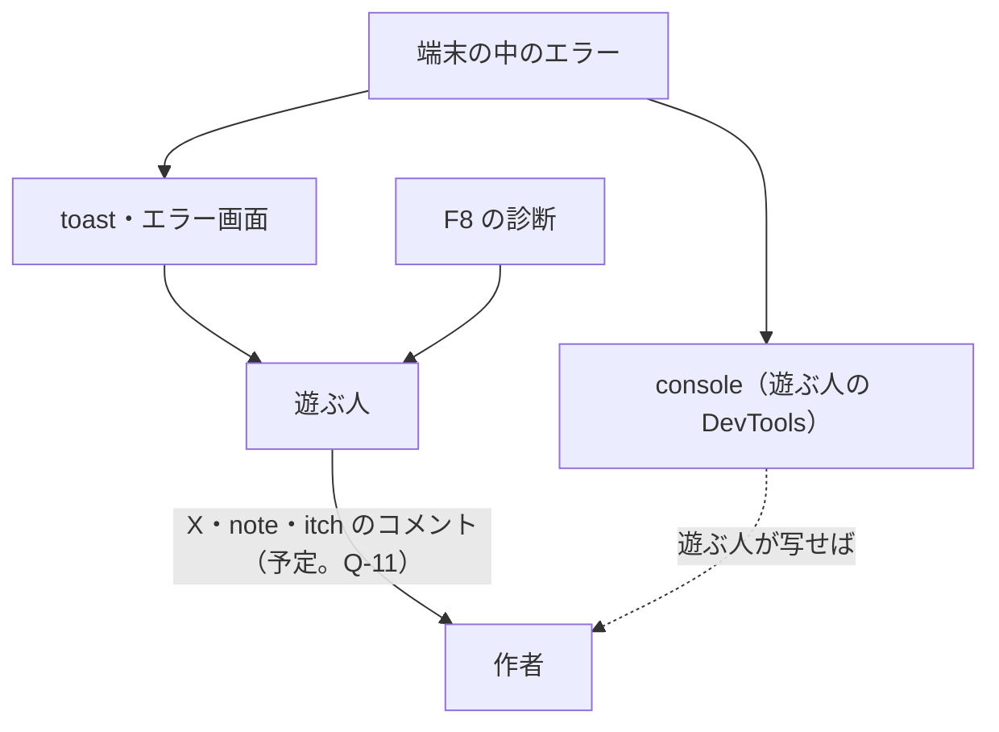

> [erabu-vn『二枚の紙』Repository Intelligence](README.md) の一部。基準は 2026-11-09 の zip（README の source）で、`path:line` はその時点の行。

# 60 Operations（観測）

## 観測できる所の地図

### Executive Summary

作者の側から見えるテレメトリーはありません。

- 無いもの：structured log・metric・trace・dashboard・alert・SLO・error tracking・analytics
- 見えるもの：遊ぶ人の手元の console と toast、それに診断の画面（F8）

障害を知る手段は、遊ぶ人からの報告だけです。報告の質を上げる道具として、診断のレポート（テキスト・JSON・クリップボード）があります。

### Scope

`console.*`・`toast.*`・診断の画面・Vercel と itch の側の観測（リポジトリの外。Unknown）。

### Findings

#### 主な流れごとの観測の可否

| 流れ | 遊ぶ人に見える | 遊ぶ人の console | 作者に届く | 根拠 |
|---|---|---|---|---|
| 起動 | スピナー → タイトル。失敗するとエラー画面 | loader の例外 | 届かない | `src/routes/__root.tsx:24-42` |
| 進む・戻る・選ぶ | 台詞が変わる。失敗しても何も出ない | `console.error(e)` | 届かない | `src/lib/hooks/narration-hooks.ts:54-61` |
| step の中のエラー | canvas の描画と toast | `Error occurred` | 届かない | `src/main.tsx:57-61` |
| セーブ・ロード・削除 | toast（保存中 → 成功か失敗） | 失敗の詳細 | 届かない | `src/lib/hooks/save-hooks.tsx:98-108` |
| IndexedDB | 失敗すると toast が終わらない（R-04） | `Error opening indexDB` など | 届かない | `src/lib/utils/db-utility.ts:28-31` |
| オフライン | 全画面の表示 | — | 届かない | `src/components/modals/error-allerts.tsx:14-41` |
| 端末の情報 | 診断の画面（F8） | — | 遊ぶ人が写して送れば届く | `src/lib/utils/device-diagnostics-utility.ts:439-534` |
| 配る側 | — | — | Vercel の Analytics・ログ、itch の閲覧数（使うかは Unknown） | — |

#### 診断のレポートの中身（`buildDiagnosticsReportText`）

次のものが入ります（`src/lib/utils/device-diagnostics-utility.ts:439-516`）。

- ゲームの版、PixiJS・Pixi'VN・Tone・Motion の版
- UA・platform・engine
- Roves の版（殻の中だけ）
- WebGL1/2・ハードウェアの加速・GPU の名前・Mesa・最大のテクスチャ・拡張
- 解像度・DPR・FPS
- JS heap
- タッチ・端末のメモリ・回線の種類・向き
- Audio・Gamepad・Clipboard・Fullscreen・LocalStorage・IndexedDB の有無

**入っていないもの**：

- ゲームの状態（今の label・step）
- 最後のエラー
- セーブの数と容量
- auto_exit_save の有無

障害の切り分けには、これらがいちばん欲しい情報です（[観測の足りない所](#観測の足りない所)）。

### Diagrams

### Risks and Gaps

関係するリスク（中身・根拠・手当ては [リスクの台帳](70-reliability.md#リスクの台帳全部)）：

- **R-12**（Medium）出したあと、遊ぶ人の環境で起きたエラーが作者に届かない

### Open Questions

関係する未確認の事項（確かめ方は [未確認の事項](99-evidence-and-questions.md#未確認の事項全部)）：

- **Q-11**（Medium）出したあと、遊ぶ人からの不具合の報告を誰がどこで受けるか

### Evidence Index

| Claim | Evidence | Confidence |
|---|---|---|
| エラーは console と toast だけ | `src/main.tsx:57-61` | Confirmed |
| 診断はテキスト・JSON・クリップボード | `src/lib/utils/device-diagnostics-utility.ts:439-534`、`src/components/menus/settings/menus/diagnostics.tsx:75` | Confirmed |

## ログの一覧（console）

### Executive Summary

ログは、すべてブラウザの console に出る自由な文です。構造（JSON）・request ID・相関の ID はありません。PII やトークンがログに漏れる恐れは見つかりませんでした。console に出すのは、例外のオブジェクトと決まった文だけです。

### Scope

`console.log`・`console.warn`・`console.error`・`console.info`・`console.debug` を grep で全部拾った（`src/components/ui/` を除く。28 か所）。

### Findings

| 文 | レベル | 出る所 | いつ | 根拠 |
|---|---|---|---|---|
| `Error occurred` ＋ error | error | main.tsx | step の中のエラー | `src/main.tsx:60` |
| `Error opening indexDB` ＋ event | error | db-utility | open の失敗（init・getRow・getList） | `src/lib/utils/db-utility.ts:29`、`src/lib/utils/db-utility.ts:88`、`src/lib/utils/db-utility.ts:168` |
| `Object store rescues does not exist` | error | db-utility | putRow で store が無い（文言はテンプレのまま） | `src/lib/utils/db-utility.ts:43` |
| `Error adding save data to indexDB` ＋ event | error | db-utility | put の失敗・open の失敗 | `src/lib/utils/db-utility.ts:53`、`src/lib/utils/db-utility.ts:58` |
| `Error getting save data from indexDB` ＋ event | error | db-utility | get・cursor の失敗 | `src/lib/utils/db-utility.ts:83`、`src/lib/utils/db-utility.ts:163` |
| `Error deleting save data from indexDB` ＋ event | error | db-utility | delete の失敗 | `src/lib/utils/db-utility.ts:106`、`src/lib/utils/db-utility.ts:111` |
| （例外のオブジェクト） | error | narration-hooks | 進む・戻る・選ぶ・jump・call の失敗 | `src/lib/hooks/narration-hooks.ts:56`、`src/lib/hooks/narration-hooks.ts:60`、`src/lib/hooks/narration-hooks.ts:76`、`src/lib/hooks/narration-hooks.ts:92`、`src/lib/hooks/narration-hooks.ts:121`、`src/lib/hooks/narration-hooks.ts:140` |
| （例外のオブジェクト） | error | save-hooks・hotkeys・quick-tools・main-menu | セーブ・ロード・削除の失敗 | `src/lib/hooks/save-hooks.tsx:43`、`src/lib/hooks/save-hooks.tsx:69`、`src/lib/hooks/save-hooks.tsx:106`、`src/lib/hooks/save-hooks.tsx:149`、`src/lib/hooks/hotkeys-hooks.ts:106`、`src/components/quick-tools.tsx:149`、`src/components/menus/main-menu.tsx:246` |
| （例外のオブジェクト） | error | alert-dialog-provider | 確認ダイアログの onConfirm が投げた | `src/components/providers/alert-dialog-provider.tsx:112` |
| `Can't save on home page` | log | hotkeys | タイトルで F5 | `src/lib/hooks/hotkeys-hooks.ts:72` |
| `No save to load` | log | hotkeys | セーブが無いのに F9 | `src/lib/hooks/hotkeys-hooks.ts:88` |
| `Failed to create UI layer for minigame` | error | minigame-hooks（使っていない） | — | `src/lib/hooks/minigame-hooks.ts:33` |

#### PII・トークンの漏れ

- 漏れるものはありません。セーブの名前（遊ぶ人が入れる文字列）も、ログには出しません。
- 診断のレポートには UA と GPU の名前が入ります。外に出るのは遊ぶ人が自分で写したときだけで、ログには出ません。

### Diagrams

（なし）

### Risks and Gaps

- 読む人が「どの操作で」「どの label で」起きたかを知る手がかりが、ログにありません（[観測の足りない所](#観測の足りない所)）。

### Open Questions

（なし）

### Evidence Index

上の表の根拠の列を見てください。

## metric と alert の一覧

### Executive Summary

metric・alert・SLO・SLI は、リポジトリの中にはありません。OpenTelemetry・Prometheus・CloudWatch・Datadog・Sentry も使っていません（package.json に無い）。端末の中で測っているものは、診断の画面の FPS と JS heap だけです。これは画面に出すだけで、送りません。

### Scope

`package.json` の依存と、`src/` の測る処理。

### Findings

| 測るもの | どこで | 送り先 | 根拠 |
|---|---|---|---|
| FPS | `canvas.app.ticker.FPS`（診断を開いている間、1 秒ごと） | 画面だけ | `src/lib/utils/device-diagnostics-utility.ts:366-372`、`src/lib/hooks/device-diagnostics-hooks.ts:75-81` |
| JS heap | `performance.memory`（Chromium だけ） | 画面だけ | `src/lib/utils/device-diagnostics-utility.ts:354-364` |
| alert | 無い | — | — |
| SLO | 無い | — | — |

#### 出したあとに置くと良いもの（提案。存在はしない）

コードを足さなくても得られるもの：

- Vercel の側：deployment の成否
- itch の側：閲覧数と遊んだ数

（製品の機能。使えるかは Q-01・Q-02）

コードを足すと得られるもの（[観測の足りない所](#観測の足りない所)）：

- エラーの件数
- 起動に失敗した数
- エンドに届いた数

### Diagrams

（なし）

### Risks and Gaps

関係するリスク（中身・根拠・手当ては [リスクの台帳](70-reliability.md#リスクの台帳全部)）：

- **R-12**（Medium）出したあと、遊ぶ人の環境で起きたエラーが作者に届かない

### Open Questions

関係する未確認の事項（確かめ方は [未確認の事項](99-evidence-and-questions.md#未確認の事項全部)）：

- **Q-01**（High）Vercel の本番のプロジェクト（URL・独自ドメイン・Build/Install Command・Node の版）はもうあるか
- **Q-02**（Medium）itch.io のページの設定（Embed のサイズ・全画面ボタン・itch のアプリで遊べるか）
- **Q-11**（Medium）出したあと、遊ぶ人からの不具合の報告を誰がどこで受けるか

### Evidence Index

| Claim | Evidence | Confidence |
|---|---|---|
| FPS は ticker から読む | `src/lib/utils/device-diagnostics-utility.ts:366-372` | Confirmed |

## 観測の足りない所

### Executive Summary

いちばん足りないのは、遊ぶ人から報告を受けたときに「どこで止まったか」が分からないことです。送信の仕組みを足さなくても、診断のレポートにゲームの状態と最後のエラーを足すだけで、切り分けはずっと楽になります。送信の仕組み（error tracking）を足すかどうかは、作者が決めることです。決めるときは、同意と個人情報、それに itch の規約を考えます。

### Scope

[観測できる所の地図](#観測できる所の地図) で見えなかった所。

### Findings

| # | 足りないもの | 困る場面 | 手当ての案（コードの変更が要る） | 重さ | 関連 |
|---|---|---|---|---|---|
| G-1 | 診断のレポートに、今の label・step・版・最後のエラーが無い | 「途中で進まなくなった」と言われても、どこか分からない | `buildDiagnosticsReportText` に `narration.stepCounter`・今の label・gameVersion・直近の console.error を足す | High | R-12 |
| G-2 | 作者に届くエラーが無い | 出したあとの不具合に気付けない | 送信の仕組み（例：error tracking）を足すか、報告の窓口と書式を決める | Medium | R-12、Q-11 |
| G-3 | 診断のレポートに、セーブと auto_exit_save の大きさが無い | 容量の問題（R-07）を切り分けられない | IndexedDB の件数と auto_exit_save の長さを足す | Low | R-07 |
| G-4 | 失敗しても何も出ない経路がある（goNext・ファイルの JSON） | 遊ぶ人が「何も起きない」と言う | toast を足す | Medium | R-06、[エラーの一覧](20-api-and-auth.md#エラーの一覧) |
| G-5 | オフライン表示が出た理由が分からない | 遊ぶ人が「通信の画面で止まる」と言う | 表示を外す（R-01）か、診断に `navigator.onLine` を足す | Medium | R-01 |
| G-6 | 配る側の観測を決めていない | build が壊れたことに、遊ぶ人より先に気付けない | CI（R-11）と、Vercel の deployment の通知 | Medium | R-11 |

#### 遊ぶ人の端末の中で、今すぐ確かめられること

コードを変えずにできること。runbook で使います。

- DevTools の Console：上の [ログの一覧（console）](#ログの一覧console) の文
- DevTools の Application → Local Storage：`auto_exit_save` と設定の鍵（[データの持ち主（誰が読み、誰が書くか）](30-data.md#データの持ち主誰が読み誰が書くか)）
- DevTools の Application → IndexedDB → `game_db` → `saves`
- F8：診断のレポート

### Diagrams

（なし）

### Risks and Gaps

関係するリスク（中身・根拠・手当ては [リスクの台帳](70-reliability.md#リスクの台帳全部)）：

- **R-01**（Medium）通信が切れると、全画面のオフライン表示でゲームを止める
- **R-12**（Medium）出したあと、遊ぶ人の環境で起きたエラーが作者に届かない
- **R-06**（Low）セーブファイルの読み込みで JSON を確かめない

### Open Questions

関係する未確認の事項（確かめ方は [未確認の事項](99-evidence-and-questions.md#未確認の事項全部)）：

- **Q-11**（Medium）出したあと、遊ぶ人からの不具合の報告を誰がどこで受けるか

### Evidence Index

| Claim | Evidence | Confidence |
|---|---|---|
| 診断にゲームの状態は入っていない | `src/lib/utils/device-diagnostics-utility.ts:439-516` | Confirmed |
