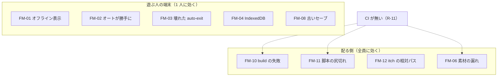
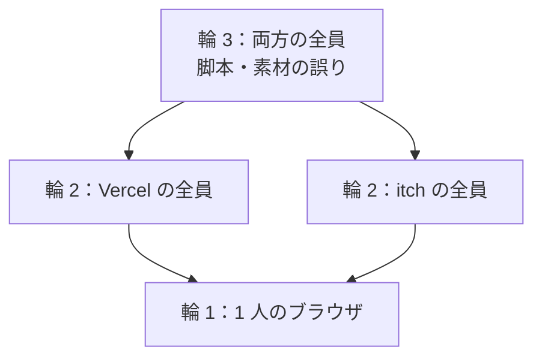

> [erabu-vn『二枚の紙』Repository Intelligence](README.md) の一部。基準は 2026-11-09 の zip（README の source）で、`path:line` はその時点の行。

# 70 Reliability

## 障害モードの分析（FMEA）

### Executive Summary

障害は、ほとんどが遊ぶ人の 1 台の端末の中で起きます。広がることはありませんが、作者からは見えません（[観測できる所の地図](60-operations.md#観測できる所の地図)）。重いのは次の 3 つです。

- **FM-01**：オフライン表示で止まる
- **FM-03**：壊れた auto-exit でエラー画面になる
- **FM-08**：更新のあとに古いセーブが壊れる

配る側の障害（FM-10〜12）は、全員に効きます。ただし、すべて build をやり直せば戻ります。

### Scope

- 方法：FMEA・依存先の障害・影響の範囲・retry の嵐と連鎖・graceful degradation
- 重点の項目：SPOF・timeout・無制限の retry・circuit breaker・poison message・cache stampede・枯渇・外部 API の劣化

### Findings

#### 障害モード

| ID | Failure mode | Trigger | User impact | Detection | Containment | Recovery | Evidence |
|---|---|---|---|---|---|---|---|
| FM-01 | オフライン表示で止まる | 端末が圏外・機内モード・PWA をオフラインで開く・itch のアプリ | 続きが遊べない（全画面を覆う）。素材がまだ手元に無い場面は、表示が無くても絵が出ない（Inferred） | 遊ぶ人の目だけ | 無い | 通信を戻して「再試行」 | `src/components/modals/error-allerts.tsx:14-21` |
| FM-02 | オート送りが勝手にオン | 設定画面でオンにしてから切り、読み直す | 文が勝手に進む | 遊ぶ人の目 | クイックツールで切れば、その回だけ止まる | 設定画面のスイッチでオン → オフ、では直らない。localStorage の鍵を消す（RB-03） | `src/lib/stores/auto-settings-store.ts:15-28` |
| FM-03 | 壊れた auto_exit_save | 書いている途中で閉じる・容量・手で書き換え | `/game/narration` の URL で開くとエラー画面。「つづきから」が押せない | 遊ぶ人の目・console | `/` から開けばタイトルは出る | localStorage の `auto_exit_save` を消す（RB-01） | `src/lib/utils/save-utility.ts:212-239` |
| FM-04 | IndexedDB が使えない | 起動のときから：プライベートブラウズ・ブラウザの設定。起動のあとで：容量など | 起動のときから使えなければ、/ でも root のエラー画面（ゲームは始まらない）。起動のあとなら、セーブの toast が終わらない | console の `Error opening indexDB`（F8 の「IndexedDB: Yes」は API があるかを見るだけで、開けるかは分からない） | 無い | 普通のウィンドウで開き直す（RB-01・RB-02） | `src/lib/utils/db-utility.ts:28-31`、`src/routes/__root.tsx:28`、`src/lib/utils/db-utility.ts:57-59`、`src/lib/utils/device-diagnostics-utility.ts:322` |
| FM-05 | セーブのファイルが壊れている | 手で直した・途中で切れた | 何も出ない | 無い | 今の状態は変わらない（Inferred） | 正しいファイルを選び直す | `src/lib/utils/save-utility.ts:109-118` |
| FM-06 | 素材が読めない | build の漏れ・名前の間違い | 背景や立ち絵が出ない。step の例外なら canvas の描画と toast | test（素材の網羅）・console | 文は進む（Inferred） | 素材を直して出し直す（RB-05） | `tests/story.test.ts:157-187`、`src/main.tsx:57-61` |
| FM-07 | 最初の背景が出ない | 最初の背景に `with fade` を付けた | 冒頭が真っ暗 | 目で見て（test は無い） | — | fade を外す | `README.md:33` |
| FM-08 | 古いセーブが新しい脚本と合わない | P4 のあとに ink を直す | 違う所から始まる・例外（Q-03） | 遊ぶ人の報告 | 無い | はじめから。互換の方針を決める | `src/lib/utils/save-utility.ts:128-130` |
| FM-09 | 音が鳴らない | ブラウザの自動再生の決まり・ミュートの保存 | BGM が無い | 遊ぶ人の目 | — | 画面を 1 回押す（ブラウザの決まり。Inferred）・音量の設定を見る（RB-03） | `src/main.tsx:32-36`、`src/lib/stores/master-sound-storage.ts:16-19` |
| FM-10 | Vercel の build の失敗 | 依存の版が上がる（latest）・optional（sharp）が入らない・型のエラー | 新しい版が出ない（前の版は残る。Inferred） | Vercel の通知（Q-01） | 前の deployment が生きている | 版を固定して build し直す（RB-05） | `package.json:31-34`、`package.json:14` |
| FM-11 | 脚本の経路が尻切れ | ink を直して END を落とした | 途中で何もできなくなる | `npm test`（CI は無い） | — | test を通して出し直す | `tests/story.test.ts:137-140` |
| FM-12 | itch の相対パスが壊れる | `--mode itch` を付けずに作った zip を上げる | 真っ白・素材が 404 | 目で見て | — | `npm run build:itch` で作り直す（RB-04） | `vite.config.ts:27`、`README.md:30` |
| FM-14 | 知らない query で止まる | 告知の link の utm_source・fbclid など | クリックしても進まない・音が止まる（Q-16） | 遊ぶ人の目 | 無い | query の無い URL で開き直す | `src/routes/__root.tsx:23`、`src/lib/stores/search-param-store.ts:17-19` |
| FM-13 | 端末のメモリ・GPU が足りない | 古いスマホ・ソフトの描画 | 遅い・落ちる | F8 の診断（ハードウェアの加速・GPU） | — | 画質は変えられない（設定が無い） | `src/lib/utils/device-diagnostics-utility.ts:155-233` |

#### 重点の項目の確認

| 項目 | 結果 | 根拠 |
|---|---|---|
| SPOF | 配る所（Vercel・itch）。それぞれ単独（Inferred：CDN の冗長は製品まかせ） | `vercel.json:1-3` |
| timeout の不在・不整合 | 実行時の外部のオリジンへの呼び出しが無いので、該当しない（同じオリジンの素材の読み込みは Pixi まかせ）。絵の生成のスクリプトだけ 290 秒 | `scripts/art/gen_art.py:51-53` |
| 無制限の retry | 無い（retry そのものが無い） | — |
| circuit breaker | 不要（外部への依存が無い） | — |
| poison message・DLQ・backlog | 該当しない（queue が無い） | — |
| cache stampede | 該当しない（サーバーが無い） | — |
| connection pool・thread・fd の枯渇 | 該当しない。端末の中ではメモリと localStorage の容量（R-07・R-17） | `src/lib/utils/save-utility.ts:27` |
| 外部 API の劣化 | 実行時は該当しない。OpenAI の劣化は、作る時だけに効く | `scripts/art/gen_art.py:81-92` |
| スキップの interval の重なり | 100ms ごとに goNext。前の continue が終わる前に次が来ることがある（Pixi'VN の側で直列にするかは Unknown） | `src/lib/hooks/narration-hooks.ts:305-310` |

### Diagrams

### Risks and Gaps

全体の一覧は [リスクの台帳（全部）](#リスクの台帳全部) にあります。

### Open Questions

関係する未確認の事項（確かめ方は [未確認の事項](99-evidence-and-questions.md#未確認の事項全部)）：

- **Q-03**（High）ink を直したあとに古いセーブを restoreGameState するとどうなるか
- **Q-09**（Medium）build した dist/sw.js の precache に、public/assets の webp・jpg・mp3 が入っているか
- **Q-12**（Medium）Vercel の build で prebuild（pwa-assets-generator の sharp）と optional の依存が入るか

### Evidence Index

上の表の Evidence の列を見てください。

## 影響の範囲（Blast Radius）

### Executive Summary

影響の範囲は 3 つの輪で考えます。

| 輪 | 範囲 | 例 |
|---|---|---|
| 1 | 1 人の 1 つのブラウザ | 端末の障害 |
| 2 | 1 つの配る所の全員 | Vercel か itch の片方 |
| 3 | 両方の全員 | 脚本か素材の誤り |

サーバーが無いので、遊ぶ人どうしで影響が伝わることはありません。

### Scope

[障害モードの分析（FMEA）](#障害モードの分析fmea) の FM-01〜13。

### Findings

| 輪 | 範囲 | 入る障害 | 抑え方 |
|---|---|---|---|
| 1 | 1 人・1 つのオリジン（Vercel と itch は別） | FM-01・02・03・04・05・09・13・14（14 は告知の link から来た人の全員になりうる） | runbook で、遊ぶ人に手当てを伝える（[runbook の一覧](90-runbooks.md#runbook-の一覧)） |
| 1' | 1 人・前の版のセーブを持つ人の全員 | FM-08 | 更新の前に互換を決める（[test とリリースの計画](80-change-impact.md#test-とリリースの計画)） |
| 2 | Vercel の全員 か itch の全員 | FM-10・12 | 出したあとすぐ確かめる（RB-05）。前の版に戻す |
| 3 | 両方の全員 | FM-06・07・11 | `npm test` を必ず走らせる。CI を足す（R-11） |

#### 依存先が止まったら

| 依存先 | 止まると | 影響の輪 |
|---|---|---|
| Vercel | Vercel 版が開けない（itch 版は動く） | 2 |
| itch.io | itch 版が開けない（Vercel 版は動く） | 2 |
| npm の registry | build できない（出ている版は動く） | 作者だけ |
| OpenAI の API | 絵を作り直せない（ゲームは動く） | 作者だけ |
| 遊ぶ人の通信 | オフライン表示で止まる（R-01） | 1 |

### Diagrams

### Risks and Gaps

関係するリスク（中身・根拠・手当ては [リスクの台帳](#リスクの台帳全部)）：

- **R-01**（Medium）通信が切れると、全画面のオフライン表示でゲームを止める
- **R-05**（Medium）セーブに版の確かめが無く、更新のあとに古いセーブを戻すと壊れうる
- **R-11**（Medium）CI が無く、test・lint・型の検査は手で走らせるだけ

### Open Questions

（なし）

### Evidence Index

[障害モードの分析（FMEA）](#障害モードの分析fmea) の Evidence の列と同じです。

## リスクの台帳（全部）

### Executive Summary

調べて見つけたリスクを、全部この 1 つの表に載せます。ほかの文書の表は、この台帳から抜き出したものです（`tools/data.py` の 1 か所から作る）。重さは次のように決めました。

| 重さ | 決め方 |
|---|---|
| High | 遊ぶ人がゲームを続けられない、かつ多くの人に起きやすい（今は該当なし。Q-16 で R-27 が確かめられたら High に上げる） |
| Medium | データが壊れる・戻れない、または出したあとに気付けない |
| Low | 不便・見た目・保守のしやすさ |

### Scope

全部の領域。数は次のとおりです。

（数は [根拠の索引（要約）](00-overview.md#根拠の索引要約) を見てください）

### Findings

<!-- BEGIN:risks -->
| ID | リスク | 領域 | 重さ | 確度 | 中身 | 手当て | 根拠 |
|---|---|---|---|---|---|---|---|
| R-01 | 通信が切れると、全画面のオフライン表示でゲームを止める | reliability | Medium | Confirmed | OfflineAllert が root に常にあり、navigator.onLine が false の間は z-120 で全画面を覆う（Confirmed）。外部のオリジンへの通信は無い。ただし同じオリジンからは、遊んでいる間にも素材（bg・senpai・audio の bundle）・経路の chunk・文言の JSON を読み込む。そのため、素材がもう手元にある場合（itch のアプリ、PWA の precache が効いている場合）は、この表示が無ければ遊び続けられたはずのところを止めてしまう。素材が手元に無い場合は、どのみち絵が出ない（Inferred。Q-09）。 | オフライン表示を外すか、閉じられる通知（toast）に変える。PWA の precache（R-09）と一緒に決める。 | `src/components/modals/error-allerts.tsx:14-21` `src/routes/__root.tsx:52-56` `src/lib/hooks/network-hooks.ts:8-34` `src/lib/utils/assets-utility.ts:21-25` |
| R-02 | オート送りを設定画面で切っても、読み直すとオンに戻る | data | Medium | Confirmed | toggleEnabled は "false" を書く。起動時は Boolean("false") === true になるので、設定画面のスイッチで一度オンにしてから切ると、次に開いたときにオート送りがオンになっている。クイックツールのトグル（setEnabled）は保存しないので、この 2 つの経路で振る舞いが違う。 | localStorage.getItem(...) === "true" で戻す。setEnabled も保存するかどうかを決めてそろえる。 | `src/lib/stores/auto-settings-store.ts:15-18` `src/lib/stores/auto-settings-store.ts:23-28` `src/lib/stores/auto-settings-store.ts:33-35` `src/components/menus/settings/dialogues-controls.tsx:66` `src/components/quick-tools.tsx:93` |
| R-03 | auto_exit_save が壊れていると、/ 以外の URL から開いたときにエラー画面になる | data | Medium | Confirmed | autoExit.load の JSON.parse は Promise の外にあり、root の loader から呼ばれる。壊れた JSON や途中で切れた JSON があると loader が例外を投げ、errorComponent が出る。peek() も同じで、最新のセーブの query がエラーになり、「つづきから」が押せなくなる。localStorage の auto_exit_save を消すと直る。エラー画面になるのは Vercel 版だけで、itch 版は経路がメモリなので、いつも / から始まる。壊れた鍵が残っている間に File 01（id 0）へセーブすると、行は書けているのに save() の getLast() → peek() が投げて「保存に失敗」と出る。restore が失敗した場合は、何も表示せずに Game.clear() して鍵を残すので、「つづきから」を押しても何も起きない。 | parse を try で囲み、失敗したら鍵を消して false を返す。runbook RB-01 に手で直す方法を書いた。 | `src/lib/utils/save-utility.ts:212-230` `src/lib/utils/save-utility.ts:233-239` `src/lib/utils/save-utility.ts:39-43` `src/App.tsx:9-12` `src/routes/__root.tsx:31-36` |
| R-04 | IndexedDB の失敗の経路で Promise が終わらない／例外が漏れる | data | Medium | Confirmed | putRow は store が無いとき reject() のあと return せずに transaction を作るので、onsuccess の中で例外になる。putRow と deleteRow は open の onerror で reject しないので、Promise が終わらない。すると toast.promise が「保存中」のまま残り、確認ダイアログの OK のボタンもロード中のまま押せない（キャンセルと Esc では閉じられる）。起動のときの gameDB.init は open の失敗で reject するので、最初から IndexedDB が開けない環境（プライベートブラウズなど）では、/ を含めて起動の時点で root のエラー画面になる。putRow と deleteRow の「終わらない」は、起動のあとで open が失敗したときに起きる（Inferred）。 | すべての失敗の経路で reject して return する。transaction.onerror と onabort も扱う。 | `src/lib/utils/db-utility.ts:42-47` `src/lib/utils/db-utility.ts:57-59` `src/lib/utils/db-utility.ts:110-112` `src/lib/utils/db-utility.ts:28-31` `src/routes/__root.tsx:28` `src/components/providers/alert-dialog-provider.tsx:69-74` |
| R-05 | セーブに版の確かめが無く、更新のあとに古いセーブを戻すと壊れうる | data | Medium | Inferred | gameVersion を記録しているのに、restore では見ていない。P4 のあとに ink を直すと、label の step の数や順番が変わる。古いセーブの step の位置がずれて、Pixi'VN 側でどうなるかは確かめていない（Q-03）。 | restore の前に gameVersion を比べて警告する。脚本を直す前にセーブの互換の方針を決める（82 の変更計画）。 | `src/lib/utils/save-utility.ts:10-19` `src/lib/utils/save-utility.ts:128-130` |
| R-10 | 依存の "latest" 指定と、Vercel の入れ方が決まっていない | infrastructure | Medium | Inferred | react-query・react-router・store・biome・router-plugin などが "latest" になっている。lockfile と npm ci を使えば固定されるが、vercel.json に installCommand が無い。Vercel が lockfile を外れて入れ直すと、知らないうちに版が上がる。README は npm ci --include=optional を前提にしている（sharp などの optional）。 | "latest" を lockfile の版に固定する。vercel.json に installCommand: "npm ci --include=optional" を書く。 | `package.json:31-34` `package.json:63-71` `vercel.json:1-3` `README.md:13` |
| R-11 | CI が無く、test・lint・型の検査は手で走らせるだけ | infrastructure | Medium | Confirmed | .github/ が無い（テンプレの release.yml も外した）。脚本を直しても、tests/story.test.ts（全経路が END で終わる・素材が揃っている・鍵が揃っている）が自動では走らない。Vercel の build（tsc -b）が型の検査だけはする（推定）。 | push のたびに npm ci → npm test → npm run check → npm run build を走らせる workflow を 1 本足す。 | `README.md:35` `package.json:11` `tests/story.test.ts:129-196` |
| R-12 | 出したあと、遊ぶ人の環境で起きたエラーが作者に届かない | observability | Medium | Confirmed | エラーは console.error と toast だけで、送る先が無い。診断画面（F8）で環境をテキストか JSON にして写せるので、遊ぶ人から報告を受けるときの材料にはなる。 | 出し方（X・note・itch のコメント）に「F8 の診断を貼ってください」と書く。要るなら送信の仕組みを足す（同意と個人情報を考える）。 | `src/main.tsx:57-61` `src/lib/utils/device-diagnostics-utility.ts:439-534` |
| R-27 | 知らない URL の query（utm_source など）が付くと、ゲームが進まなくなる | runtime | Medium | Inferred | validateSearch は URL の query を何でも SearchParams の store にまとめて入れ、setMany は鍵を消さない。語り・停止・ホットキーは「store のどれかの値が undefined でない」ことを「メニューが開いている」と見なす。X や note の link に付く utm_source・fbclid などが残ると、/game/narration でクリックしても進まず、音と canvas も止まる。store に残り続けるかは、TanStack Router が validateSearch をどう呼ぶかによる（Q-16）。README によると、出すときは X と note で知らせる予定。 | validateSearch で settings・settings_tab・history・saves だけを通す。「メニューが開いている」の判定も、この 4 つだけを見る。 | `src/routes/__root.tsx:23` `src/lib/stores/search-param-store.ts:17-19` `src/lib/hooks/narration-hooks.ts:34-40` `src/lib/hooks/pause-game-hooks.ts:27-30` `src/lib/hooks/hotkeys-hooks.ts:32-41` `README.md:26` |
| R-06 | セーブファイルの読み込みで JSON を確かめない | security | Low | Confirmed | JSON.parse が FileReader の onload の中で try に囲まれていない。壊れたファイルだと例外が外に漏れ、afterLoad が呼ばれないので画面に何も出ない。形も gameVersion も確かめずに restoreGameState に渡している。サーバーは無いので影響は手元のブラウザに限られる。 | parse を try で囲み、zod（依存にすでにある）で形を確かめてから restore する。 | `src/lib/utils/save-utility.ts:109-118` |
| R-07 | ページを閉じるときの自動セーブは、書き終わる保証が無い | data | Low | Inferred | beforeunload の中で、非同期の exportGameState を待ってから localStorage に書いている。タブを閉じるときは、書き終わる前に止まることがある。visibilitychange(hidden) でも書くので、ふつうはそちらで保存される。localStorage の容量を超えたときの QuotaExceededError も扱っていない。 | visibilitychange を主にする。setItem を try で囲む。auto_exit_save の大きさを測る（Q-15）。 | `src/lib/hooks/save-hooks.tsx:177-199` `src/lib/utils/save-utility.ts:203-209` |
| R-08 | isNativeBuild の向きが逆で、Web 版にネイティブ向けの素材の設定が付く | infrastructure | Low | Inferred | isNativeBuild = !ROVES_BUILD なので、ROVES_BUILD を付けない Vercel 版と itch 版で true になる。コメントには「ネイティブなら素材は手元にあるので帯域を気にしない」とあるのに、その設定（0.5x を作らない・WebP を q88）が Web 版に付いている。コードは確かめた。意図と逆かどうかは推定（Q-05）。 | テンプレの元（create-pixi-vn）と見比べて、向きを直すか名前を直す。 | `.assetpack.ts:6` `.assetpack.ts:94-99` |
| R-09 | PWA の precache に絵と音が入っていない可能性がある | infrastructure | Low | Inferred | workbox の設定は runtimeCaching（raw.githubusercontent.com）だけで、globPatterns を足していない。vite-plugin-pwa の既定（js/css/html）のままなら、public/assets の webp・jpg・mp3 はオフラインで出ない。R-01 のオフライン表示もあるので、今は気付かれにくい。 | build したあと dist/sw.js の precache の一覧を見る（Q-09）。要るなら globPatterns に webp/png/jpg/mp3 を足す。 | `vite.config.ts:22` `vite.config.ts:91-107` |
| R-13 | AGENTS.md が今の構成と合わない（release.yml・.vscode・Roves で配る） | docs | Low | Confirmed | AGENTS.md は .vscode/ と .github/workflows/release.yml があり、Roves で配る前提で書かれている。README は release.yml を外したと書き、zip にはどちらも無い。AI エージェントがこの指示に従ってタグを push しても、何も作られない。 | AGENTS.md の Distribution と VS Code の節を、Web と itch の今の形に直す。 | `AGENTS.md:42` `AGENTS.md:80` `README.md:35` |
| R-14 | 設定画面のキーの表示（Ctrl+K・Ctrl+H）と、登録しているキー（K・H）が違う | api | Low | Inferred | hotkey は修飾キーなしの "K" と "H"。画面には Ctrl+K と Ctrl+H と出る。ブラウザでは Ctrl+H は履歴、Ctrl+K は検索に取られやすい。@tanstack/hotkeys で "K" が Ctrl+K にも当たるかは確かめていない（Q-06）。 | 表示をコードに合わせる（K・H）。 | `src/lib/hooks/hotkeys-hooks.ts:189-199` `src/lib/hooks/hotkeys-hooks.ts:239-249` `src/components/menus/settings/quick-menus.tsx:54-57` `src/components/menus/settings/quick-menus.tsx:129-132` |
| R-15 | ホイールでの送りと戻しは、メニューを開いているかを見ない | runtime | Low | Inferred | goNext はメニューが開いていると何もしないが、useWheelActions は narration.continue と stepHistory.back を直に呼ぶ。#ui と #canvas の外（portal で出すダイアログなど）では無視するので、ふつうは当たらないと推定している。上で進み、下で戻る向きが意図どおりかも確かめていない（Q-07）。 | goNext と goBack を通すように直す。 | `src/lib/hooks/quick-tools-hooks.ts:41-66` `src/lib/hooks/narration-hooks.ts:39-40` |
| R-16 | IndexedDB の getList が limit のあとも最後まで歩く | data | Low | Confirmed | 「最新の 1 件」を取るたびに、saves の全部の行（スクショ入り）を cursor で歩く。66 枠ならほとんど気にならないが、無駄に読んでいる。 | limit に達したら cursor.continue() を呼ばない。 | `src/lib/utils/db-utility.ts:146-160` |
| R-17 | セーブ 1 件ごとに、全画面のスクショをそのまま入れる | data | Low | Inferred | image を渡さないと canvas.extractImage() の結果を入れる。1920x1080 の画像が手動 60 枠とクイック 6 枠に溜まる。ファイルへ書き出した JSON にも入る。 | 縮めた画像（サムネイル）を入れる。 | `src/lib/utils/save-utility.ts:27` `src/components/menus/save-menu/index.tsx:16-18` |
| R-18 | 台詞を allowHtml で描いている | security | Low | Confirmed | ink の文と翻訳の文を HTML として描く。今は文を書くのが作者だけなので危なくない。人に翻訳を頼むときや、外から文を読み込むようにしたときに、信頼の境界になる。 | HTML が要らなければ allowHtml を外す。翻訳を受け取るときに中身を確かめる。 | `src/components/screens/narration/narration-cards.tsx:123-136` |
| R-19 | Vercel の応答にセキュリティのヘッダーが無い | security | Low | Confirmed | vercel.json は rewrite だけ。CSP・X-Content-Type-Options・Permissions-Policy などを付けていない。静的なゲームで秘密も持たないので、影響は小さい。 | 出すときに headers を足すかどうかを決める（itch の iframe で動かすなら frame-ancestors に気を付ける）。 | `vercel.json:1-3` |
| R-20 | build:itch が POSIX のコマンドに頼っている | infrastructure | Low | Confirmed | rm -f と zip を使うので、Windows の PowerShell や cmd ではそのままでは動かない。WSL か Git Bash で走らせる。 | runbook RB-05 に「WSL で走らせる」と書いた。要るなら node のスクリプトにする。 | `package.json:13` |
| R-21 | label id の名前で bundle を裏で読み込もうとしている | runtime | Low | Unknown | onLoadingLabel が、label id（start・choice など）と同じ名前の bundle を読み込もうとする。bundle は audio・bg・images・senpai だけなので、何も起きないか警告が出る（Q-04）。bg は ink の show image のたびに読み込まれるので、場面が変わる最初の 1 回は遅れうる（推定）。 | 場面ごとの bundle を作るか、bg も起動時か start で lazyload する。 | `src/main.tsx:63` `src/pixi-vn.keys.gen.ts:72` |
| R-22 | ドキュメントの物差しと、実際の素材の数が合わない | docs | Low | Confirmed | README と骨子は「背景 3・表情 3」と書いている。実際の素材は、背景の画像が 9 枚（3 か所に夕方の版と掲示板の版を足したもの）、表情が 4 つ（neutral・smile・grin・concern）。場所の数としては 3 か所で合うが、読む人が迷う。 | 物差しの書き方を「場所 3（画像 9）・表情 3＋基本」のように直す。 | `README.md:7` `docs/story/outline.md:22` `src/pixi-vn.keys.gen.ts:72` |
| R-23 | タイトルへ戻るとセーブせずに状態を消す | runtime | Low | Confirmed | 確認のダイアログは出るが、Game.clear() のあとに保存はしない。auto_exit_save はページを隠したときに書いたものが残っていれば使えるが、確実ではない。意図した仕様と推定している。 | 確認の文に「セーブしていない所は消えます」と書くか、戻る前に auto-exit のセーブを書く。 | `src/components/menus/settings/quick-menus.tsx:94-103` |
| R-24 | エンドのあとも、前の auto_exit_save が「つづきから」に残る | runtime | Low | Inferred | onEnd は Game.clear() して / に戻るだけで、auto_exit_save を消さない。エンドまで読んだあとに「つづきから」を押すと、エンドの前の所から始まりうる。意図した仕様かは確かめていない（Q-08）。 | 意図を決める。消すなら onEnd で localStorage.removeItem("auto_exit_save") する。 | `src/main.tsx:52-55` `src/lib/utils/save-utility.ts:212-230` `src/components/menus/main-menu.tsx:236-252` |
| R-25 | 絵の原本が repo に無く、同じ絵を作り直せない | infrastructure | Low | Confirmed | gen_art.py は OpenAI の画像 API（gpt-image-2）を呼び、原本を --out に置く（repo には入れない）。生成は毎回違うので、src/assets の絵を失うと同じ絵には戻せない。今は git の履歴と zip が唯一の控え。 | 原本（PNG）を repo の外に控えておく。 | `scripts/art/gen_art.py:62-66` `README.md:40` |
| R-26 | RootProvider が描画のたびに Game.onNavigate を登録する | runtime | Low | Inferred | useEffect を通さずに描画の中で呼んでいる。上書きされるだけなら害は無いが、足されていくなら navigate が何度も呼ばれる。Pixi'VN の実装は見ていない。 | useEffect に移す。 | `src/components/providers/root-provider.tsx:11-13` |
| R-28 | 更新したあとも、Service Worker が前の版を出し続けうる | infrastructure | Low | Inferred | SW を登録する・更新するコード（registerSW・virtual:pwa-register）がリポジトリに無いので、vite-plugin-pwa の既定のまま動く。既定では、新しい版に切り替わるのは全部のタブを閉じたあと、と推定している。そのため、出した直後の確認や戻しが効いていないように見えることがある。加えて、rewrite が全部の path に効くので、開いたままのタブが古い chunk を求めると HTML が返り、chunk の読み込みのエラーになる（Inferred）。 | RB-05 の確認に「全部のタブを閉じて開き直す」を入れる。要るなら registerType を決め、更新を知らせる。 | `vite.config.ts:59-60` `vercel.json:1-3` |
<!-- END:risks -->

#### 先に直すと良い順（提案）

| 順 | ID | 理由 |
|---|---|---|
| 1 | R-02 | 1 行で直る。遊ぶ人が必ず気付く |
| 2 | R-27 | 出すときの告知の link で起きうる。先に Q-16 で確かめる |
| 2 | R-01 | 通信が無いと続きが遊べない。itch のアプリと PWA に効く |
| 3 | R-03・R-04・R-06 | 失敗の経路を閉じる。それぞれ数行 |
| 4 | R-11・R-10 | 出す前に。build と test を自動にして、版を固定する |
| 5 | R-05 | 出したあとに脚本を直す前に、方針を決める |
| 6 | R-12 | 出す前に、報告の窓口と、診断に足す情報を決める |

### Diagrams

（なし）

### Risks and Gaps

- 動かして確かめていないので、Inferred が 12 件、Unknown が 1 件あります。確かめ方は [未確認の事項（全部）](99-evidence-and-questions.md#未確認の事項全部) にあります。

### Open Questions

[未確認の事項（全部）](99-evidence-and-questions.md#未確認の事項全部)

### Evidence Index

表の「根拠」の列を見てください。
