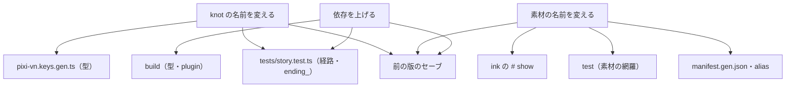
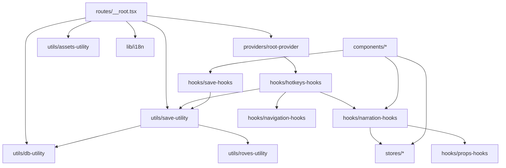
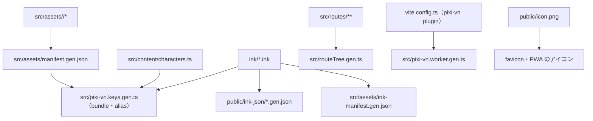
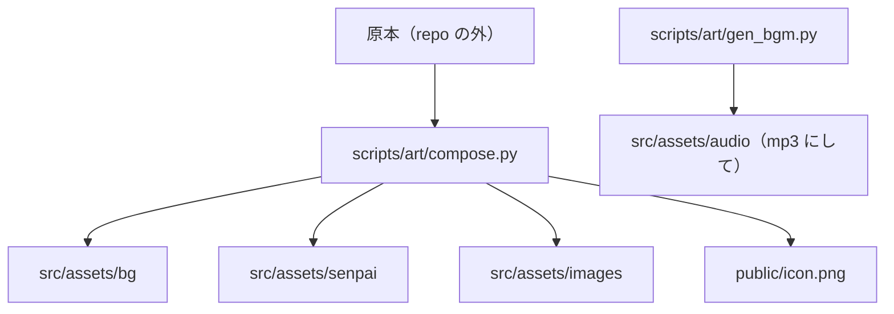
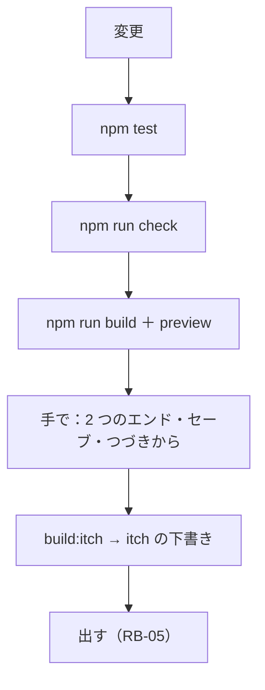

> [erabu-vn『二枚の紙』Repository Intelligence](README.md) の一部。基準は 2026-11-09 の zip（README の source）で、`path:line` はその時点の行。

# 80 Change Impact

## 変更の影響（代表の 8 つ）

### Executive Summary

このリポジトリで起きそうな変更を 8 つ選び、影響を追いました。影響がいちばん広いのは「ink の knot の名前を変える」と「素材の名前を変える」です。どちらも、生成物（keys・manifest）・test・前の版のセーブの 3 か所に効きます。知らない変更を調べるときは、下の手順に従って [部品の一覧（Component Catalog）](10-architecture.md#部品の一覧component-catalog) と [依存の図](#依存の図) を引きます。

### Scope

- 対象：ink・素材・セーブ・設定の鍵・経路・依存・配る経路・人物
- 調べ方：定義と参照を grep で拾い、呼び出しの元と先をたどる

### Findings

#### 調べる手順（Skill の手順を、このリポジトリに当てはめたもの）

1. 変更を正規化する：ファイル・ink の knot・素材の alias・localStorage の鍵・経路・依存のどれか。
2. 定義と参照を拾う。
   - ink の knot：`ink/` と `src/pixi-vn.keys.gen.ts` と `tests/`
   - 素材：`src/assets/` と `ink/` と `src/assets/manifest.gen.json`
   - コード：`grep -rn <名前> src tests`
3. 呼び出しの元と先：[C4 Component（SPA の中の部品）](10-architecture.md#c4-componentspa-の中の部品) の図
4. 契約が変わるか：[契約の互換のリスク](20-api-and-auth.md#契約の互換のリスク)
5. どこに出るか：Vercel と itch の両方（[環境ごとの違い](50-infrastructure.md#環境ごとの違い)）
6. test・セーブの互換・戻し方：[test とリリースの計画](#test-とリリースの計画)

#### 代表の変更

| Change | Direct impact | Transitive impact | Compatibility | Required tests | Rollback |
|---|---|---|---|---|---|
| CI-1：ink の台詞を直す（行の数は同じ） | `ink/start.ink` → `public/ink-json/start.gen.json` | 履歴の表示 | 前のセーブは読める（Inferred） | `npm test`・目で読む | 前の版を出し直す |
| CI-2：ink の行を足す・消す | 同上 | 前の版のセーブの step の位置（R-05） | **壊れうる**（Q-03） | `npm test`・古いセーブでロード（Q-03 の手順） | 戻しても、新しい版で作ったセーブはそのまま |
| CI-3：knot の名前を変える・knot を足す | `pixi-vn.keys.gen.ts` の label の型。`ending_` なら test のエンドの数 | `navigate`・`jump` の呼び出し（今は無い）。セーブ | **壊れる**（その knot の中のセーブ） | `npm test`（全経路・ending_）・`npm run build`（型） | 同上 |
| CI-4：素材を足す・名前を変える（`src/assets/<folder>/`） | AssetPack の manifest・alias・`pixi-vn.keys.gen.ts`。新しいフォルダは新しい bundle | ink の `# show`。`.gitignore` の `!`（`src/assets` の外に新しい置き場を作るとき。`src/assets` の下のフォルダは `.gitignore:11-12` が覆っている。`README.md:31`） | 名前を変えると、前のセーブの canvas の状態が無い alias を指す（Inferred） | `npm test`（素材の網羅）・`npm run build` | 前の素材に戻す |
| CI-5：オート送りの保存を直す（R-02） | `auto-settings-store.ts` | 設定画面・クイックツール | 前の値（"false"）を正しく読めるようになる | 手で：オン → オフ → 読み直す | 1 行を戻す |
| CI-6：IndexedDB に index を足す | `db-utility.ts` の版と upgrade | 全部のセーブの読み書き。起動（init が reject すると root のエラー画面） | 版を上げるだけでは足りない。今の upgrade は store が無いときだけ index を作るので、`oldVersion` で分けて既存の store に足すコードが要る（`src/lib/utils/db-utility.ts:10-22`）。下げられない（Inferred） | 手で：前の版で作ったセーブが読める・新しく入れた人も動く | 戻せない。戻すと、新しい版で遊んだ人は VersionError で起動できない（RB-05） |
| CI-7：依存を上げる（`@drincs/pixi-vn` など） | lockfile・bundle | GameState の形・タグ命令・ink の変換（test が変換器を使う） | Pixi'VN 次第（Unknown） | `npm test`・`npm run build`・全部の経路を目で通す・古いセーブでロード | lockfile を戻す |
| CI-8：itch の配り方を変える（base・経路） | `vite.config.ts:27`・`src/App.tsx:9-12`・`navigation-hooks.ts` | 素材の根・PWA | — | itch の下書きのページで開く（RB-04） | 前の zip を上げる |

#### 人物を足すとき（補足）

- `src/content/characters.ts` に足します。`RegisteredCharacters.add` にも入れます（`src/content/characters.ts:26`）。
- `pixi-vn.keys.gen.ts` の人物の id（`characterIdsEnum`）が増え、`# rename` の検証も広がります（`src/content/ink/hashtag-commands.ts:40`）。
- 立ち絵を付けるなら、`src/assets/<id>/` を作ります（新しい bundle になる）。

### Diagrams

### Risks and Gaps

関係するリスク（中身・根拠・手当ては [リスクの台帳](70-reliability.md#リスクの台帳全部)）：

- **R-05**（Medium）セーブに版の確かめが無く、更新のあとに古いセーブを戻すと壊れうる
- **R-10**（Medium）依存の "latest" 指定と、Vercel の入れ方が決まっていない
- **R-11**（Medium）CI が無く、test・lint・型の検査は手で走らせるだけ

### Open Questions

関係する未確認の事項（確かめ方は [未確認の事項](99-evidence-and-questions.md#未確認の事項全部)）：

- **Q-03**（High）ink を直したあとに古いセーブを restoreGameState するとどうなるか

### Evidence Index

| Claim | Evidence | Confidence |
|---|---|---|
| label の名前は生成の型になる | `src/pixi-vn.keys.gen.ts:13-25` | Confirmed |
| 新しい置き場は .gitignore にも足す | `README.md:31`、`.gitignore:10-13` | Confirmed |
| test は変換器を使う | `tests/story.test.ts:34-45` | Confirmed |

## 依存の図

### Executive Summary

モジュールの依存を、3 つの図にしました。

- 実行時の依存
- 生成物の依存（何を直すと、何が作り直されるか）
- 素材の依存

実行時に循環する依存はありません。`tools/cycles.py` で確かめました（85 のモジュール・183 の import。`import type` は除く）。

型だけの循環は 4 本あります。どれも `routeTree.gen.ts` か `router.tsx` に戻る `import type` で、実行時には消えます。

- `src/lib/hooks/save-hooks.tsx:8`
- `src/routes/__root.tsx:13`
- `save-slots`・`save-load` の `FileRouteTypes`

### Scope

`src/` の import（`src/components/ui/` を除く）と、vite の plugin が作るもの。

### Findings

依存される数の多い順（`tools/cycles.py` の import の図から数えた。`src/components/ui` を除く。型だけの import は数えない）：

| モジュール | 使う所の数 | 主な使う所 | 変えたときの影響 |
|---|---|---|---|
| `src/constants.ts` | 11 | main・assets-utility・narration-hooks・narration-query・choice-menus・quick-tools-hooks | レイヤーとチャンネルの名前。localStorage の鍵の名前（`bgm_volume` など）も変わる |
| `src/lib/stores/text-display-settings-store.ts` | 10 | narration-hooks・narration-query・narration-cards・choice-menus・hotkeys | タイプライター・選択肢を出す時・スキップ |
| `src/lib/utils/save-utility.ts` | 9 | __root・save-hooks・hotkeys・quick-tools・main-menu・save-slots・save-load・save-query | セーブの全部の画面とキー、起動の時の auto-exit |
| `src/lib/hooks/narration-hooks.ts` | 9 | narration の経路・click-overlay・narration-cards・choice-menus・input・hotkeys・main-menu・quick-tools・testing | 進む・戻る・選ぶの全部 |
| `src/lib/query/narration-query.ts` | 8 | narration-cards・choice-menus・input・history・hotkeys・loading・quick-tools | 画面に出る台詞・選択肢・履歴 |
| `src/lib/hooks/props-hooks.ts` | 8 | narration-hooks・save-hooks・hotkeys・quick-tools(-hooks)・main-menu・save-load・testing | 全部の画面の描き直し（invalidate） |
| `src/lib/hooks/navigation-hooks.ts` | 7 | __root・hotkeys・main-menu・quick-menus・quick-tools・save-hooks・settings | メニューの開閉（search param）・戻るの打ち消し |
| `src/lib/stores/game-status-store.ts` | 7 | narration-hooks・choice-menus・input・loading・main-menu・quick-tools(-hooks) | ローディングの表示と、ボタンを押せるか |

### Diagrams

#### 実行時

#### 生成物（直すもの → 作り直されるもの）

根拠：`vite.config.ts:36-58`、`.assetpack.ts:8`、`pwa-assets.config.js`、`AGENTS.md:38`

#### 素材

### Risks and Gaps

- 生成物（`*.gen.*`）は手で直さないでください。直すときは、元（ink・素材・routes・設定）を直します（`AGENTS.md:36`）。

### Open Questions

（なし）

### Evidence Index

| Claim | Evidence | Confidence |
|---|---|---|
| 生成物とその元 | `AGENTS.md:38`、`vite.config.ts:36-58` | Confirmed |
| manifest の出力先 | `.assetpack.ts:8` | Confirmed |

## test とリリースの計画

### Executive Summary

自動の test は `tests/story.test.ts` の 1 本で、6 つの項目があります。この test が見るのは、脚本の形・素材が揃っているか・文言の鍵です。次のものは、手で確かめる必要があります。

- 画面の振る舞い
- セーブ
- 2 つの配る所

この文書では、それらを変更の種類ごとの「最低限の確認」にまとめます。

### Scope

`tests/`・`package.json` の scripts・[変更の影響（代表の 8 つ）](#変更の影響代表の-8-つ) の CI-1〜8。

### Findings

#### 今ある自動の test（`npm test`）

| # | 確かめること | 落ちる例 | 根拠 |
|---|---|---|---|
| T-1 | 参照先の label が全部ある | `-> 無い knot` | `tests/story.test.ts:129-135` |
| T-2 | start からの全部の経路が END で終わる | END を落とした | `tests/story.test.ts:137-140` |
| T-3 | `ending_` の knot に全部届く | エンドに届かない | `tests/story.test.ts:142-148` |
| T-4 | エンドが 2 つ以上・2 択以上の分岐がある | 物差しを割る | `tests/story.test.ts:150-155` |
| T-5 | 脚本が指す素材と bundle が `src/assets` にある。外の URL を指さない | 名前の打ち間違い | `tests/story.test.ts:157-187` |
| T-6 | ja と en の `ui` の鍵が同じ | 片方だけ足した | `tests/story.test.ts:189-196` |

無いもの：

- 画面（React）の test
- セーブとロードの test
- build の検査（`npm run build` は別に走らせる）
- 型の検査（`tsc -b` は build に入っている）
- lint（`npm run check`）

#### 変更ごとの最低限の確認

| 変更 | npm test | npm run check | npm run build | build:itch | 手で確かめる |
|---|---|---|---|---|---|
| ink の文（CI-1） | 要る | — | 要る | 要る | 直した場面を読む |
| ink の行・knot（CI-2・3） | 要る | — | 要る | 要る | 2 つのエンドまで通す。前の版のセーブでロード（Q-03） |
| 素材（CI-4） | 要る | — | 要る | 要る | その場面を見る。`.gitignore` |
| コード | 要る | 要る | 要る | 要る | 変えた画面。F8 の診断に console のエラーが無い |
| 依存（CI-7） | 要る | 要る | 要る | 要る | 全部（下の「出す前の確認」） |

#### 出す前の確認（P4 の前に 1 回、そのあとは毎回）

1. `npm ci --include=optional`（`README.md:13`）
2. `npm test`・`npm run check`
3. `npm run build`、そして `npm run preview` で手元で開く（`package.json:10`）
4. はじめから → 選択 → 左の紙 → エンド。もう 1 回、右の紙 → エンド（`README.md:23` の P1 と同じ確かめ方）
5. セーブ → タイトルへ → ロード。F5 → F9。タブを隠す → 開き直す → つづきから
6. `npm run build:itch` → itch の下書きのページに上げて、iframe の中で 4〜5 をくり返す（RB-04）
7. 版を上げたとき（セーブの互換を壊すとき）は、`package.json` の `version` を上げる（`vite.config.ts:115` で `gameVersion` に入る）

#### 戻し方

[build と配る経路（デプロイのパイプライン）](50-infrastructure.md#build-と配る経路デプロイのパイプライン) の「ロールバック」の節を見てください。セーブの互換を壊す変更は、戻しても直らないことがあります（R-05）。

### Diagrams

### Risks and Gaps

関係するリスク（中身・根拠・手当ては [リスクの台帳](70-reliability.md#リスクの台帳全部)）：

- **R-05**（Medium）セーブに版の確かめが無く、更新のあとに古いセーブを戻すと壊れうる
- **R-11**（Medium）CI が無く、test・lint・型の検査は手で走らせるだけ

### Open Questions

関係する未確認の事項（確かめ方は [未確認の事項](99-evidence-and-questions.md#未確認の事項全部)）：

- **Q-03**（High）ink を直したあとに古いセーブを restoreGameState するとどうなるか
- **Q-12**（Medium）Vercel の build で prebuild（pwa-assets-generator の sharp）と optional の依存が入るか

### Evidence Index

| Claim | Evidence | Confidence |
|---|---|---|
| test は 6 つ | `tests/story.test.ts:124-197` | Confirmed |
| P1 では 2 つの枝をブラウザでエンドまで通した | `README.md:23` | Confirmed |
