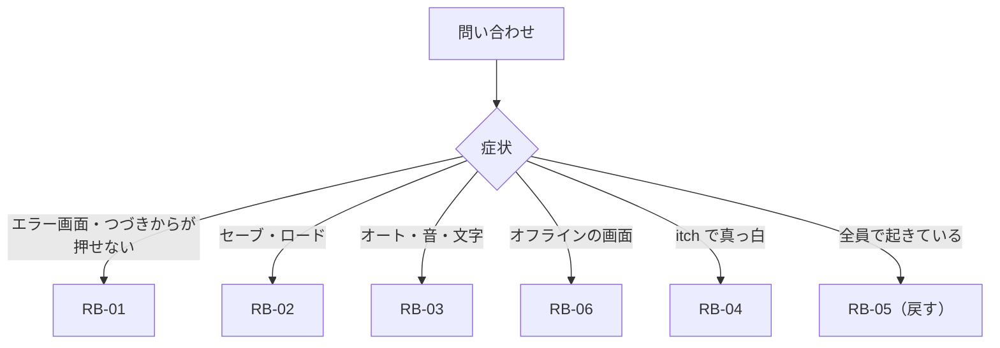

> [erabu-vn『二枚の紙』Repository Intelligence](README.md) の一部。基準は 2026-11-09 の zip（README の source）で、`path:line` はその時点の行。

# 90 Runbooks

## runbook の一覧

### Executive Summary

runbook は 7 本あり、2 種類に分かれます。

- **遊ぶ人の端末で起きた障害**（RB-01〜03・06）：問い合わせを受けた人が、遊ぶ人に手順を伝えます。
- **作者の作業**（RB-04・05・07）：作者が自分の手元で行います。

書いてあるのは、次のものだけです。

- リポジトリにあるコマンド（`npm run ...`・`python3 scripts/art/...`）
- ブラウザの標準の機能（DevTools）
- 配る所の画面

dashboard・log group・監視は、存在しないので書いていません（[観測できる所の地図](60-operations.md#観測できる所の地図)）。

### Scope

[障害モードの分析（FMEA）](70-reliability.md#障害モードの分析fmea) の FM-01〜13 のうち、手で手当てできるもの。

### Findings

| ID | 名前 | 症状の入口 | 対応する FM | 誰が |
|---|---|---|---|---|
| RB-01 | [RB-01 起動するとエラー画面になる／「つづきから」が押せない](#rb-01-起動するとエラー画面になるつづきからが押せない) | 開くとエラー画面・「つづきから」が押せない・クリックしても進まない | FM-03・04・14 | 遊ぶ人（案内する） |
| RB-02 | [RB-02 セーブとロードができない](#rb-02-セーブとロードができない) | 保存中のまま・一覧が空・ロードに失敗 | FM-04・05・08 | 遊ぶ人（案内する） |
| RB-03 | [RB-03 設定がおかしい（オートが勝手にオン・音が出ない・文字の大きさ）](#rb-03-設定がおかしいオートが勝手にオン音が出ない文字の大きさ) | オートが勝手にオン・音が出ない・文字が大きい | FM-02・09 | 遊ぶ人（案内する） |
| RB-04 | [RB-04 itch 版が表示されない（真っ白・素材が出ない）](#rb-04-itch-版が表示されない真っ白素材が出ない) | itch で真っ白・素材が出ない | FM-12 | 作者 |
| RB-05 | [RB-05 リリースと戻し（Vercel・itch）](#rb-05-リリースと戻しvercelitch) | 出す・出したあとの確認・前の版に戻す | FM-10・11・06 | 作者 |
| RB-06 | [RB-06 「オフライン」の全画面で進めない](#rb-06-オフラインの全画面で進めない) | 「オフライン」の全画面で進めない | FM-01 | 遊ぶ人（案内する） |
| RB-07 | [RB-07 素材を作り直す（絵・BGM・アイコン）](#rb-07-素材を作り直す絵bgmアイコン) | 絵や BGM を差し替える | — | 作者 |

#### 問い合わせを受けたら、まず聞くこと（全部の runbook に共通）

1. どこで遊んでいるか：Vercel の URL か、itch のページか、itch のアプリか
2. ブラウザと端末：F8 の診断の「コピー」の結果を貼ってもらう（`src/components/menus/settings/menus/diagnostics.tsx:75`）。「IndexedDB: Yes」は API があるかだけで、開けるかは分からない（`src/lib/utils/device-diagnostics-utility.ts:322`）
5. 開いた URL：`?` のあとに何か付いていないか（R-27）
3. どの場面か：タイトル・語りの途中・選択の前後・エンド
4. 何をしたら起きたか：はじめから・つづきから・ロード・タブを閉じて開き直した

### Diagrams



### Risks and Gaps

- 窓口と、作者まで上げる（Escalation）の経路が決まっていません（Q-11）。各 runbook の Escalation は「作者へ」とだけ書いてあります。

### Open Questions

関係する未確認の事項（確かめ方は [未確認の事項](99-evidence-and-questions.md#未確認の事項全部)）：

- **Q-11**（Medium）出したあと、遊ぶ人からの不具合の報告を誰がどこで受けるか
- **Q-01**（High）Vercel の本番のプロジェクト（URL・独自ドメイン・Build/Install Command・Node の版）はもうあるか
- **Q-02**（Medium）itch.io のページの設定（Embed のサイズ・全画面ボタン・itch のアプリで遊べるか）

### Evidence Index

各 runbook の最後の節にあります。

## RB-01 起動するとエラー画面になる／「つづきから」が押せない

### Symptoms

- `/game/narration` などの URL（ブックマーク・読み直し）で開くと、英語のエラー画面（TanStack Router の ErrorComponent）が出る
- `/`（タイトル）でも同じエラー画面が出る
- `/`（タイトル）は出るが、「つづきから」が押せないか、押しても何も起きない
- はじめからで語りの画面に入ったのに、クリックしても進まない

### User Impact

1 人の 1 つのブラウザ（オリジン）で起きます。手動のセーブ（IndexedDB）は無事なことが多いです（Inferred）。

### Preconditions and Access

- 遊ぶ人が、自分のブラウザの DevTools を開けること（PC）。スマホでは DevTools が使えないので、Mitigation の手順（開き直す・別のウィンドウ・URL を直す）だけになります。
- 作者の側の権限は要りません。

### First 5 Minutes

1. 遊ぶ人に、`?` 以降を付けないトップの URL（`/`）で開き直してもらう。
2. / でもエラー画面なら、下の「原因 B」（IndexedDB・素材）を見る。タイトルが出れば、原因 A か C。
3. 設定 → セーブ・ロードで、手動のセーブが見えるかを聞く。
4. F8 の診断の「IndexedDB: Yes」は API があるかを見るだけです。開けるかどうかは分かりません（`src/lib/utils/device-diagnostics-utility.ts:322`）。

### Diagnosis

| 原因 | 見ること | どこ | 印 | 根拠 |
|---|---|---|---|---|
| A：auto-exit の JSON が壊れている | auto-exit のセーブ | DevTools → Application → Local Storage → そのオリジン → `auto_exit_save` | 値が JSON として読めない。Console に `SyntaxError` | `src/lib/utils/save-utility.ts:212-239`、`src/routes/__root.tsx:31-36` |
| A'：auto-exit の restore が失敗する | 同じ鍵 | 同上 | JSON は読めるのに、「つづきから」を押しても何も起きない。**Console には何も出ない**（catch が握りつぶす） | `src/lib/utils/save-utility.ts:223-226` |
| B：IndexedDB が開けない・素材が読めない | Console | DevTools → Console・Network | `Error opening indexDB`（プライベートブラウズなど）、または `assets/` の読み込みの失敗。/ でもエラー画面になる | `src/lib/utils/db-utility.ts:28-31`、`src/routes/__root.tsx:28`、`src/lib/utils/assets-utility.ts:21-22` |
| C：URL の query でゲームが止まっている | URL | アドレスバー | `?utm_source=...` などが付いている | `src/routes/__root.tsx:23`（R-27） |

起きる仕組み：`/` 以外で開くと、root の loader が `auto_exit_save` を読んで戻そうとします。JSON.parse が Promise の外にあるので、壊れていると loader ごと落ちます（R-03）。「つづきから」の判定（`save.getLast` → `autoExit.peek`）も同じ parse を通るので、query がエラーになり、ボタンが押せなくなります。

### Mitigation

1. A・A'：`/` から開いて、手動のセーブがあればロードで続ける。少し進めてタブを隠すと、auto-exit は正しい JSON で上書きされる（`src/lib/hooks/save-hooks.tsx:177-191`）。手動のセーブが無ければ「はじめから」。
2. B：普通のウィンドウ（プライベートでない）で開き直す。別のブラウザで試す。
3. C：`?` 以降を消した URL で開き直す。

### Recovery

#### 消す操作（遊ぶ人のデータを消す。通常の手順とは分ける）

- **影響**：最後にタブを隠した所からの続き（auto-exit）が消えます。手動とクイックのセーブ、設定は消えません。
- **条件**：遊ぶ人が「auto-exit の続きは要らない」と同意したとき。
- **手順**：DevTools → Application → Local Storage → そのオリジン → `auto_exit_save` だけを選んで消す（Delete）。**「Clear All」や「サイトのデータを消す」は使わない**。手動のセーブも設定も消えるため。

### Verification

1. `/game/narration` の URL で開き直す → エラー画面にならず、タイトルか語りの画面が出る。
2. タイトルの「つづきから」が、手動のセーブがあれば押せる。無ければ無効のまま（正しい）。
3. 少し進めてタブを隠し、もう一度開いて、続きから戻れる。

### Rollback

消した auto-exit は戻せません。消す前に値を控えておくと、調べるのに使えます（遊ぶ人の同意を取る。中身はゲームの状態だけで、個人情報は無い）。

### Escalation

同じ報告が 2 件以上あれば、作者へ上げます（窓口は Q-11）。直すには `autoExit.load` と `peek` の parse を try で囲みます（R-03）。

### Evidence and Related Dashboards

- dashboard は無い。
- 根拠：`src/lib/utils/save-utility.ts:212-239`・`src/routes/__root.tsx:31-36`・`src/components/menus/main-menu.tsx:236-252`
- 関連：[障害モードの分析（FMEA）](70-reliability.md#障害モードの分析fmea) FM-03、R-03

## RB-02 セーブとロードができない

### Symptoms

- A：セーブすると toast が「保存中」のまま終わらない／「保存に失敗」
- B：セーブ・ロードの画面の枠が全部空（前はあった）
- C：ロードすると「ロードに失敗」／違う場面から始まる
- D：ファイルから読み込んでも何も起きない

### User Impact

1 人の 1 つのブラウザで起きます。C が更新のすぐあとなら、前の版のセーブを持つ全員に起きているかもしれません（R-05）。

### Preconditions and Access

遊ぶ人のブラウザ。作者の側の権限は要りません。C を調べるには、作者が手元で `npm run dev` を使います。

### First 5 Minutes

1. どこで遊んでいるかを聞く（Vercel と itch はセーブが別。セーブは引き継がない）。
2. プライベートブラウズ（シークレット）かを聞く。
3. F8 の診断の「IndexedDB: Yes」は API があるかだけを見ます。開けるかは Console で確かめます（`src/lib/utils/device-diagnostics-utility.ts:322`）。
4. C なら、いつのセーブか、最近更新したかを確かめる。

### Diagnosis

| 症状 | 原因の候補 | 確かめ方 | 根拠 |
|---|---|---|---|
| A | 起動のあとで IndexedDB が開けなくなった（容量など）。open が失敗すると Promise が終わらない。起動のときから開けない環境では、そもそも起動でエラー画面になる（RB-01 の原因 B）。auto-exit が壊れているときに File 01（id 0）へ保存すると、書けているのに「保存に失敗」と出る（R-03） | Console に `Error opening indexDB` か `Error adding save data to indexDB` | `src/lib/utils/db-utility.ts:57-59`、`src/lib/utils/db-utility.ts:29` |
| B | 違うオリジン（Vercel と itch、別の URL）で開いている。ブラウザのデータを消した | DevTools → Application → IndexedDB → `game_db` → `saves` に行があるか | `src/lib/utils/db-utility.ts:4-22` |
| C | 更新で脚本が変わり、前のセーブの位置が合わない（Q-03）。Pixi'VN の restore の例外 | Console の例外。セーブの `gameVersion`（IndexedDB の行で見える）と、タイトルの右下の版を比べる | `src/lib/utils/save-utility.ts:128-130`、`src/components/menus/main-menu.tsx:216` |
| D | ファイルの JSON が壊れている（例外が漏れて何も出ない） | Console に `SyntaxError` | `src/lib/utils/save-utility.ts:109-118` |

### Mitigation

- A：普通のウィンドウで開き直す。ゲームは続けられるので、設定 → セーブ・ロード → 「ファイルに保存」で、今の状態をファイルに書き出しておく（`src/lib/utils/save-utility.ts:86-97`）。
- B：前と同じ所（URL）で開く。別の所へ移したいときは、元の所で枠のダウンロードのボタンを押してファイルにし、新しい所で「ファイルから読み込む」。
- C：はじめから遊ぶ。作者へ上げる（Escalation）。
- D：別のファイルを選ぶ。ファイルを手で直したなら、元のファイルに戻す。

### Recovery

#### 消す操作（遊ぶ人のデータを消す。通常の手順とは分ける）

- 壊れた枠は、画面のごみ箱のボタンで消します（確認が出る）。`src/lib/hooks/save-hooks.tsx:51-75`
- DevTools から IndexedDB を丸ごと消すのは、**最後の手段**です。全部のセーブが消えます。消す前に、残したい枠をファイルに書き出しておきます。

### Verification

1. 空の枠にセーブ → toast が「保存しました」になる。
2. タイトルへ戻る → ロード → 同じ場面から始まる。
3. F5 → F9 で、クイックセーブとロードができる。

### Rollback

ファイルに書き出したセーブは、「ファイルから読み込む」で戻せます。消した枠は戻せません。

### Escalation

C（更新のあと）は、すぐ作者へ上げます。前の版のセーブを持つ全員に起きている恐れがあります。戻すかどうかは RB-05 で決めます。

### Evidence and Related Dashboards

- dashboard は無い。
- 根拠：上の表
- 関連：FM-04・05・08、R-04・05・06

## RB-03 設定がおかしい（オートが勝手にオン・音が出ない・文字の大きさ）

### Symptoms

- A：開くたびにオート送りがオンになっている（切ったのに）
- B：BGM が鳴らない
- C：文字が大きすぎる・小さすぎる、速さがおかしい

### User Impact

1 人の 1 つのブラウザで起きます。A は、設定画面のスイッチでオンとオフをしたことがある人の全員に起きます（R-02）。

### Preconditions and Access

遊ぶ人のブラウザ。

### First 5 Minutes

1. どの画面で切り替えたかを聞く（設定画面のスイッチか、語りの画面のクイックツールの「オート」か）。
2. F8 の診断で「Audio (Web Audio API): Yes」を確かめる（B のとき）。

### Diagnosis

| 症状 | 原因 | 確かめ方 | 根拠 |
|---|---|---|---|
| A | `auto_forward_enabled` に "false" が入っていると、起動のときに true として読む | DevTools → Local Storage の `auto_forward_enabled` が `false` | `src/lib/stores/auto-settings-store.ts:15-18`、`src/lib/stores/auto-settings-store.ts:23-28` |
| B | 全体か BGM のミュートが保存されている。音量が 0。ブラウザが自動の再生を止めている | Local Storage の `master_muted`・`bgm_muted`・`master_volume`・`bgm_volume` | `src/lib/stores/master-sound-storage.ts:16-19`、`src/lib/stores/channel-sound-stores.ts:29-35` |
| C | `text_display_font_size`（%）・`typewriter_delay_millisecond` | Local Storage の値 | `src/lib/stores/text-display-settings-store.ts:23-31` |

### Mitigation

- A：語りの画面のクイックツールの「オート」を押して切る。その回は止まる（保存はされない）。設定画面のスイッチは、読み直すとまたオンになる。
- B：設定の音量で、全体と BGM のミュートを外し、音量を上げる。それでも鳴らないときは、画面を 1 回押してから待つ（ブラウザの自動再生の決まり。Inferred）。
- C：設定の文字の大きさと速さを戻す。

### Recovery

#### 消す操作（設定だけを消す）

- **影響**：その鍵の設定が既定に戻ります。セーブは消えません。
- **手順**：
  - A のとき：DevTools → Local Storage → `auto_forward_enabled` を消す。既定（オフ）に戻る。
  - C のとき：`text_display_font_size` か `typewriter_delay_millisecond` を消す。
- 根本の直し（作者）：`=== "true"` で読む（R-02）。

### Verification

- A：読み直して、オート送りがオフのまま。
- B：タイトルから「はじめから」で、BGM（昼）が鳴る。
- C：台詞の文字が既定の大きさになる。

### Rollback

消した鍵は、設定の画面から同じ値を入れ直せば戻ります。

### Escalation

A は既知の不具合（R-02）です。作者に直してもらうまでは、上の Mitigation で回避します。

### Evidence and Related Dashboards

- dashboard は無い。
- 鍵の一覧：[データの持ち主（誰が読み、誰が書くか）](30-data.md#データの持ち主誰が読み誰が書くか)
- 関連：FM-02・09、R-02

## RB-04 itch 版が表示されない（真っ白・素材が出ない）

### Symptoms

- itch のページで「Run game」を押すと真っ白になる。スピナーのまま
- タイトルは出るが、背景や立ち絵が出ない
- Vercel 版は正常に動く

### User Impact

itch で遊ぶ人の全員に起きます（輪 2）。

### Preconditions and Access

- 作者：itch の作品の編集の権限、手元のリポジトリ、`zip` が使える shell（WSL・Git Bash。R-20）。
- itch のページの設定の場所は、リポジトリの外にあります（Q-02）。

### First 5 Minutes

1. itch のページを開き、ブラウザの DevTools（Console と Network）を見る。iframe の中の文書を選ぶ。
2. Network で、js・css・`assets/` の要求が 404 か、思っていない path（根の `/assets/...`）に行っていないかを見る。
3. 上げた zip が、`npm run build:itch` で作ったものか（`dist` を zip にしたものではないか）を確かめる。

### Diagnosis

| 見えるもの | 原因の候補 | 根拠 |
|---|---|---|
| js が 404・path が `/assets/index-*.js`（根から） | `--mode itch` を付けずに作った（base が `/` のまま） | `vite.config.ts:27`、`package.json:13` |
| 開いてすぐ URL が変わり、素材が 404 | 経路がメモリになっていない（itch の mode でない build） | `src/App.tsx:9-12`、`README.md:30` |
| zip の中身が `dist-itch/index.html` のように 1 段深い | zip を作る場所が違う（`build:itch` は `dist-itch` の中で zip する） | `package.json:13` |
| 素材だけ出ない | AssetPack の出力が無い（build の途中の失敗） | `.assetpack.ts:84-103` |

### Mitigation

itch の作品の編集で、前の版の zip に戻します（手元に控えがあれば）。

### Recovery

```bash
npm ci --include=optional
npm test
npm run build:itch      # dist-itch/ を作り、erabu-itch.zip にする
```

できた `erabu-itch.zip` を、itch の作品の編集から上げ直します。上げる前に、itch の下書き（非公開）のページで確かめます（itch の側の操作は Q-02）。

### Verification

1. itch のページで「Run game」→ タイトルの絵が出る。
2. はじめから → 背景・立ち絵・BGM が出る。
3. 選択肢 → エンドまで通す。
4. ブラウザの URL が変わらない（itch のページのまま）。

### Rollback

前の zip を上げ直します。`erabu-itch.zip` は git に入らないので（`.gitignore:17-18`）、出すたびに版を付けて手元に控えておきます。

### Escalation

作者が自分で行います。itch の側の障害が疑わしいときは、itch のサポートを当たります（窓口は未確認）。

### Evidence and Related Dashboards

- dashboard は無い（itch の作品の画面に閲覧数がある。Inferred）。
- 関連：FM-12、R-20、Q-02

## RB-05 リリースと戻し（Vercel・itch）

### Symptoms

（作業の runbook）新しい版を出すとき、出したあとに全員で同じ不具合が起きたときに使います。

### User Impact

出した版を、全員が遊びます。セーブの互換を壊す変更なら、前の版のセーブを持つ人に効きます（R-05）。

### Preconditions and Access

- 手元：Node と npm（版は未確認。`@types/node ^26` から新しい Node と推定）、`zip`（WSL か Git Bash）、Python は要らない。
- Vercel：project の権限。project・Build Command・Install Command・Git 連携の有無が決まっていない（Q-01）。
- itch：作品の編集の権限。

### First 5 Minutes

（出すとき）作業する枝が、出したい commit になっているかを確かめます。

（出したあとの障害のとき）

1. Vercel 版と itch 版の両方で起きているかを確かめる。両方なら脚本か素材、片方なら build か配る所。
2. 直前に出した版の差分を見る。

### Diagnosis

| 確かめること | コマンド・場所 | 根拠 |
|---|---|---|
| 依存が揃うか | `npm ci --include=optional` | `README.md:13` |
| 脚本の網羅 | `npm test` | `package.json:20`、`tests/story.test.ts:124-197` |
| lint と format | `npm run check` | `package.json:17` |
| 型と build | `npm run build`（prebuild でアイコン → `tsc -b` → `vite build`） | `package.json:11-15` |
| 手元で開く | `npm run preview`（`build:fast` のあと preview） | `package.json:10` |

### Mitigation

#### 出す（通常の手順）

1. `npm ci --include=optional`
2. `npm test` と `npm run check` が通る。
3. `npm run build` → `npm run preview` で、[test とリリースの計画](80-change-impact.md#test-とリリースの計画) の「出す前の確認」の 4〜5 を行う。
4. セーブの互換を壊すなら、`package.json` の `version` を上げる（`vite.config.ts:115`）。
5. Vercel に出す。方法は Q-01 で決める（Git 連携なら push、CLI なら deploy）。Vercel が npm ci を使うように、Install Command を `npm ci --include=optional` にしておく（R-10）。
6. `npm run build:itch` → `erabu-itch.zip` に版の番号を付けて控え、itch に上げる（RB-04）。

#### 出したあとに全員で壊れていたら（戻す）

- Vercel：前の deployment に戻す。Vercel の製品の機能を使う（Inferred。この project で使えるかは Q-01）。または、前の commit で 5 をやり直す。
- itch：控えておいた前の zip を上げ直す。

### Recovery

原因を直して、「出す」の手順をはじめからやり直します。

### Verification

0. 前に開いていたタブを全部閉じてから開く。Service Worker が前の版を出し続けることがある（R-28。Inferred）。
1. Vercel の URL と itch のページの両方で、タイトル → はじめから → 2 つのエンド。
2. タイトルの右下の版の番号が、出した版になっている（`src/components/menus/main-menu.tsx:216`）。
3. Vercel 版：`/game/narration` を直接開いても、index.html が返る（`vercel.json:1-3`）。
4. F8 の診断の Game version が、出した版になっている。

### Rollback

上の「戻す」と同じです。注意が 3 つあります。

- 新しい版で作ったセーブは、古い版で読めるとは限りません（R-05）。
- **`INDEXED_DB_VERSION` を上げた版から戻すと、その版で遊んだ人は起動でエラー画面になります**。古いコードが版 2 で open して VersionError になり、`gameDB.init` が reject するためです（`src/lib/utils/db-utility.ts:4-8`、`src/lib/utils/db-utility.ts:28-31`。Inferred：ブラウザの決まり）。版を上げる変更は、戻さない前提で出します。
- Service Worker が古い版を持っていることがあります（R-28）。

### Escalation

作者が自分で行います。Vercel や itch の側の障害は、それぞれのサポートへ。

### Evidence and Related Dashboards

- Vercel の deployment の一覧（製品の画面。project があるかは Q-01）
- 関連：FM-10・11・06、R-10・11・20、[build と配る経路（デプロイのパイプライン）](50-infrastructure.md#build-と配る経路デプロイのパイプライン)

## RB-06 「オフライン」の全画面で進めない

### Symptoms

画面全体が暗くなり、通信が無いことを知らせるカードと「再試行」のボタンが出て、ゲームが操作できない。

### User Impact

通信が無い所で遊ぶ人です（PWA を入れた人・itch のアプリ・移動中）。外部のオリジンには通信しませんが、遊んでいる間も同じオリジンから素材を読み込みます。そのため、素材がまだ手元に無い場面は、この表示が無くても絵が出ません（Inferred。R-01・R-09）。

### Preconditions and Access

遊ぶ人の端末。

### First 5 Minutes

1. 端末が本当に通信できないか（機内モード・Wi-Fi）を確かめてもらう。
2. 通信が戻れば、「再試行」を押す。

### Diagnosis

| 見ること | 理由 | 根拠 |
|---|---|---|
| `navigator.onLine` が false | 表示はこの値と online/offline のイベントだけで決まる | `src/lib/hooks/network-hooks.ts:8-34` |
| 表示は root にいつもある | タイトルでも語りの途中でも出る | `src/routes/__root.tsx:52-56`、`src/components/modals/error-allerts.tsx:14-21` |

### Mitigation

- 通信を戻して「再試行」を押す。表示はタブを前に出したときにも見直す（`src/lib/hooks/network-hooks.ts:15-24`）。
- 通信が無い所では遊べない、と伝える（今の仕様）。

### Recovery

根本の直しは作者が行います。表示を外すか、閉じられる通知にする（R-01）。PWA でオフラインのときに素材が出るかも、合わせて確かめます（R-09・Q-09）。

### Verification

通信を戻して「再試行」→ 表示が消え、前の画面に戻る。

### Rollback

（なし）

### Escalation

itch のアプリや PWA で遊ぶ人からの報告が続くときは、作者に R-01 の優先を上げてもらいます。

### Evidence and Related Dashboards

- dashboard は無い。
- 関連：FM-01、R-01・R-09

## RB-07 素材を作り直す（絵・BGM・アイコン）

### Symptoms

（作業の runbook）絵を差し替える・表情を足す・BGM を変えるときに使います。

### User Impact

出し直すまでは無いです。名前（alias）を変えると、前のセーブに効きます（[変更の影響（代表の 8 つ）](80-change-impact.md#変更の影響代表の-8-つ) の CI-4）。

### Preconditions and Access

- Python 3・Pillow・numpy（README には入れ方が書かれていない。Unknown）
- 絵の生成：`OPENAI_API_KEY` を、環境変数として自分の shell に入れる。**repo やファイルには書かない**（`.gitignore:6` は `.env*` を無視するが、鍵は環境変数で渡すのが README の手順）。
- フォント：Zen Kurenaido（`--font` に ttf を渡す）
- 原本の置き場：repo の外のディレクトリ（`--out` と `--src`）

### First 5 Minutes

作業の前に、今の `src/assets` を控えます（git に入っているので、commit してあれば足りる）。原本のディレクトリも控えます（R-25）。

### Diagnosis

（作業の runbook のため、なし）

### Mitigation

README の「素材を作り直す」の手順です（`README.md:37-45`）。

```bash
python3 scripts/art/gen_art.py --out <dir>            # 絵の原本。原本があるものは作らない
python3 scripts/art/gen_art.py --out <dir> --face     # 先輩の表情（senpai_base から）
python3 scripts/art/compose.py --src <dir> --font <ZenKurenaido-Regular.ttf>
python3 scripts/art/gen_bgm.py --out <dir>            # wav。mp3 に直して src/assets/audio へ（直す道具はリポジトリに無い）
npm run icon                                          # public/icon.png から favicon と PWA のアイコン
npm test                                              # 脚本が指す素材が揃っているか
```

- 生成は毎回違う絵になります。作り直したくない絵の原本は、`--out` に残しておきます（あると作らない。`scripts/art/gen_art.py:100-107`）。
- `compose.py` は `src/assets` と `public/icon.png` を上書きします（`scripts/art/compose.py:257-281`）。
- `src/assets` の外に新しい置き場を作ったら、`.gitignore` に `!` の行を足します。足さないと、clone からの build に素材が入りません（`README.md:31`）。`src/assets` の下の新しいフォルダ（bundle）の jpg と png は、`.gitignore:11-12` がすでに覆っています（mp3 など、ほかの形式は作者の全体の ignore しだい）。

### Recovery

上書きした素材は、git から戻します。

### Verification

1. `npm test` が通る（素材の網羅）。
2. `npm run dev` で、差し替えた場面を見る。立ち絵の切り抜き（市松の背景が残っていないか）を見る（`README.md:32`）。
3. 生成した絵であることを、作品のページとエンドのあとに開示する（`README.md:25`・Q-14）。

### Rollback

`git checkout -- src/assets public/icon.png`（commit してあれば）。

### Escalation

（作者の作業）

### Evidence and Related Dashboards

- 関連：[バッチと定期の処理](40-runtime.md#バッチと定期の処理)、R-25、Q-14
